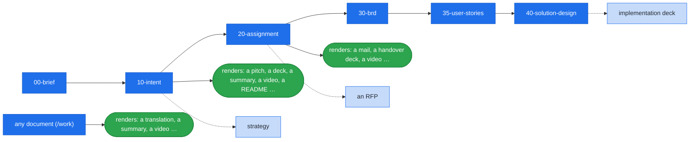

# Forge of Thought 6.21

*A workshop where thought is tempered and shaped.* · [Documentation](docs/README.md) · [Videos](https://pche-broken-artist.github.io/forge-of-thought/videos/) · [Release notes](RELEASE-NOTES.md)

**New here? Watch first.** Ten videos and eight short clips of real
sessions, in two languages, show the forge at work before a word of
this README is read: [Videos](https://pche-broken-artist.github.io/forge-of-thought/videos/).

Forge of Thought is an **AI cognitive extension** of a thinking
human, the **principal**: the person whose thinking is being forged,
who supplies the ideas, the answers and the decisions, and who has
the final word on all content. It takes a raw, half-formed idea - a
process redesign, a platform initiative, an organisational change, a
D&D campaign - and tempers it into a precise, self-contained handover
for whoever delivers it: a team, a colleague, your future self. It
rests on one principle - **the machine carries every part of the
work that is not deciding** - in three forms.

- **It thinks with you.** It interviews and probes, criticises,
  challenges and inspires; it extracts what the principal has not
  yet articulated; it lays out options with their trade-offs. It
  proposes; you decide.
- **It keeps the work consistent.** Nothing wanders off in forgotten
  chats: the thinking lives in versioned, templated artefacts, with
  decisions, state and history keeping themselves in order and
  consistency guarded across every output.
- **It carries the tedious work.** Audience-facing outputs - a pitch,
  a deck, this README, the whole documentation - are **renders**:
  generated from the artefacts, regenerated whenever the thinking
  moves, never written by hand twice.

Technically, Forge of Thought is a git repository: slash commands
and isolated agents - challenger personas and critic lenses - for
Claude Code, templates, and the conventions binding them. Today the
chain runs from a brief through the intent, the assignment, the BRD
and the user stories to the solution design; below the intent a
project takes the layers it needs, and many end at the intent.

Short on time? Two one-page notes say it briefly:
[for a CTO](projects/forge/renders/cto-pitch.md) and
[for a CEO](projects/forge/renders/ceo-pitch.md). Each has a Word
version beside it.

## 1. Better with AI, or replaced by it?

Forge of Thought is for those who chose to be better. The failure
modes it exists to remove:

- Thinking scattered across chat sessions that die, taking their
  context with them.
- Handovers whose completeness depends on the mood of the day they
  were written.
- The same thinking retold to every audience - a pitch, a deck, a
  mail - each version rewritten by hand and drifting from the others.
- Feedback and decisions with no place to land, so the same ground
  is fought over twice.
- Assumptions nobody attacked before reality did.

## 2. Watch it work

Every video is a real session of the forge, cut to a few minutes and
played in the browser as a simulated terminal with captions, in two
languages; nothing is staged.

- **How a brief is born.** A brief found by questions, a critique
  from outside, research, the approval, the mining.
  [watch](https://pche-broken-artist.github.io/forge-of-thought/videos/#01-brief-elicitation) ·
  [read](docs/use/write-a-brief.md)
- **One item, one verdict.** A list settled one item per message,
  the verdict line, one write at the end of the round.
  [watch](https://pche-broken-artist.github.io/forge-of-thought/videos/#02-walkthrough) ·
  [read](docs/use/walk-through-a-list.md)
- **From the brief to the intent.** The brief mined into positions,
  rejections and threads, cited at its version.
  [watch](https://pche-broken-artist.github.io/forge-of-thought/videos/#03-brief-to-intent) ·
  [read](docs/use/forge-the-intent.md)
- **A critic and walking its findings.** An isolated reviewer of
  document quality, its findings mended or rejected with a reason.
  [watch](https://pche-broken-artist.github.io/forge-of-thought/videos/#04-critique) ·
  [read](docs/use/critique-the-documents.md)
- **A check at a save.** A save runs the check, conformance findings
  settled before the commit, a release with more.
  [watch](https://pche-broken-artist.github.io/forge-of-thought/videos/#05-check-at-save) ·
  [read](docs/use/save-your-work.md)
- **A challenger: peer review of the substance.** A persona attacks
  the thinking; accepted goes into the intent, rejected keeps its
  reason.
  [watch](https://pche-broken-artist.github.io/forge-of-thought/videos/#06-challenger) ·
  [read](docs/use/challenge-the-thinking.md)
- **History and threads.** Why an item changed, one command away;
  the open threads as the project's memory.
  [watch](https://pche-broken-artist.github.io/forge-of-thought/videos/#07-history-threads) ·
  [read](docs/use/read-the-history-of-an-item.md)
- **Solution design: a new layer of the chain.** The chain grows by
  a definition and a template; the first solution design.
  [watch](https://pche-broken-artist.github.io/forge-of-thought/videos/#08-new-artefact) ·
  [read](docs/extend/add-an-artefact.md)
- **The BRD, a new artefact.** A new artefact from its definition to
  its first document.
  [watch](https://pche-broken-artist.github.io/forge-of-thought/videos/#12-brd) ·
  [read](docs/use/write-a-brd.md)
- **Research: a plan, two LLMs and a synthesis.** The plan confirmed
  before the search, the same cards on two model families, the
  synthesis.
  [watch](https://pche-broken-artist.github.io/forge-of-thought/videos/#13-deep-research) ·
  [read](docs/use/research-a-topic.md)

The whole course is at the
[course page](https://pche-broken-artist.github.io/forge-of-thought/videos/),
where each video has its scenes as chapters and the language is a
switch, and where the eight short clips stand in the order of a
talk: the wall between reading git and writing it, the principal
deciding by a letter, a mistake becoming a rule, research planned
first, elicitation one question at a time, handing over, reviewers
that never saw the conversation, and GitHub from an issue to an
answer.

## 3. What you get

- A versioned document chain growing from a **brief** - your idea
  put together, yours by your approval - through the **intent** to
  the layers your project needs, an assignment to hand over and a
  solution design among them
  ([the document chain](docs/about/the-document-chain.md)).
- An elicitation interview that forges the intent: one question per
  message, drawing out what you have not yet articulated
  ([elicitation](docs/about/elicitation.md)).
- Blind adversarial reviewers - critics of the documents, challengers
  of the thinking, checks of the conventions - every verdict recorded
  ([the isolated reviewers](docs/about/isolated-reviewers.md)).
- Audience-specific renders generated from **recipes**, including an
  actual PowerPoint file through your own template
  ([renders and recipes](docs/about/renders-and-recipes.md)).
- External sources registered immutably and used only as the
  principal directs
  ([sources and research](docs/about/sources-and-research.md)).
- Everything in files and git: nothing depends on a chat's memory
  ([persistence in git](docs/about/persistence-in-git.md)).

## 4. What is new in 6.0

**More than one hand on one project.** An integrator and contributors
work on git together: a conflict is left standing and settled in one
step, both sides laid out and the principal deciding, and a hook
holds the wall between reading git and writing it. Two people on one
project no longer cost the project its records
([working together on one project](docs/about/working-together.md)).

**The ledger made at read time, the threads as files.** Nobody writes
a row of state any more: the ledger is built from the documents
whenever it is read, and every open matter of the intent is a file
of its own. State cannot drift from the records it is made of, and a
migration brings an older project to that shape
([the ledger, made from the records](docs/about/the-ledger.md)).

**The BRD as a layer of the chain.** An assignment, an intent or a
document someone gave you is broken into business requirements the
stakeholders of each area can review and the delivery can estimate.
The chain reaches one layer further below the intent, for the
projects that need it ([write a BRD](docs/use/write-a-brd.md)).

**Research planned before it is searched.** A research shows its plan
first and runs only on your word, on two model families where you
ask for it, and every citation is opened before a note is filed. What
a research returns is checked rather than trusted
([how a research is made](docs/about/the-research.md)).

**`/migrate`.** A release that changes the shape of files comes with
a migration: once per project, on one clone, on your word, every
other clone pulling the result. A project of the old shape is read,
not written, until it is migrated
([migrate a project](docs/use/migrate-a-project.md)).

**`/work`.** A model, an analysis or a worked task has a home of its
own: a work product is the file with the content and a versioned
specification beside it holding the way and the why. What was made
with work of its own is kept with its reasons, approvable like an
artefact ([work a work product](docs/use/work-a-work-product.md)).

**`/history`.** One command gives the whole way to an item: its
wording today, every record of its changes, the archive rows and
every place that cites it. Why an item changed is one call away
([read the history of an item](docs/use/read-the-history-of-an-item.md)).

**`/pull`.** The forge looks at the remote and says the state as a
fact, pulls only a clean repository that is behind and offers the
rest; it never pulls or merges on its own judgement. An upgrade of
the engine is taken from inside a session
([pull from the remote](docs/use/pull-from-the-remote.md)).

**`/end`.** A session ends with one command that says what lives only
in the conversation, which repositories hold unsaved changes and
whether closing the command line loses anything. Nothing is lost
unknowingly ([end a session](docs/use/end-a-session.md)).

The full account, every version since 1.0 with what to do after an
upgrade, is in [RELEASE-NOTES.md](RELEASE-NOTES.md).

## 5. Quickstart

**First, once per machine**

```
# git, Python and Claude Code must be installed first: docs/start/install.md
git clone <this repository>   # you are looking at it
claude                        # always from the engine root
/setup                        # first run only; what it asks: docs/start/setup.md
```

The forge is developed on Windows; its tests run in CI on Linux and
Windows at every push, and its conversions and its two hooks are
written to run unchanged on Linux and macOS.

**Starting a new project**

```
/new-project my-idea
/forge intent
git -C projects/my-idea init -b main   # in your own terminal, at the engine root:
                                       # Claude writes nothing into git itself;
                                       # the init and a remote are your one-off act
/save                                  # a save that commits nothing names its cause
                                       # (no repository, or no git identity for the
                                       # host); docs/start/first-result.md says what to do
```

**Bringing an existing project**

```
/import-project <project url>   # clones into projects/
/forge <project-slug>           # the slug is the repository's name; select the
                                # project before any work - the forge cannot guess it
```

Each project lives inside `projects/<slug>/` as a git repository of
its own, which the engine does not track: that is why you name it
first. `projects/forge` is the forge's own project, the exemplar
every render and page of the documentation derives from, and the one
directory under `projects/` the engine tracks; a user never needs to
open it. The first sitting from nothing to a saved intent is
[docs/start/first-result.md](docs/start/first-result.md).

## 6. The document chain in one picture



**Blue = chain artefacts and a work product (light = not built yet), green = renders, the dots saying the list is open; dashed arrows = growth that does not exist yet.**

- **Brief**: the principal's idea put together, found with Claude or
  handed over, approved when done
  ([the brief](docs/about/the-brief.md)).
- **Intent**: the briefs chiselled into what the principal holds
  ([the intent](docs/about/the-intent.md)).
- **Assignment**: the intent's in-scope substance carried to the
  recipients in a joint pass
  ([the assignment](docs/about/the-assignment.md)).
- **BRD**: the business requirements, the assignment or the intent
  broken into rules, behaviour and qualities the stakeholders can
  review and the delivery can estimate; a source put in yields a
  draft BRD as a work product ([the BRD](docs/about/the-brd.md)).
- **User stories**: the requirements broken into stories of behaviour
  that the stakeholders approve as a whole, the delivery builds from
  and the testers test from
  ([the user stories](docs/about/the-user-stories.md)).
- **Solution design**: how the things wanted are realised, part by
  part, with the choices they rest on
  ([the solution design](docs/about/the-solution-design.md)).

Below the intent a project takes the layers it needs, none a
condition of another, and many end at the intent.

> A render is never edited by hand: what is iterated is its recipe.

## 7. Documentation

The documentation of the forge is in [`docs/`](docs/README.md):
pages of one topic each, generated from the engine like this README.

- **The user**: watch
  [how a brief is born](https://pche-broken-artist.github.io/forge-of-thought/videos/#01-brief-elicitation)
  first, then begin at
  [What Forge of Thought is](docs/start/what-it-is.md).
- **The extender**: watch
  [a new layer of the chain](https://pche-broken-artist.github.io/forge-of-thought/videos/#08-new-artefact)
  first, then begin at
  [What the forge is made of](docs/extend/what-it-is-made-of.md).
- **The evaluator**: watch
  [a challenger](https://pche-broken-artist.github.io/forge-of-thought/videos/#06-challenger)
  first, then begin at
  [What the forge is and is not](docs/about/what-it-is-and-is-not.md).

The documentation was generated on 2026-11-08 for Forge of Thought
at version 6.21, and its index says so too.

- [Start](docs/README.md#start): what the forge is, what to install,
  what `/setup` asks and how to reach a first result in one sitting.
- [Use](docs/README.md#use): one page per thing you do with the
  forge, from starting a project to releasing a version, each around
  its command.
- [About](docs/README.md#about): what each part of the forge is and
  why it is made that way, for the evaluator.
- [Extend](docs/README.md#extend): how the forge is changed, and how
  an artefact, a lens, a persona, a check, a genre, a command, a
  script or an engine is added.
- [Reference](docs/README.md#reference): the commands, artefacts,
  reviewers, scripts, templates, schemes and shapes, exactly.

Each video is a screenplay rendered from the session records of the
principal's rollout project and made into a player file by
`scripts/md2video.py`. The files live in `docs/videos/`, served as
the course page, and the documentation on making one is the page
[Make a teaching video from a recipe](docs/use/make-a-video-from-a-recipe.md).

## 8. Author and licence

Forge of Thought © Petr Chlumsky (PCHe) - petr.chlumsky@gmail.com.
Licensed under [CC BY 4.0](LICENSE): use and adapt it freely; credit
the author and link to this repository. The code of conduct,
[CODE_OF_CONDUCT.md](CODE_OF_CONDUCT.md), is the Contributor
Covenant 3.0 under CC BY-SA 4.0.

Feedback, ideas and changes are welcome: see
[CONTRIBUTING.md](CONTRIBUTING.md).

## 9. About this README

This file is a render of `projects/forge`: never edited by hand,
regenerated by `/render readme` whenever the process changes, and by
every `/release` of the engine. Fixes go into the recipe or the
inputs. The documentation in `docs/` is generated the same way, from
the engine, and its index says when and for which version. The YAML
front-matter at the top is the render's provenance, kept by design;
changes to the system itself are recorded in `projects/forge/`.

_Last updated: 2026-11-08_
