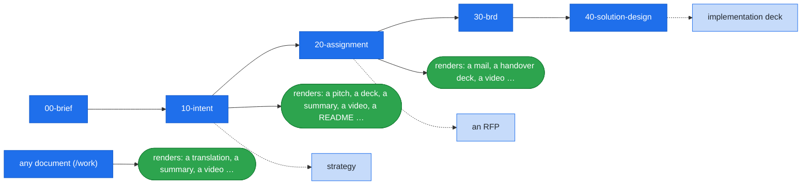

# Forge of Thought 6.4

*A workshop where thought is tempered and shaped.* · [Documentation](docs/README.md) · [Videos](https://pche-broken-artist.github.io/forge-of-thought/videos/) · [Release notes](RELEASE-NOTES.md)

**New here? Watch first.** Ten videos and eight short clips of real sessions, in two languages, show the forge at work before a word of this README is read: [Videos](https://pche-broken-artist.github.io/forge-of-thought/videos/).

Forge of Thought is an **AI cognitive extension** of a thinking
human, the **principal**: the one whose thinking is being forged and
who has the final word on all of it. It takes a raw, half-formed
idea - a process redesign, a platform initiative, an organisational
change, a D&D campaign - and tempers it into a precise,
self-contained handover for whoever delivers it: a team, a
colleague, your future self. It rests on one principle - **the
machine carries every part of the work that is not deciding** - in
three forms.

- **It thinks with you.** It interviews and probes, criticises,
  challenges and inspires; it extracts what you have not yet
  articulated and lays out the options with their trade-offs. It
  proposes; you decide.
- **It keeps the work consistent.** Nothing wanders off in forgotten
  chats: the thinking lives in versioned, templated artefacts, with
  decisions, state and history keeping themselves in order and
  consistency guarded across every output.
- **It carries the tedious work.** Audience-facing outputs - a pitch,
  a deck, this README, the whole documentation - are **renders**:
  generated from the artefacts, regenerated whenever the thinking
  moves, never written by hand twice.

Technically, Forge of Thought is a git repository: slash commands and
isolated agents - challenger personas and critic lenses - for Claude
Code, templates, and the conventions binding them. Today the chain
runs from a brief through the intent to an assignment, a BRD and a
solution design, and it ends wherever a project needs it to.

Short on time? Two one-page notes say it briefly:
[for a CTO](projects/forge/renders/cto-pitch.md) and
[for a CEO](projects/forge/renders/ceo-pitch.md). Each has a Word
version beside it.

## 1. Better with AI, or replaced by it?

Forge of Thought is for those who chose to be better. The failure
modes it exists to remove:

- Thinking scattered across chat sessions that die, taking their
  context with them.
- Handovers whose completeness depends on the mood of the day they
  were written.
- The same thinking retold to every audience - a pitch, a deck, a
  mail - each version rewritten by hand and drifting from the others.
- Feedback and decisions with no place to land, so the same ground is
  fought over twice.
- Assumptions nobody attacked before reality did.

## 2. Watch it work

Every video is a real session of the forge, cut to a few minutes and
played in the browser as a simulated terminal with captions, in two
languages, nothing staged.

- **How a brief is born**: a brief found by questions, a critique
  from outside, research, the approval and the mining.
  ([watch](https://pche-broken-artist.github.io/forge-of-thought/videos/#01-brief-elicitation) ·
  [read](docs/use/write-a-brief.md))
- **One item, one verdict**: a list settled one item per message, the
  verdict line, one write at the end of the round.
  ([watch](https://pche-broken-artist.github.io/forge-of-thought/videos/#02-walkthrough) ·
  [read](docs/use/walk-through-a-list.md))
- **From the brief to the intent**: the brief mined into positions,
  rejections and threads, cited at its version.
  ([watch](https://pche-broken-artist.github.io/forge-of-thought/videos/#03-brief-to-intent) ·
  [read](docs/use/forge-the-intent.md))
- **A critic and walking its findings**: an isolated reviewer of
  document quality, its findings mended or rejected with a reason.
  ([watch](https://pche-broken-artist.github.io/forge-of-thought/videos/#04-critique) ·
  [read](docs/use/critique-the-documents.md))
- **A check at a save**: a save runs the check, conformance findings
  are settled before the commit, and a release runs more.
  ([watch](https://pche-broken-artist.github.io/forge-of-thought/videos/#05-check-at-save) ·
  [read](docs/use/save-your-work.md))
- **A challenger: peer review of the substance**: a persona attacks
  the thinking; what is accepted goes into the intent, what is
  rejected keeps its reason.
  ([watch](https://pche-broken-artist.github.io/forge-of-thought/videos/#06-challenger) ·
  [read](docs/use/challenge-the-thinking.md))
- **History and threads**: why an item changed, one command away, and
  the open threads as the project's memory.
  ([watch](https://pche-broken-artist.github.io/forge-of-thought/videos/#07-history-threads) ·
  [read](docs/use/read-the-history-of-an-item.md))
- **Solution design: a new layer of the chain**: the chain grows by a
  definition and a template, up to the first solution design.
  ([watch](https://pche-broken-artist.github.io/forge-of-thought/videos/#08-new-artefact) ·
  [read](docs/extend/add-an-artefact.md))
- **The BRD, a new artefact**: a new artefact from its definition to
  its first document.
  ([watch](https://pche-broken-artist.github.io/forge-of-thought/videos/#12-brd) ·
  [read](docs/use/write-a-brd.md))
- **Research: a plan, two LLMs and a synthesis**: the plan confirmed
  before the search, the same cards on two model families, the
  synthesis.
  ([watch](https://pche-broken-artist.github.io/forge-of-thought/videos/#13-deep-research) ·
  [read](docs/use/research-a-topic.md))

The whole course is at the
[course page](https://pche-broken-artist.github.io/forge-of-thought/videos/),
where each video has its scenes as chapters and the language is a
switch, and where eight short clips stand in the order of a talk: the
wall between reading git and writing it, the principal deciding by a
letter, a mistake becoming a rule, research planned first,
elicitation one question at a time, handing over, reviewers that
never saw the conversation, and GitHub from an issue to an answer.

## 3. What you get

- A versioned document chain growing from a **brief** - your idea put
  together, yours by your approval - through the **intent** to the
  layers your project needs, an assignment to hand over and a
  solution design among them.
  ([the document chain](docs/about/the-document-chain.md))
- An elicitation interview that forges the intent.
  ([elicitation](docs/about/elicitation.md))
- Blind adversarial reviewers - critics of the documents, challengers
  of the thinking, checks of the conventions - with every verdict
  recorded. ([the isolated reviewers](docs/about/isolated-reviewers.md))
- Audience-specific renders, each generated from its **recipe**,
  including an actual PowerPoint file through your own template.
  ([renders and recipes](docs/about/renders-and-recipes.md))
- External sources registered immutably and used only as the
  principal directs.
  ([sources and research](docs/about/sources-and-research.md))
- Everything in files and git: nothing depends on a chat's memory.
  ([persistence in git](docs/about/persistence-in-git.md))

## 4. What is new in 6.0

**More than one hand on a project.** An integrator and contributors
can now work on one project through git: a conflict at a save is left
standing and settled in the session, both sides laid out one question
at a time, and a hook holds the wall between reading git and writing
it. Two people working on one project no longer lose each other's
work. ([working together](docs/about/working-together.md))

**The ledger made from the records, threads as files.** The state of
a project is now made at read time from its documents, never kept by
hand, and every open matter is a file of its own, with a migration to
that shape. What the forge shows you can no longer drift from what
the files say. ([the ledger](docs/about/the-ledger.md))

**The BRD as a layer of the chain.** A project that needs it can now
break its assignment or its intent into business requirements the
stakeholders review and the delivery can estimate. What the forge
cannot know, it names as something to be supplied instead of
inventing it. ([the BRD](docs/about/the-brd.md))

**Research planned before it is searched.** You now see and confirm
the questions of a research before they cost anything, can have the
same plan answered by a second model family on your word, and every
citation is opened before a note is filed. The result can be judged,
not just trusted. ([how a research is made](docs/about/the-research.md))

**`/migrate`.** You can bring a project to the shape of files a new
release expects, once, on one clone, with an undo where git is there.
A project of the old shape is read, not written, until it is
migrated. ([migrate a project](docs/use/migrate-a-project.md))

**`/work`.** A model, an analysis or a worked task now has its own
home: the file holds the content, a versioned specification beside it
the way and the why. An output with work of its own is neither forced
into the chain nor lost beside it.
([work a work product](docs/use/work-a-work-product.md))

**`/history`.** You get the whole way to one item in one call: its
wording today, every record of it and every place that cites it.
Before changing an item, you see why it is as it is.
([read the history of an item](docs/use/read-the-history-of-an-item.md))

**`/pull`.** The forge now looks at the remote and says the state of
every repository, and pulls only a clean repository that is behind.
It never pulls or merges on its own, so nothing arrives unannounced.
([pull from the remote](docs/use/pull-from-the-remote.md))

**`/end`.** You can close a session knowing what a shutdown would
lose: what lives only in the conversation, what is unsaved, which
renders are stale. It writes nothing itself and offers the rest.
([end a session](docs/use/end-a-session.md))

The full account is in [RELEASE-NOTES.md](RELEASE-NOTES.md).

## 5. Quickstart

First, once per machine:

```
# install git, Python and Claude Code first (docs/start/install.md)
git clone <this repository>   # you are looking at it
cd forge-of-thought
claude                        # always start from the engine root
/setup                        # first run only; what it asks: docs/start/setup.md
```

The forge is developed and run on Windows; the git scripts, the
ledger and docs-state have run on Linux on a user's machine, and the
conversions and the two hooks are written to run unchanged on Linux
and macOS.

**Starting a new project**

```
/new-project my-idea
/forge intent
# in your own terminal, at the engine root (Claude writes nothing into
# git itself; the init and a remote are your one-off act):
git -C projects/my-idea init -b main
/save
# a save that commits nothing names its cause (no repository, or no
# git identity for the host); docs/start/first-result.md says what to do
```

**Bringing an existing project**

```
/import-project <project url>   # clones into projects/
/forge <project-slug>           # the slug is the repository's name;
                                # select the project before any work -
                                # the forge cannot guess it
```

Each project lives inside `projects/<slug>/` as a git repository of
its own, which the engine does not track - that is why you name it
first. `projects/forge` is the forge's own project, the exemplar
every render and page of the documentation derives from, and the one
directory under `projects/` the engine tracks; a user never needs to
open it. The first sitting from nothing to a saved intent is
[docs/start/first-result.md](docs/start/first-result.md).

## 6. The document chain in one picture



**Blue = chain artefacts and a work product (light = not built yet), green = renders, the dots saying the list is open; dashed arrows = growth that does not exist yet.**

- **Brief**: compose or finish a brief, the principal's idea put
  together, found with Claude or handed over, approved when done.
  ([the brief](docs/about/the-brief.md))
- **Intent**: iterate `10-intent.md`, the briefs chiselled into what
  the principal holds. ([the intent](docs/about/the-intent.md))
- **Assignment**: iterate `20-assignment.md`, the intent's in-scope
  substance carried to the recipients in a joint pass.
  ([the assignment](docs/about/the-assignment.md))
- **BRD**: iterate `30-brd.md`, the business requirements: the
  assignment or the intent broken into rules, behaviour and qualities
  the stakeholders can review and the delivery can estimate; a source
  put in yields a draft BRD as a work product.
  ([the BRD](docs/about/the-brd.md))
- **Solution design**: iterate `40-solution-design.md`, how the
  things wanted are realised, part by part, with the choices they
  rest on. ([the solution design](docs/about/the-solution-design.md))

Below the intent a project takes the layers it needs, none a
condition of another, and many end at the intent.

> A render is never edited by hand: what is iterated is its recipe.

## 7. Documentation

The documentation of the forge is in [`docs/`](docs/README.md), pages
of one topic each, generated from the engine like this README.

- **The user**: [watch](https://pche-broken-artist.github.io/forge-of-thought/videos/#01-brief-elicitation) how a brief is born, then begin with [What Forge of Thought is](docs/start/what-it-is.md).
- **The extender**: [watch](https://pche-broken-artist.github.io/forge-of-thought/videos/#08-new-artefact) a new artefact, then begin with [What the forge is made of](docs/extend/what-it-is-made-of.md).
- **The evaluator**: [watch](https://pche-broken-artist.github.io/forge-of-thought/videos/#06-challenger) a challenger, then begin with [What the forge is and is not](docs/about/what-it-is-and-is-not.md).

The documentation was generated on 2026-11-01 for Forge of Thought
at version 6.4, as its index says too.

- [Start](docs/README.md#start): what the forge is, what to install,
  the first setup and a first result in one sitting.
- [Use](docs/README.md#use): one page per task, from starting a
  project to releasing a version, each with the command that does it.
- [About](docs/README.md#about): why the forge works as it does, one
  concept per page.
- [Extend](docs/README.md#extend): how the forge is changed and grown,
  by a new artefact, lens, persona, check, genre, command, script or
  engine.
- [Reference](docs/README.md#reference): the exact tables, formats
  and rules, from the commands to the glossary.

Each video is a screenplay rendered from the session records of the
principal's rollout project and made into a player file by
`scripts/md2video.py`. The files live in `docs/videos/`, served as
the course page, and making one is the page
[Make a teaching video from a recipe](docs/use/make-a-video-from-a-recipe.md).

## 8. Author and licence

Forge of Thought © Petr Chlumsky (PCHe) - petr.chlumsky@gmail.com.
Licensed under [CC BY 4.0](LICENSE): use and adapt it freely; credit
the author and link to this repository.

Feedback, ideas and changes are welcome: see
[CONTRIBUTING.md](CONTRIBUTING.md).

## 9. About this README

This file is a render of `projects/forge`: never edited by hand,
regenerated by `/render readme` whenever the process changes and by
every `/release` of the engine. Fixes go into the recipe or its
inputs, and system changes are recorded in `projects/forge/`. The
documentation in `docs/` is generated the same way, from the engine,
and its index says when and for which version. The YAML front-matter
provenance at the top of this file is kept by design.

_Last updated: 2026-11-01_
