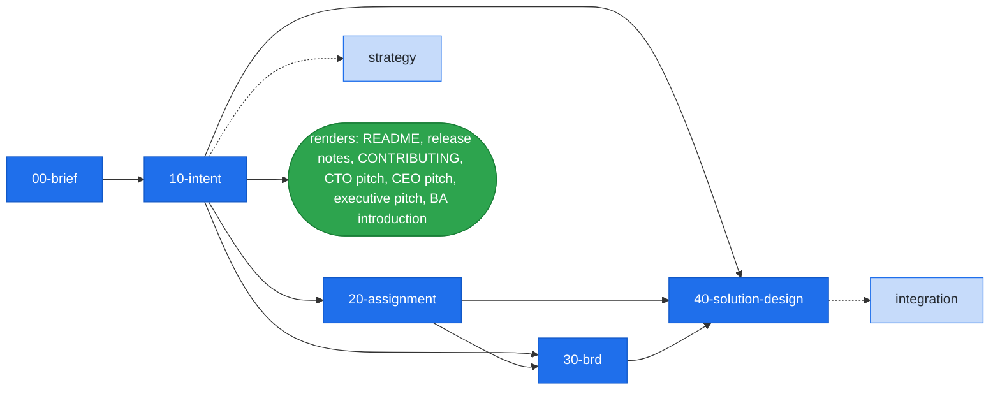

# Forge of Thought 5.35

*A workshop where thought is tempered and shaped.* · [Documentation](docs/README.md) · [Videos](https://pche-broken-artist.github.io/forge-of-thought/videos/) · [Release notes](RELEASE-NOTES.md)

**New here? Watch first.** Eight short videos of real sessions, seven to fifteen minutes each, in two languages, show the forge at work before you read a word of this README: [Videos](https://pche-broken-artist.github.io/forge-of-thought/videos/).

Forge of Thought is an **AI cognitive extension** of a thinking
human, the **principal**: the person whose thinking is being forged
and who alone decides what it says. It takes a raw, half-formed idea,
a process redesign, a platform initiative, an organisational change,
a D&D campaign, and tempers it into a precise, self-contained
handover for whoever delivers it: a team, a colleague, your future
self. It rests on one principle, **the machine carries every part of
the work that is not deciding**, in three forms.

- **It thinks with you.** It interviews and probes, criticises,
  challenges and inspires; it extracts what you have not yet
  articulated and lays out options with their trade-offs. It
  proposes; you decide.
- **It keeps the work consistent.** Nothing wanders off in forgotten
  chats: the thinking lives in versioned, templated artefacts, with
  decisions, state and history keeping themselves in order and
  consistency guarded across every output.
- **It carries the tedious work.** Audience-facing outputs, a pitch,
  a deck, this README, the whole documentation, are **renders**:
  generated from the artefacts, regenerated whenever the thinking
  moves, never written by hand twice.

Technically the forge is a git repository: slash commands and
isolated agents, challenger personas and critic lenses, for Claude
Code, templates, and the conventions binding them. Today the chain
has five artefacts, from the brief to the solution design, and a
project takes below the intent only the layers it needs. The forge is
developed and run on Windows; its scripts, the one platform-bound
layer, are written to run unchanged on Linux and macOS, where a user
has run the git scripts, the ledger and the documentation state, and
the conversions and the hooks have not yet been run.

Short on time? Two one-page notes say it briefly:
[for a CTO](projects/forge/renders/cto-pitch.md) and
[for a CEO](projects/forge/renders/ceo-pitch.md). Each has a Word
version beside it.

## 1. Better with AI, or replaced by it?

Forge of Thought is for those who chose to be better. The failure
modes it exists to remove:

- thinking scattered across chat sessions that die, taking their
  context with them;
- handovers whose completeness depends on the mood of the day they
  were written;
- the same thinking retold to every audience, a pitch, a deck, a
  mail, each version rewritten by hand and drifting from the others;
- feedback and decisions with no place to land, so the same ground is
  fought over twice;
- assumptions nobody attacked before reality did.

## 2. Watch it work

Every video is a real session of the forge, cut to a few minutes and
played in the browser as a simulated terminal with captions, in two
languages; nothing is staged.

- **How a brief is born.** A brief found by questions, a critique
  from outside, research, the approval, the mining.
  [watch](https://pche-broken-artist.github.io/forge-of-thought/videos/#01-brief-elicitation) ·
  [read](docs/use/write-a-brief.md)
- **One item, one verdict.** A list settled one item per message, the
  verdict line, one write at the end of the round.
  [watch](https://pche-broken-artist.github.io/forge-of-thought/videos/#02-walkthrough) ·
  [read](docs/use/walk-through-a-list.md)
- **From the brief to the intent.** The brief mined into positions,
  rejections and threads, cited at its version.
  [watch](https://pche-broken-artist.github.io/forge-of-thought/videos/#03-brief-to-intent) ·
  [read](docs/use/forge-the-intent.md)
- **A critic and walking its findings.** An isolated reviewer of
  document quality, its findings mended or rejected with a reason.
  [watch](https://pche-broken-artist.github.io/forge-of-thought/videos/#04-critique) ·
  [read](docs/use/critique-the-documents.md)
- **A check at a save.** A save runs the check, conformance findings
  settled before the commit, a release with more.
  [watch](https://pche-broken-artist.github.io/forge-of-thought/videos/#05-check-at-save) ·
  [read](docs/use/save-your-work.md)
- **A challenger: peer review of the substance.** A persona attacks
  the thinking; accepted goes into the intent, rejected keeps its
  reason.
  [watch](https://pche-broken-artist.github.io/forge-of-thought/videos/#06-challenger) ·
  [read](docs/use/challenge-the-thinking.md)
- **A layer below the intent and a new artefact.** The chain grows by
  a definition and a template, the first solution design.
  [watch](https://pche-broken-artist.github.io/forge-of-thought/videos/#07-new-artefact) ·
  [read](docs/extend/add-an-artefact.md)
- **History and threads.** Why an item changed, one command away; the
  open threads as the project's memory.
  [watch](https://pche-broken-artist.github.io/forge-of-thought/videos/#08-history-threads) ·
  [read](docs/use/read-the-history-of-an-item.md)

The whole course is at the
[course page](https://pche-broken-artist.github.io/forge-of-thought/videos/),
where each video has its scenes as chapters and the language is a
switch.

## 3. What you get

- A versioned document chain growing from a **brief**, your idea put
  together, yours by your approval, through the **intent** to the
  layers your project needs, an assignment to hand over and a
  solution design among them
  ([the document chain](docs/about/the-document-chain.md)).
- An elicitation interview that forges the intent: one question per
  message, drawing out what you have not yet said
  ([elicitation](docs/about/elicitation.md)).
- Blind adversarial reviewers, critics of the documents, challengers
  of the thinking, checks of the conventions, every verdict recorded
  ([the isolated reviewers](docs/about/isolated-reviewers.md)).
- Audience-specific renders generated from **recipes**, including an
  actual PowerPoint file through your own template
  ([renders and recipes](docs/about/renders-and-recipes.md)).
- External sources registered immutably and used only as the
  principal directs
  ([sources and research](docs/about/sources-and-research.md)).
- Everything in files and git; nothing depends on a chat's memory
  ([persistence in git](docs/about/persistence-in-git.md)).

## 4. What is new in 5

Version 5 closes how a thought is found and how the forge is read.

**Every artefact has a definition of its elicitation.** A brief, an
intent, an assignment or a solution design is found by its own
definition, seven blocks that say what it is, from what it is derived
and how the conversation runs, and `/forge <state>` works by it. You
no longer need to know by heart what an artefact is made of: what
holds for it is read in one file
([elicitation](docs/about/elicitation.md)).

**The working methods stand named, with their reasons.** Walkthrough,
one write per round, step by step, plain speech and the others are a
vocabulary you can invoke in a word, and each says why it exists. A
long working conversation keeps its shape because the rules are
written, not remembered
([the working methods](docs/about/working-methods.md)).

**The chain grew below the intent to the solution design.** An intent
says what is wanted and why; a solution design says how it is
realised, part by part, with the choices it rests on, and the cut
between the two is a rule. A project takes the layer when it needs
it, and many end at the intent
([the solution design](docs/about/the-solution-design.md)).

**The history of a document is a log.** Every change to a versioned
document is one record beside it, with why it changed, and the
release notes derive from those records. You can ask for the history
of one item and get its whole way, not a diff
([versioning and history](docs/about/versioning-and-history.md)).

**The forge explains itself from its own definitions.** The
documentation is generated by `/document`, the scripts are Python
and run from one `python` on PATH, and `CONTRIBUTING.md` says how to
give feedback. Nothing you read about the forge is written by hand
beside the thing it describes, so it cannot drift from it
([the documentation](docs/about/the-documentation.md)).

**`/new-artefact <name>`** adds a new kind of artefact to the chain
and leads to everything a kind needs: its position, its definition
and template, its prefixes, its reviewers. The chain grows without
anyone having to know the recipe for a layer
([add an artefact](docs/extend/add-an-artefact.md)).

**`/document [slug]`** generates the documentation of the engine or
of a project into `docs/`: pages of one topic each and their index,
for the user, the extender and the evaluator. It asks nothing and
regenerates only what changed
([generate the documentation](docs/use/generate-the-documentation.md)).

**`/publish <recipe>`** makes the designed Word or PowerPoint file
from a render through a model, into `published/`. The cheap plain
file comes from `/render`; the expensive designed one only on your
command
([publish a designed file](docs/use/publish-a-designed-file.md)).

**`/man [command or method]`**, alias `/manual`, prints the forge's
manual read from its own definitions: the commands, the working
methods, every check and what it looks for. What a command does is
one question away
([look up a command](docs/use/look-up-a-command.md)).

The full account, version by version, is in
[RELEASE-NOTES.md](RELEASE-NOTES.md).

## 5. Quickstart

**First, once per machine**

```
# git, Python and Claude Code must be installed first;
# what and how is docs/start/install.md
git clone ...                    # this repository: you are looking at it
cd forge-of-thought
claude                           # always from the engine root
/setup                           # first run only; what it asks is
                                 # docs/start/setup.md
```

**Starting a new project**

```
/new-project my-idea
/forge intent
# in your own terminal, at the engine root: Claude writes nothing
# into git itself; the init and a remote are your one-off act
git -C projects/my-idea init -b main
/save                            # a save that commits nothing names
                                 # its cause, no repository or no git
                                 # identity for the host;
                                 # docs/start/first-result.md says
                                 # what to do
```

**Bringing an existing project**

```
/import-project <project url>    # clones into projects/
/forge <project-slug>            # the slug is the repository's name;
                                 # select the project before any
                                 # work: the forge cannot guess it
```

Each project lives inside `projects/<slug>/` as a git repository of
its own, which the engine does not track; that is why you name it
first. `projects/forge` is the forge's own project, the exemplar
every render and page of the documentation derives from, and the one
directory under `projects/` the engine tracks; a user never needs to
open it. The first sitting from nothing to a saved intent is
[docs/start/first-result.md](docs/start/first-result.md).

## 6. The document chain in one picture



**Blue = chain artefacts the forge has · light blue dashed = growth the intent foresees and nothing built · green = renders.**

- **00-brief**: the principal's idea put together, found with Claude
  or handed over, approved when done
  ([the brief](docs/about/the-brief.md)).
- **10-intent**: the briefs chiselled into what the principal holds
  ([the intent](docs/about/the-intent.md)).
- **20-assignment**: the intent's in-scope substance carried to the
  recipients in a joint pass
  ([the assignment](docs/about/the-assignment.md)).
- **30-brd**: the business requirements, the assignment, the intent
  or a source put in, broken into rules, behaviour and qualities the
  stakeholders can review and the delivery can estimate (no page yet:
  the documentation stands at 5.34, before this layer was born).
- **40-solution-design**: how the things wanted are realised, part by
  part, with the choices they rest on
  ([the solution design](docs/about/the-solution-design.md)).

Below the intent a project takes the layers it needs, none a
condition of another, and many end at the intent.

> A render is never edited by hand: what is iterated is its recipe.

## 7. Documentation

The documentation of the forge is in [`docs/`](docs/README.md):
pages of one topic each, generated from the engine like this README.

- **the user**: watch
  [how a brief is born](https://pche-broken-artist.github.io/forge-of-thought/videos/#01-brief-elicitation),
  then begin at [What Forge of Thought is](docs/start/what-it-is.md).
- **the extender**: watch
  [a layer below the intent and a new artefact](https://pche-broken-artist.github.io/forge-of-thought/videos/#07-new-artefact),
  then begin at [What the forge is made of](docs/extend/what-it-is-made-of.md).
- **the evaluator**: watch
  [a challenger: peer review of the substance](https://pche-broken-artist.github.io/forge-of-thought/videos/#06-challenger),
  then begin at [What the forge is and is not](docs/about/what-it-is-and-is-not.md).

The documentation was generated on 2026-10-23 for Forge of Thought
at version 5.34, as its index says.

- [Start](docs/README.md#start): what the forge is, what must be on
  your machine, the first setup and the first result.
- [Use](docs/README.md#use): one page per job the forge has a command
  or a procedure for, from starting a project to releasing a version.
- [About](docs/README.md#about): one page per concept and per kind of
  artefact or part, the reasons included.
- [Extend](docs/README.md#extend): what the forge is made of, how a
  change is made, proved and recorded, and one page per kind of
  addition.
- [Reference](docs/README.md#reference): the commands, the rosters,
  the conventions, the layout, the scripts, the templates and a
  glossary, exactly.

Each video is a screenplay rendered from the session records of the
principal's rollout project and made into a player file by
`scripts/md2video.py`. The files live in `docs/videos/`, served as
the course page, and the documentation on making one is the page
[Make a teaching video from a recipe](docs/use/make-a-video-from-a-recipe.md).

## 8. Author and licence

Forge of Thought © Petr Chlumsky (PCHe) - petr.chlumsky@gmail.com.
Licensed under [CC BY 4.0](LICENSE): use and adapt it freely; credit
the author and link to this repository.

Feedback, ideas and changes are welcome: see
[CONTRIBUTING.md](CONTRIBUTING.md).

## 9. About this README

This file is a render of `projects/forge`: never edited by hand,
regenerated by `/render readme` whenever the process changes and by
every `/release` of the engine. A fix goes into the recipe,
`projects/forge/recipes/readme.md`, or into the inputs, never here.
The documentation in `docs/` is generated the same way, from the
engine, and its index says when and for which version. The YAML
front-matter at the top is the render's provenance and is kept by
design; changes to the system are recorded in `projects/forge/`.

_Last updated: 2026-10-23_
