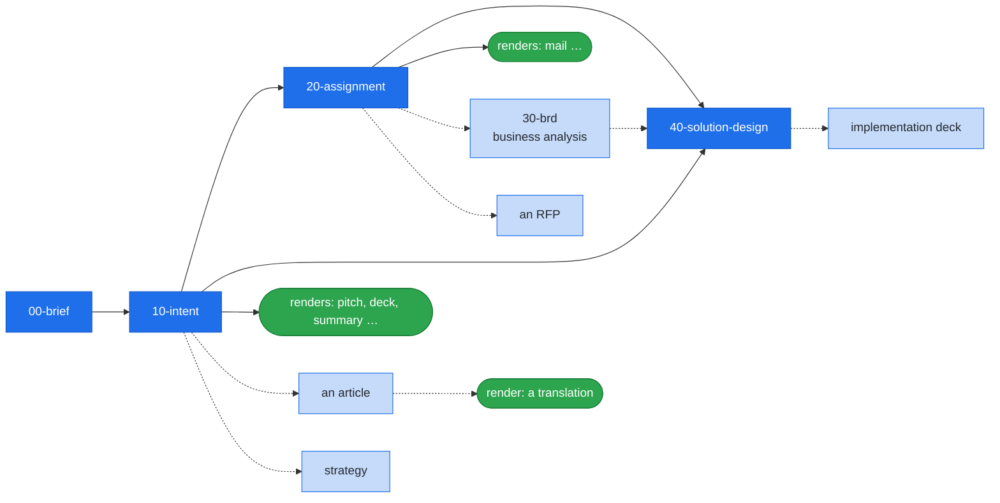

# Forge of Thought 5.26

*A workshop where thought is tempered and shaped.* · [Documentation](docs/README.md) · [Videos](https://pche-broken-artist.github.io/forge-of-thought/videos/) · [Release notes](RELEASE-NOTES.md)

**New here? Watch first.** Eight short videos of real sessions, seven
to fifteen minutes each and in two languages, show the forge at work
before you read a word of this README:
[Videos](https://pche-broken-artist.github.io/forge-of-thought/videos/).

Forge of Thought is an **AI cognitive extension** of a thinking
human, the **principal**: the person whose thinking is being forged,
who supplies the ideas, answers and decisions and has the final say
on all content. It takes a raw, half-formed idea (a process redesign,
a platform initiative, an organisational change, a D&D campaign) and
tempers it into a precise, self-contained handover for whoever
delivers it: a team, a colleague, your future self. It rests on one
principle, **the machine carries every part of the work that is not
deciding**, in three forms:

- **It thinks with you.** It interviews and probes, criticises,
  challenges and inspires; it extracts what you have not yet
  articulated and lays out options with their trade-offs. It
  proposes; you decide.
- **It keeps the work consistent.** Nothing wanders off in forgotten
  chats: the thinking lives in versioned, templated artefacts, with
  decisions, state and history keeping themselves in order and
  consistency guarded across every output.
- **It carries the tedious work.** Audience-facing outputs, such as a
  pitch, a deck, this README or the whole documentation, are
  **renders**: generated from the artefacts, regenerated whenever the
  thinking moves, never written by hand twice.

Technically the forge is a git repository: slash commands and
isolated agents (challenger personas and critic lenses) for Claude
Code, templates, and the conventions that bind them. It is a place
where thoughts are forged, and the chain of documents ends where a
project needs it to; today it runs from the brief through the intent
to an assignment and a solution design.

Short on time? Two one-page notes say it briefly:
[for a CTO](projects/forge/renders/cto-pitch.md) and
[for a CEO](projects/forge/renders/ceo-pitch.md). Each has a Word
version beside it.

## 1. Better with AI, or replaced by it?

Forge of Thought is for those who chose to be better. The failure
modes it exists to remove:

- Thinking scattered across chat sessions that die, taking their
  context with them.
- Handovers whose completeness depends on the mood of the day they
  were written.
- The same thinking retold to every audience (a pitch, a deck, a
  mail), each version rewritten by hand and drifting from the others.
- Feedback and decisions with no place to land, so the same ground is
  fought over twice.
- Assumptions nobody attacked before reality did.

## 2. Watch it work

Every video is a real session of the forge, cut to a few minutes and
played in the browser as a simulated terminal with captions, in two
languages, nothing staged.

- **How a brief is born**: a brief found by questions, a critique
  from outside, research, the approval and the mining.
  ([watch](https://pche-broken-artist.github.io/forge-of-thought/videos/#01-brief-elicitation),
  [read](docs/use/write-a-brief.md))
- **One item, one verdict**: a list settled one item per message,
  the verdict line, one write at the end of the round.
  ([watch](https://pche-broken-artist.github.io/forge-of-thought/videos/#02-walkthrough),
  [read](docs/use/walk-through-a-list.md))
- **From the brief to the intent**: the brief mined into positions,
  rejections and threads, cited at its version.
  ([watch](https://pche-broken-artist.github.io/forge-of-thought/videos/#03-brief-to-intent),
  [read](docs/use/forge-the-intent.md))
- **A critic and walking its findings**: an isolated reviewer of
  document quality, its findings mended or rejected with a reason.
  ([watch](https://pche-broken-artist.github.io/forge-of-thought/videos/#04-critique),
  [read](docs/use/critique-the-documents.md))
- **A check at a save**: a save runs the check, conformance findings
  are settled before the commit, and a release runs more.
  ([watch](https://pche-broken-artist.github.io/forge-of-thought/videos/#05-check-at-save),
  [read](docs/use/save-your-work.md))
- **A challenger: peer review of the substance**: a persona attacks
  the thinking; what is accepted goes into the intent, what is
  rejected keeps its reason.
  ([watch](https://pche-broken-artist.github.io/forge-of-thought/videos/#06-challenger),
  [read](docs/use/challenge-the-thinking.md))
- **A layer below the intent and a new artefact**: the chain grows by
  a definition and a template, up to the first solution design.
  ([watch](https://pche-broken-artist.github.io/forge-of-thought/videos/#07-new-artefact),
  [read](docs/extend/add-an-artefact.md))
- **History and threads**: why an item changed, one command away, and
  the open threads as the project's memory.
  ([watch](https://pche-broken-artist.github.io/forge-of-thought/videos/#08-history-threads),
  [read](docs/use/read-the-history-of-an-item.md))

The whole course is at the
[course page](https://pche-broken-artist.github.io/forge-of-thought/videos/),
where each video has its scenes as chapters and the language is a
switch.

## 3. What you get

- A versioned document chain growing from a **brief**, your idea put
  together and yours by your approval, through the **intent** to the
  layers your project needs, an assignment to hand over and a solution
  design among them ([the document chain](docs/about/the-document-chain.md)).
- An elicitation interview that forges the intent
  ([elicitation](docs/about/elicitation.md)).
- Blind adversarial reviewers: critics of the documents, challengers
  of the thinking, checks of the conventions, every verdict recorded
  ([the isolated reviewers](docs/about/isolated-reviewers.md)).
- Audience-specific renders generated from recipes, including an
  actual PowerPoint file through your own template
  ([renders and recipes](docs/about/renders-and-recipes.md)).
- External sources registered immutably and used only as the
  principal directs ([sources and research](docs/about/sources-and-research.md)).
- Everything in files and git: nothing depends on a chat's memory
  ([persistence in git](docs/about/persistence-in-git.md)).

## 4. What is new in 5

**Every artefact has a definition of how it is found.** `/forge
brief`, `/forge intent`, `/forge assignment` and `/forge
solution-design` each run by a definition of the artefact's
elicitation, paired with its template. What holds for an artefact is
read in one place, and the conversation that finds it follows the
same course every time ([elicitation](docs/about/elicitation.md)).

**The working methods stand named, with their reasons.** The ways a
working conversation runs, such as the walkthrough, step by step, one
write per round and plain speech, have names you can invoke in a
word. You know how Claude will behave and can ask for a method by
name ([the working methods](docs/about/working-methods.md)).

**The chain grows below the intent to the solution design.** A
project can now take a solution design, made of parts with the
choices they rest on, cut cleanly from what is wanted: the intent
says what and why, the solution design how. A project takes only the
layers it needs, and many end at the intent
([the solution design](docs/about/the-solution-design.md)).

**The history of a document is a log.** Every change to a versioned
document is one record in a companion beside it, with the reason, so
why an item changed can always be found. The release notes are
derived from that log, not written beside it
([versioning and history](docs/about/versioning-and-history.md)).

**The forge explains itself from its own definitions.** Its
documentation is generated from the engine, its scripts are Python
and written to run beyond Windows, and `CONTRIBUTING.md` says how to
give feedback or send a change. You can read, run and contribute
without asking anyone ([the documentation](docs/about/the-documentation.md)).

**`/new-artefact` adds a new kind of artefact.** It leads you through
everything a kind needs, from its position in the forge intent to its
definition, template, prefixes and reviewers. You alone start it and
it decides nothing, so the chain grows only where you choose
([add an artefact](docs/extend/add-an-artefact.md)).

**`/document` generates the documentation.** It makes pages of one
topic each and their index, for the engine or for a project, and
regenerates only what changed. Your project's documentation keeps up
with it without being written by hand
([generate the documentation](docs/use/generate-the-documentation.md)).

**`/publish` makes the designed file.** From a render you have read
it makes a designed Word or PowerPoint file through a model, only on
your command. The cheap plain file stays with `/render`, the
expensive designed one is a deliberate step
([publish a designed file](docs/use/publish-a-designed-file.md)).

**`/man` prints the forge's manual.** It lists the commands and the
working methods and shows any one of them, read from the forge's own
definitions. What it says is what the forge does
([look up a command](docs/use/look-up-a-command.md)).

The full account is in [RELEASE-NOTES.md](RELEASE-NOTES.md).

## 5. Quickstart

First, once per machine:

```
# install git, Python and Claude Code first (docs/start/install.md)
# clone this repository (you are looking at it)
claude          # always from the engine root
/setup          # first run only; what it asks: docs/start/setup.md
```

**Starting a new project**

```
/new-project my-idea
/forge intent
# in your own terminal, at the engine root (Claude is not allowed to
# run git); a remote may follow:
git -C projects/my-idea init -b main
/save           # a save that commits nothing names its cause (no
                # repository, or no git identity for the host);
                # docs/start/first-result.md says what to do
```

**Bringing an existing project**

```
/import-project <project url>   # clones into projects/
/forge <project-slug>           # the slug is the repository's name;
                                # select the project before any work:
                                # the forge cannot guess it
```

Each project lives inside `projects/<slug>/` as a git repository of
its own, which the engine does not track: that is why you name it
first. `projects/forge` is the forge's own project, the exemplar
every render and page of the documentation derives from, and the one
directory under `projects/` the engine tracks; a user never needs to
open it. The first sitting from nothing to a saved intent is
[docs/start/first-result.md](docs/start/first-result.md).

## 6. The document chain in one picture



**Blue = chain artefacts (light = not built yet), green = renders;
dashed arrows = growth that does not exist yet.**

- **Brief**: the principal's idea put together, found with Claude or
  handed over, approved when done ([the brief](docs/about/the-brief.md)).
- **Intent**: the briefs chiselled into what the principal holds
  ([the intent](docs/about/the-intent.md)).
- **Assignment**: the intent's in-scope substance carried to the
  recipients in a joint pass ([the assignment](docs/about/the-assignment.md)).
- **Solution design**: how the things wanted are realised, part by
  part, with the choices they rest on
  ([the solution design](docs/about/the-solution-design.md)).

Below the intent a project takes the layers it needs, none a
condition of another, and many end at the intent.

> A render is never edited by hand: what is iterated is its recipe.

## 7. Documentation

The documentation of the forge is in [`docs/`](docs/README.md), pages
of one topic each, generated from the engine like this README.

- **The user**: watch [how a brief is born](https://pche-broken-artist.github.io/forge-of-thought/videos/#01-brief-elicitation),
  then begin with [What Forge of Thought is](docs/start/what-it-is.md).
- **The extender**: watch [a new artefact](https://pche-broken-artist.github.io/forge-of-thought/videos/#07-new-artefact),
  then begin with [What the forge is made of](docs/extend/what-it-is-made-of.md).
- **The evaluator**: watch [a challenger](https://pche-broken-artist.github.io/forge-of-thought/videos/#06-challenger),
  then begin with [What the forge is and is not](docs/about/what-it-is-and-is-not.md).

The documentation was generated on 2026-10-19 for version 5.26, as
its index says too.

- [Start](docs/README.md#start): what the forge is, what to install,
  the first run and a first result.
- [Use](docs/README.md#use): how to do each thing with the forge,
  command by command, from a project's start to a release.
- [About](docs/README.md#about): why the forge is as it is, concept
  by concept.
- [Extend](docs/README.md#extend): how the forge is made and how to
  add an artefact, a reviewer, a genre, a command or a script.
- [Reference](docs/README.md#reference): the exact tables and shapes:
  commands, IDs, front-matter, the ledger, scripts, templates and the
  glossary.

Each video is a screenplay rendered from the session records of the
principal's rollout project and made into a player file by
`scripts/md2video.py`. The files live in `docs/videos/`, served as
the course page, and how to make one is the page
[Make a teaching video from a recipe](docs/use/make-a-video-from-a-recipe.md).

## 8. Author and licence

Forge of Thought © Petr Chlumsky (PCHe) - petr.chlumsky@gmail.com.
Licensed under [CC BY 4.0](LICENSE): use and adapt it freely; credit
the author and link to this repository.

Feedback, ideas and changes are welcome: see
[CONTRIBUTING.md](CONTRIBUTING.md).

## 9. About this README

This file is a render of `projects/forge`: never edited by hand,
regenerated by `/render readme` whenever the process changes, and by
every `/release` of the engine. Fixes go into the recipe or its
inputs. The documentation in `docs/` is generated the same way, from
the engine, and its index says when and for which version. The YAML
front-matter provenance at the top is kept by design; changes to the
system are recorded in `projects/forge/`.

_Last updated: 2026-10-19_
