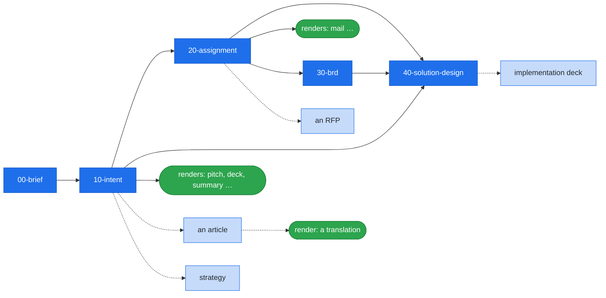

# Forge of Thought 6.0

*A workshop where thought is tempered and shaped.* · [Documentation](docs/README.md) · [Videos](https://pche-broken-artist.github.io/forge-of-thought/videos/) · [Release notes](RELEASE-NOTES.md)

**New here? Watch first.** Ten videos and eight short clips of real
sessions, in two languages, show the forge at work before a word of
this README is read:
[Videos](https://pche-broken-artist.github.io/forge-of-thought/videos/).

Forge of Thought is an **AI cognitive extension** of a thinking human,
the **principal**: whoever's thinking is being forged, and the final
authority on all of its content. It is a place where thoughts are
forged. It takes a raw, half-formed idea - a process redesign, a
platform initiative, an organisational change, a D&D campaign - and
tempers it into a precise, self-contained handover for whoever
delivers it: a team, a colleague, your future self. It rests on one
principle, **the machine carries every part of the work that is not
deciding**, in three forms.

- **It thinks with you.** It interviews and probes, criticises,
  challenges and inspires; it extracts what you have not yet
  articulated and lays out the options with their trade-offs. It
  proposes; you decide.
- **It keeps the work consistent.** Nothing wanders off in forgotten
  chats: the thinking lives in versioned, templated artefacts, the
  decisions, the state and the history keep themselves in order, and
  consistency is guarded across every output.
- **It carries the tedious work.** Audience-facing outputs - a pitch,
  a deck, this README, the whole documentation - are **renders**:
  generated from the artefacts, regenerated whenever the thinking
  moves, never written by hand twice.

Technically, the forge is a git repository: slash commands and
isolated agents - challenger personas and critic lenses - for Claude
Code, templates, and the conventions binding them. Today its chain
reaches from the brief through the intent to an assignment, a BRD and
a solution design. It is developed and run on Windows; the git
scripts, the ledger and docs-state have run on Linux on a user's
machine, and the conversions and the two hooks are written to run
unchanged on Linux and macOS.

Short on time? Two one-page notes say it briefly:
[for a CTO](projects/forge/renders/cto-pitch.md) and
[for a CEO](projects/forge/renders/ceo-pitch.md). Each has a Word
version beside it.

## 1. Better with AI, or replaced by it?

Forge of Thought is for those who chose to be better. The failure
modes it exists to remove:

- Thinking scattered across chat sessions that die, taking their
  context with them.
- Handovers whose completeness depends on the mood of the day they
  were written.
- The same thinking retold to every audience - a pitch, a deck, a
  mail - each version rewritten by hand and drifting from the others.
- Feedback and decisions with no place to land, so the same ground is
  fought over twice.
- Assumptions nobody attacked before reality did.

## 2. Watch it work

Every video is a real session of the forge, cut to a few minutes and
played in the browser as a simulated terminal with captions, in two
languages, nothing staged.

- **How a brief is born.** A brief found by questions, a critique from
  outside, research, the approval and the mining.
  [watch](https://pche-broken-artist.github.io/forge-of-thought/videos/#01-brief-elicitation)
  · [read](docs/use/write-a-brief.md)
- **One item, one verdict.** A list settled one item per message, the
  verdict line, one write at the end of the round.
  [watch](https://pche-broken-artist.github.io/forge-of-thought/videos/#02-walkthrough)
  · [read](docs/use/walk-through-a-list.md)
- **From the brief to the intent.** The brief mined into positions,
  rejections and threads, cited at its version.
  [watch](https://pche-broken-artist.github.io/forge-of-thought/videos/#03-brief-to-intent)
  · [read](docs/use/forge-the-intent.md)
- **A critic and walking its findings.** An isolated reviewer of
  document quality, its findings mended or rejected with a reason.
  [watch](https://pche-broken-artist.github.io/forge-of-thought/videos/#04-critique)
  · [read](docs/use/critique-the-documents.md)
- **A check at a save.** A save runs the check, conformance findings
  settled before the commit, a release with more.
  [watch](https://pche-broken-artist.github.io/forge-of-thought/videos/#05-check-at-save)
  · [read](docs/use/save-your-work.md)
- **A challenger: peer review of the substance.** A persona attacks
  the thinking; what is accepted goes into the intent, what is
  rejected keeps its reason.
  [watch](https://pche-broken-artist.github.io/forge-of-thought/videos/#06-challenger)
  · [read](docs/use/challenge-the-thinking.md)
- **History and threads.** Why an item changed, one command away; the
  open threads as the project's memory.
  [watch](https://pche-broken-artist.github.io/forge-of-thought/videos/#07-history-threads)
  · [read](docs/use/read-the-history-of-an-item.md)
- **Solution design: a new layer of the chain.** The chain grows by a
  definition and a template, the first solution design.
  [watch](https://pche-broken-artist.github.io/forge-of-thought/videos/#08-new-artefact)
  · [read](docs/extend/add-an-artefact.md)
- **The BRD, a new artefact.** A new artefact from its definition to
  its first document.
  [watch](https://pche-broken-artist.github.io/forge-of-thought/videos/#12-brd)
  · [read](docs/use/write-a-brd.md)
- **Research: a plan, two LLMs and a synthesis.** The plan confirmed
  before the search, the same cards on two model families, the
  synthesis.
  [watch](https://pche-broken-artist.github.io/forge-of-thought/videos/#13-deep-research)
  · [read](docs/use/research-a-topic.md)

The whole course is at the
[course page](https://pche-broken-artist.github.io/forge-of-thought/videos/),
where each video has its scenes as chapters and the language is a
switch, and where eight short clips stand in the order of a talk: the
wall between reading git and writing it, the principal deciding by a
letter, a mistake becoming a rule, research planned first, elicitation
one question at a time, handing over, reviewers that never saw the
conversation, and GitHub from an issue to an answer.

## 3. What you get

- A versioned document chain growing from a **brief** - your idea put
  together, yours by your approval - through the **intent** to the
  layers your project needs, an assignment to hand over and a
  solution design among them.
  ([The document chain](docs/about/the-document-chain.md))
- An elicitation interview that forges the intent.
  ([Elicitation](docs/about/elicitation.md))
- Blind adversarial reviewers - critics of the documents, challengers
  of the thinking, checks of the conventions - every verdict recorded.
  ([The isolated reviewers](docs/about/isolated-reviewers.md))
- Audience-specific renders generated from **recipes**, including an
  actual PowerPoint file through your own template.
  ([Renders and recipes](docs/about/renders-and-recipes.md))
- External sources registered immutably and used only as the
  principal directs.
  ([Sources and research](docs/about/sources-and-research.md))
- Everything in files and git: nothing depends on a chat's memory.
  ([Persistence in git](docs/about/persistence-in-git.md))

## 4. What is new in 6.0

**More than one hand on a project.** An integrator and contributors
can now work on one project through git: a conflict at a save is left
standing with nothing lost and settled in the session, one conflict
one question, and a hook holds the wall between reading git and
writing it. Every file has its way of merging, so record files keep
both sides and a render in conflict is simply made again.
([Working together on one project](docs/about/working-together.md))

**The ledger made at read time, the threads as files.** The ledger is
built from the documents by a script whenever it is read and is no
longer kept in git, so the state cannot drift from the files it
describes. Each thread is a file of its own, opened, worked and closed
there, and a project of the old shape reaches the new one by a
migration.
([The ledger, made from the records](docs/about/the-ledger.md))

**The BRD as a layer of the chain.** A project that needs it can
break an assignment, an intent or a file you put in into business
requirements with `/forge brd`: rules the stakeholders of each area
review, behaviour agreed as a sequence, qualities with their values
from the stakeholders. What the forge cannot know it names as a
dependency or an open question with an owner, instead of writing it
from imagination. ([The BRD](docs/about/the-brd.md))

**Research planned before it is searched.** `/research` shows its plan
first and you confirm it, so the questions are judged before they
cost anything; a deep research runs one isolated agent per question
into a bundle with a synthesis. On your word a second model family
takes the same plan, its independence measured, and every citation is
opened before a note is filed.
([How a research is made](docs/about/the-research.md))

**`/migrate`.** It brings a project to the shape of files a new
release expects: it runs only the steps that are missing, verifies
each, commits nothing and can be undone. A project is migrated once,
on one clone, and every other clone of it pulls.
([Migrate a project](docs/use/migrate-a-project.md))

**`/work`.** A model, an analysis or a worked task now has a home of
its own in `work/`: the file holds the content and a versioned
specification beside it holds the way and the why. It is neither an
artefact of the chain nor a render, and you approve it like a
document. ([Work a work product](docs/use/work-a-work-product.md))

**`/history`.** It gives the whole way to one item in one call: its
wording today, every record about it and every place that cites it,
gathered by a script, with a few sentences from Claude marked as his.
Why an item changed no longer has to be searched for by hand.
([Read the history of an item](docs/use/read-the-history-of-an-item.md))

**`/pull`.** It looks at the remote and pulls only a clean repository
that is behind; the forge never pulls or merges on its own judgement.
After a pull of the engine it shows the Action required lines of the
release notes and offers the checks.
([Pull from the remote](docs/use/pull-from-the-remote.md))

**`/end`.** It closes a session by saying what lives only in the
conversation and would be lost, which repositories have unsaved
changes, and whether shutting the command line loses anything. It
writes nothing itself, so you decide what to save before you leave.
([End a session](docs/use/end-a-session.md))

The full account, with what to do after an upgrade, is in
[RELEASE-NOTES.md](RELEASE-NOTES.md).

## 5. Quickstart

First, once per machine:

```
# git, Python and Claude Code installed first (docs/start/install.md)
git clone <this repository>   # you are looking at it
claude                        # always from the engine root
/setup                        # first run only (docs/start/setup.md)
```

**Starting a new project**

```
/new-project my-idea
/forge intent
# in your own terminal, at the engine root: Claude writes nothing into
# git itself; the init and a remote are your one-off act
git -C projects/my-idea init -b main
/save    # a save that commits nothing names its cause (no repository,
         # or no git identity for the host); docs/start/first-result.md
         # says what to do
```

**Bringing an existing project**

```
/import-project <project url>   # clones into projects/
/forge <project-slug>           # the slug is the repository's name;
                                # select the project before any work,
                                # the forge cannot guess it
```

Each project lives inside `projects/<slug>/` as a git repository of
its own, which the engine does not track: that is why you name it
first. `projects/forge` is the forge's own project, the exemplar every
render and page of the documentation derives from, and the one
directory under `projects/` the engine tracks; a user never needs to
open it, and the first sitting from nothing to a saved intent is
[Get a first result](docs/start/first-result.md).

## 6. The document chain in one picture



**Blue = chain artefacts (light = not built yet), green = renders;
dashed arrows = growth that does not exist yet.**

- **Brief**: the principal's idea put together, found with Claude or
  handed over, approved when done. ([The brief](docs/about/the-brief.md))
- **Intent**: the briefs chiselled into what the principal holds.
  ([The intent](docs/about/the-intent.md))
- **Assignment**: the intent's in-scope substance carried to the
  recipients in a joint pass.
  ([The assignment](docs/about/the-assignment.md))
- **BRD**: the business requirements, the assignment, the intent or a
  source broken into rules, behaviour and qualities the stakeholders
  can review and the delivery can estimate.
  ([The BRD](docs/about/the-brd.md))
- **Solution design**: how the things wanted are realised, part by
  part, with the choices they rest on.
  ([The solution design](docs/about/the-solution-design.md))

Below the intent a project takes the layers it needs, none a condition
of another, and many end at the intent.

> A render is never edited by hand: what is iterated is its recipe.

## 7. Documentation

The documentation of the forge is in [`docs/`](docs/README.md), pages
of one topic each, generated from the engine like this README.

- **The user**: watch
  [how a brief is born](https://pche-broken-artist.github.io/forge-of-thought/videos/#01-brief-elicitation),
  then begin with [What Forge of Thought is](docs/start/what-it-is.md).
- **The extender**: watch
  [a new artefact](https://pche-broken-artist.github.io/forge-of-thought/videos/#08-new-artefact),
  then begin with
  [What the forge is made of](docs/extend/what-it-is-made-of.md).
- **The evaluator**: watch
  [a challenger](https://pche-broken-artist.github.io/forge-of-thought/videos/#06-challenger),
  then begin with
  [What the forge is and is not](docs/about/what-it-is-and-is-not.md).

The documentation was generated on 2026-10-25 for Forge of Thought at
version 6.0, and its index says so too.

- [Start](docs/README.md#start): what the forge is, what to install,
  the first run and a first result.
- [Use](docs/README.md#use): how to do each thing the forge does, one
  task and its command per page.
- [About](docs/README.md#about): what each part of the forge is and
  why it is built the way it is.
- [Extend](docs/README.md#extend): how to add an artefact, a reviewer,
  a recipe genre, a command, a script or an engine, and how a change
  is made.
- [Reference](docs/README.md#reference): the exact tables and shapes:
  commands, IDs, front-matter, the ledger, scripts, templates and the
  glossary.

Each video is a screenplay rendered from the session records of the
principal's rollout project and made into a player file by
`scripts/md2video.py`. The files live in `docs/videos/`, served as the
course page, and the documentation on making one is the page
[Make a teaching video from a recipe](docs/use/make-a-video-from-a-recipe.md).

## 8. Author and licence

Forge of Thought © Petr Chlumsky (PCHe) - petr.chlumsky@gmail.com.
Licensed under [CC BY 4.0](LICENSE): use and adapt it freely; credit
the author and link to this repository.

Feedback, ideas and changes are welcome: see
[CONTRIBUTING.md](CONTRIBUTING.md).

## 9. About this README

This file is a render of `projects/forge`: it is never edited by hand
and is regenerated by `/render readme` whenever the process changes,
and by every `/release` of the engine. Fixes go into the recipe or the
inputs, and changes of the system are recorded in `projects/forge/`.
The documentation in `docs/` is generated the same way, from the
engine, and its index says when and for which version. The YAML
front-matter at the top of this file is its provenance, kept by
design.

_Last updated: 2026-10-25_
