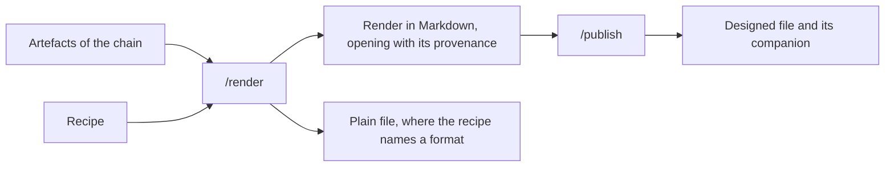

# Renders and recipes

A render is an output of a project that is made for one audience and
generated from the documents of the project's chain. A recipe is the
file that says how that render is made. This page explains what the
two are, how an output comes to be and why a render is generated
from its recipe and never edited by hand. It serves whoever uses the
forge, extends it or evaluates it.

## What it is

A render is an audience-specific output generated from the chain.
The chain is the set of versioned documents a project keeps: it
starts at a brief, its trunk is the intent, and below the intent the
project takes the layers it needs. A document of the chain is called
an artefact (see the [Glossary](../reference/glossary.md) for these
terms). A render can be, for example:

- a pitch for a group
- an architecture picture
- an executive summary
- the README of a repository

A render is never a source of truth. It assigns nothing and is not
part of the chain. The artefacts stay the sole source of truth.

A render is never edited by hand. What is iterated is its recipe
(`recipes/<recipe>.md`): one versioned file that says what the
render is made from, for whom and in what shape. The command
`/render <recipe>` regenerates the output from the recipe (see
[Render an output](../use/render-an-output.md)).

The boundary between the chain and a render is authorship, not
audience. An artefact of the chain is composed by the principal
(the person whose thinking is being forged): Claude proposes, the
principal composes. A render is generated from artefacts. An article
the principal writes is a layer of the chain. Its translation is a
render.

A recipe is a tool, not a record of thinking. It carries a version
and no status, and nobody receives it.

A page of the documentation is not a render. It is generated and
never composed by hand, as a render is. It is made from the
documentation map, which holds one entry per page, and not from a
recipe (see [The documentation](the-documentation.md)).

## How it works

An output comes to be in this order. The recipe names the artefacts
it reads. `/render` generates the render from them, in Markdown, and
the plain file where the recipe names a format. `/publish` makes the
designed file from the render.



### The recipe

A recipe is composed in conversation with the principal (see
[Compose a recipe](../use/compose-a-recipe.md)). Its header carries
these lines:

- `project`: the slug of the project.
- `purpose`: what the render is for.
- `audience`: whom the render is for.
- `version`: the version of the recipe.
- `output:` (optional): a path that replaces the default place of
  the render.
- `languages:` (optional): the languages the render is made in.

Its body has four sections:

- `Inputs`: the artefacts the render is generated from, by path, one
  per line. More than one input is legitimate. Another render may
  stand here as the source of a picture. A render cites no other
  render that is not named here.
- `Instructions`: everything the renderer must know beyond the
  template, such as the audience, the tone, what to emphasise and
  what to omit. The renderer is the run of the model that generates
  the render.
- `Format`: optional. It names the file that is made from the render
  and how it is made. It is never copied into the render.
- `Template`: the literal skeleton of the render, with placeholders.
  It is always Markdown.

A recipe is deliberately loose. Its template fixes the structure and
what information appears where, never the wording. A recipe of a
presentation says what belongs on a slide, not its phrasing or its
placement on a picture. Each rendering derives the words again from
the current inputs. Wording that must not move is pinned in the
recipe as fixed text, such as a title, a claim or a fixed line. What
is pinned regenerates word for word. Everything else is derived
freely.

A recipe carries a version in its header and no status. It stays at
0.x. The one exception is the principal's word: when he names an
integer, 1.0 or 2.0, the recipe takes it and the count goes on from
there, 2.1 and 2.2. Claude never proposes an integer. The number is
the principal's own mark and not an approval, and nothing guards or
reads it. Like every versioned document, a recipe keeps its history
in a file beside it. That file records what changed in the recipe.
The substantive turns live in the intent. The date of a recipe is
computed from its history, and a render cites the version.

The composition of a recipe may be guided by a genre: `/recipe
<genre>`. Each genre has one definition, which carries the checklist
of what to ask. Each genre has a template of its own, which extends
the base recipe template and never replaces it. The genres are:

- `presentation`: a deck defined slide by slide, whose render is
  turned into a PowerPoint file
- `readme`
- `release-notes`
- `screenplay` (see
  [The screenplay and its player](the-screenplay-and-its-player.md))
- `user-stories-export`

### Provenance and staleness

Every render opens with its provenance: it cites the recipe and
every input with their versions (see
[Render provenance](../reference/render-provenance.md)). A render
may serve as an input of another render, such as a slide of a deck
that cites an architecture picture. The citing recipe then declares
that render among its `Inputs`. Provenance and staleness follow the
dependency in this way.

The provenance is what staleness is read from. A render is stale
when its recipe or one of its inputs has moved on from the version
the provenance cites. Claude never regenerates a render on its own
judgement: it reports the staleness and offers. A render is
regenerated in two ways only:

- by `/release`, the command that makes a release of a project
- by the principal's explicit `/render`

Every `/release` regenerates the README and the release notes. Every
other render is as stale as the principal lets it be. No check
reports the staleness of a render, those two included. The state map
that `/forge` shows is where staleness is seen.

A `/release` that regenerated renders reports in its summary what
materially changed in them. The principal rules on that difference
before the release commit, without reading a full diff.

### Several languages

A recipe may declare several output languages in `languages:`. The
first is the primary language and the rest are its translations.
`/render` generates the primary render and, in the same run,
translates it into every other language, scene for scene and line
for line. The result is one render per language,
`renders/<recipe>.<lang>.md`. Each has its own provenance and its
own row in the Renders table of the ledger (the file that holds the
state of a project). A translation cites the primary render it was
made from. The file of a format follows the name of its render. A
recipe with one language keeps `renders/<recipe>.md`. A render may
be in any language its recipe declares.

### Markdown first, then the file

Everything the forge produces is Markdown, renders included. A
presentation is a `.md` file that says what is on each slide. A
picture is in the format its recipe names, which the principal
chooses recipe by recipe:

- mermaid: the picture is written inside the Markdown.
- `png`: the renderer draws the picture itself, in the run of the
  render. A render stands beside the picture and carries the
  provenance and a link to it. The recipe states the width in
  pixels, and the height follows the content. The recipe is the one
  source of the picture.

Further formats may be added.

The forge ends at content, and it carries the tools for the formats
of delivery at its edge. An output is made in two steps, each with
its own command, divided by cost:

1. `/render` generates the Markdown render and, where the recipe
   names a format, the plain file beside it. The conversion into the
   plain file is deterministic and cheap, and the step is repeated
   freely. For a plain file made through pandoc, the recipe states
   the reference file and the page size.
2. `/publish` makes the designed file through a model and its
   document skills, into `published/` (see
   [Publish a designed file](../use/publish-a-designed-file.md)).
   This step is expensive. It runs only on the principal's command.
   Neither `/render` nor `/release` runs it, and Claude never runs
   it on its own judgement. It makes a file and sends nothing
   anywhere. It takes the render as it lies on disk and never
   renders. A stale render is named before the conversion, and the
   decision is the principal's. The recipe states the template and
   the model for the designed file.

The formats a recipe may name:

| Format | The file is made by | Designed file |
|---|---|---|
| `pptx` | `/render` through pandoc, from the render of a deck | by `/publish` |
| `docx` | `/render` through pandoc | by `/publish` |
| `video` | `/render` through the screenplay script, `scripts/md2video.py` | none |
| `html-player` | `/render` through the same script, as the events the player plays | none |
| `png` | the renderer itself, in the run of the render | none |

A screenplay and a picture have no designed step. A recipe that
names no format ends at the Markdown. A plain file and a designed
file are tracked in git like any render output and are never edited
by hand. The Markdown render stays the source of truth: the
generated file is an output of second order, regenerated at will.
All other conversion of formats stays outside the forge.

### The principal's own files

The forge owns in `renders/` and `published/` only the files its
recipes name:

- the render and its translations
- the plain file
- the designed file and its companion (a file beside it)

Any other file there is the principal's own, made by hand from the
forge's files. Examples:

- a copy under a new name that he edits
- a PDF saved from Word or PowerPoint
- an HTML of a diagram

Such a file is kept in git beside the forge's files. It has no
companion, no row in the ledger and no check. The forge never reads
it, never overwrites it and never raises it. The forge's own file
stays untouched by hand. What is to change in it is copied first.

### The renders every project carries

Every project has a README. A thought project (a project with a
chain) also has release notes. Both are renders of the project's own
recipes, `recipes/readme.md` and `recipes/release-notes.md`, whose
`output:` is the root of the project. The two recipes are genres of
`/recipe`. `/new-project`, the command that creates a project,
scaffolds them, and the checks of `/check` expect them. Every
`/release` of the project regenerates both after its check. The
Renders table of the ledger carries them like any render. A library
(a project that has no intent) has a README only: a catalogue of
what it holds and how to use it, made from its ledger and its
indexes.

A README presents the project to someone who meets its repository
for the first time. It stands alone: no claim requires opening the
chain. Every claim can be derived from the inputs, nothing is
invented, and what the inputs have superseded does not survive. A
README carries:

- what the thing is
- what one gets
- how to start
- where it stands
- where the documentation is

It closes with a short section that says it is a render of
`recipes/readme.md`, regenerated at every release and never edited
by hand, and that fixes go into the recipe or the inputs. It keeps a
visible dated footer. The engine's own README has a recipe of its
own. In the forge's own project a change of the process is complete
only once the intent is updated and the README is rendered again.

Release notes are a log of releases, not a story. They hold one
section per release, newest first, with fixed groups in a fixed
order and one sentence per change from the reader's side. The
sections are derived at the release from the records of the
histories. One thing is never derived: what the reader must do is
written with the change, in the `Action` field of its record, and
the render carries it word for word.

A recipe's `output:` replaces the default place of the render,
`renders/<recipe>.md`. The path is read relative to the root of the
project. A leading slash means the root of the engine (see
[Projects and the engine](projects-and-the-engine.md)). The forge's
own project uses that form: its root renders (the engine's README,
release notes and CONTRIBUTING) land in the root of the engine.

## Why

**A render is generated and never edited by hand.** The artefacts
are the sole source of truth, and a render restates them for one
audience. `/render` overwrites the output freely, and each rendering
derives the words again from the current inputs. A fix of the
content therefore goes into the recipe or into the inputs, and the
file is regenerated.

**A recipe fixes the structure, never the wording.** Fixing the text
in the template would turn the recipe into the render and make the
inputs meaningless.

**A recipe has a version and no status.** Approval has a meaning
only where someone receives the document. A recipe is received by
nobody and is iterated continuously. An integer on a recipe is
therefore the principal's own mark and nothing more.

**A render is regenerated only by a release or on the principal's
command.** Regeneration is stochastic: the same inputs never
guarantee the same words. An unreviewed regeneration is therefore an
unreviewed edit of a document that faces outward. Two light defences
stand against that, and neither is a gate. The first is the wording
pinned in the recipe. The second is the summary of a release, which
says what materially changed.

**The translations are made in the run of the primary render.** The
quotes of a transcript, the beats and the captions are chosen once.
A second generation would choose them again differently. A
translation made in the same run keeps the same cut.

**An output is made in two steps.** The steps are divided by cost.
The purpose is that the expensive conversion runs as seldom as
possible. `/publish` never renders. A render is made by a model and
is never the same twice. A second render would publish a text the
principal has not read.

**The forge's own file is copied before it is changed.** The files
the forge makes stay untouched by hand. A file the principal wants
to change is therefore a copy, and the copy is his own. Why his own
files carry no companion, no row and no check: the reason is not
recorded.

**Renders are not regenerated at every save.** One shape was
considered and rejected: a save that regenerates only the renders
whose recipe or input moved in that save, with a mark in the ledger
for a render skipped on the principal's word. It would spare perhaps
a third of the saves of the engine and none of a project's. The
README of a project has the ledger among its inputs, and the ledger
moves at every operation. It would also add a state of staleness
that the save, `/forge` and the checks would all have to read alike.
The shape with two commands, in which a save regenerates nothing and
a release regenerates, spares everything and adds nothing.

**A page of the documentation has no recipe.** Making the
documentation as renders, with one recipe per page, was considered
and dropped. Eighty pages would mean eighty recipes to iterate by
hand. A recipe is a tool the principal shapes. A page is to come
from the documents of the project with no hand in between. The
documentation map replaces the recipes, with one generated entry per
page.

**Release notes are a log, not a story.** A reader wants to see
plainly what was added, changed and removed.

**A library has no release notes.** Release notes are derived from
the history of an intent, and a library has no intent. Its history
is git.

## A worked example

A project `my-project` wants a summary of its intent for a steering
group, in English and in German, as a Word document. Its recipe is
`recipes/summary.md`:

```markdown
---
project: my-project
purpose: summary for the steering group
audience: the steering group
version: 0.3
languages: en, de
---

# Recipe — summary for the steering group

<!-- Shape: templates/recipe.md -->

## Inputs
- 10-intent.md

## Instructions
- For readers who decide and do not read the chain: what is wanted,
  why, and what is asked of them.
- Plain and direct. One page.
- Omit how the intent was reached.

## Format
- Format: docx
- Plain file, made by `/render` through pandoc: reference none,
  page size A4.
- Published file, made by `/publish` through a model: template
  none, model <name>.

## Template
# <Project title>: summary

## What is wanted
<the objective, in two or three sentences>

## Why
<the reasons that carry the decision>

## What is asked of you
<one line per request>
```

`/render summary` generates `renders/summary.en.md` and, in the same
run, its translation `renders/summary.de.md`. Each opens with its
own provenance. The English render cites the recipe at 0.3 and the
intent at its version. The translation cites the English render it
was made from. Each render has its plain `.docx` beside it, named
after it. The wording differs from run to run. The three headings of
the template do not.

When the principal wants the designed document, `/publish` makes it
into `published/` from the render as it lies on disk. A change to
the summary goes into the recipe or into the intent, and the render
is regenerated. The recipe stays at 0.x through every such
iteration.

## See also

- [Compose a recipe](../use/compose-a-recipe.md): composing a
  recipe.
- [Render an output](../use/render-an-output.md): generating a
  render.
- [Publish a designed file](../use/publish-a-designed-file.md): the
  designed file.
- [The screenplay and its player](the-screenplay-and-its-player.md):
  the screenplay, its two formats and where a public one lands.
- [The work product](the-work-product.md): the output that is not a
  render.
- [Projects and the engine](projects-and-the-engine.md): the forge's
  own project, whose root renders land in the engine.
- [Render provenance](../reference/render-provenance.md): the
  provenance block and the definition of stale.
- [The documentation](the-documentation.md): the pages, generated
  without a recipe.
- [The security policy and the code of conduct](the-security-policy-and-the-code-of-conduct.md):
  the two fixed files of the root, which are no render either.
- [Glossary](../reference/glossary.md): every term of the forge in
  one line.

Generated on 2026-11-17 for version 7.12 from the files the front-matter names; never edited by hand.
