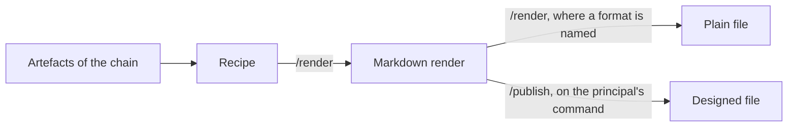

# Renders and recipes

A render is an output for one audience that Claude generates from the
documents of a project, and a recipe is the file that says how it is
made. This page explains what the two are, how an output travels from
a recipe to a finished file, and why a render is never edited by hand.
It is written for anyone who uses the forge, extends it or wants to
understand how it works.

## What it is

A project's thinking lives in its chain: the versioned documents
(called artefacts) that run from a brief through the intent to any
layers below it. The principal (the person whose thinking is being
forged) composes the chain together with Claude. Every term of this
kind is explained in one line in the [Glossary](../reference/glossary.md).

A **render** is an audience-specific output generated from the chain.
Examples are a pitch for a group, an architecture picture, an executive
summary or the README of a repository. A render assigns nothing.
A render is not part of the chain. The artefacts stay the one source of
truth.

A **recipe** is the file a render is made from, `recipes/<recipe>.md`.
It holds in one versioned file:

- the inputs: the artefacts the render is generated from, one or
  several;
- the audience and the purpose;
- the instructions: tone, emphasis, what to leave out, length;
- the format, optionally: which delivery file is made beside the
  Markdown;
- the template: the literal skeleton of the render, with placeholders.

The boundary between the chain and a render is authorship, not
audience. A chain artefact is composed by the principal. A render is
generated from artefacts. An article the principal writes is therefore
a layer of the chain, and its translation is a render.

A recipe is a tool, not a record of thinking. It carries a version and
no status, because a recipe is never approved. It stays at a version
below 1.0 for its whole life. Being versioned, it keeps its history in
a companion file beside it, like every versioned document of the forge.

Two outputs of a project are always renders. Every project has a README
made from its own `recipes/readme.md`. A thought project also has
release notes made from `recipes/release-notes.md`. A library (a
project of shared material with no chain) has a README only, which is a
catalogue of what it holds.

The documentation of a project is not a render. Its pages are
generated without a recipe, as [The documentation](the-documentation.md)
explains.

## How it works

### From a recipe to a render

A render is never edited by hand. What the principal iterates is its
recipe. The command `/render <recipe>` then regenerates the output from
it. [Render an output](../use/render-an-output.md) shows the job step by
step, and [Compose a recipe](../use/compose-a-recipe.md) shows how a
recipe is written.

Every render opens with its provenance: it cites the recipe and every
input, each with its version. The ledger (the file that holds the state
of a project) mirrors that provenance in its Renders table. A render
whose recipe or inputs have moved past the versions it cites is stale.
The exact block and the definition of stale are in
[Render provenance](../reference/render-provenance.md).

A recipe is loose on purpose. Its template fixes the structure and what
information appears where. It never fixes the wording: a presentation
recipe says what belongs on a slide, not how it is phrased. Each
rendering derives the words again from the current inputs. Where a
wording carries weight (a title, a claim, a fixed line), the recipe pins
it as fixed text. What is pinned is regenerated word for word, and
everything else is derived freely.

A render may serve as an input of another render. One example is a
slide of a deck that shows an architecture picture made by another
recipe. The citing recipe must then declare the other render among its
inputs.

### When a render is regenerated

A render is regenerated in two cases only:

- the principal runs `/render` explicitly;
- a `/release` regenerates it.

Claude never regenerates a render on its own judgement. It reports that
a render is stale and offers to regenerate it. Every `/release` of a
project regenerates its README and its release notes. Every other render
stays as stale as the principal lets it be. No check reports the
staleness of any render. The state map that `/forge` shows does.

A release that regenerated renders says in its summary what materially
changed in them. The principal rules on that change before the release
is committed, without reading a full comparison.

### Several languages

A recipe may declare several output languages in `languages:`. The
first language is the primary one, and the others are its translations.
`/render` generates the primary render and, in the same run, translates
it into every other language, scene for scene and line for line. Each
language gets its own render, `renders/<recipe>.<lang>.md`, with its own
provenance. A translation cites the primary render it was made from. A
recipe with one language keeps the single file `renders/<recipe>.md`.

### Two steps to a delivery file

Everything the forge produces is Markdown, renders included. A
presentation is a Markdown file saying what is on each slide. Where the
recipe's `## Format` section names a format, the output is made in two
steps, each with its own command:

1. `/render` generates the Markdown and the plain file beside it. A deck
   becomes a PowerPoint file and a document becomes a Word file, both
   through pandoc. A screenplay becomes a video, or the events its
   player plays, through `scripts/md2video.py`. This step is
   deterministic and cheap, and it can be repeated freely.
2. `/publish` makes the designed file through a model and its document
   skills, into `published/`. This step is expensive. It runs only on
   the principal's command, never by `/render`, never by `/release` and
   never on Claude's own judgement.
   [Publish a designed file](../use/publish-a-designed-file.md) shows the
   job.

A screenplay has no designed step and no published file.
[The screenplay and its player](the-screenplay-and-its-player.md)
explains its two formats and where a public one lands. A recipe that
names no format ends at the Markdown.

`/publish` takes the render as it lies on disk and never renders it
again. A stale render is named before the conversion, and the principal
decides. The ledger's Published table says what each published file was
made from and whether it is `current` or `stale`.

A plain file and a published file are kept in git like any render and
are never edited by hand. The Markdown render stays the source of truth.



### Recipes by genre

A recipe may be composed through a genre interview, `/recipe <genre>`.
Each genre has a definition carrying the questions to ask and a
skeleton, `templates/recipe-<genre>.md`. The skeleton extends the base
recipe shape and never replaces it. The genres are `presentation`,
`readme`, `release-notes` and `screenplay`. The README and the release
notes recipes are scaffolded by `/new-project`.

The readme genre owns what a README carries:

- what the thing is;
- what one gets;
- how to start;
- where it stands;
- where the documentation is.

A README stands alone for a reader who meets the repository for the
first time. Every claim in it can be derived from its inputs. It closes
with a short section saying that it is a render, regenerated at every
release and never edited by hand.

## Why

**The artefacts stay the one source of truth.** A render only restates
what the chain holds and assigns nothing. A content fix therefore goes
into the recipe or into the inputs, and the output is regenerated.

**The wording is not fixed in the recipe.** Fixing the text in the
template would turn the recipe into the render and make the inputs
meaningless.

**Regeneration is under the principal's eyes.** Regeneration is
stochastic: the same inputs never guarantee the same words. An
unreviewed regeneration is therefore an unreviewed edit of a document
that faces outward. Pinned wording and the release summary of what
changed are the two light defences. Neither of them blocks anything.

**The translations come from one generation.** The quotes of a
transcript, the beats and the captions are chosen once. A second
generation would choose them again differently. Translating the primary
render keeps the same cut in every language.

**The two steps are divided by cost.** The expensive conversion runs as
seldom as possible. `/publish` never makes a new render, because a
render is made by a model and is never the same twice. A second one
would publish a text the principal has not read.

**Release notes are a log, not a story.** A reader wants to see plainly
what was added, changed and removed.

**Rejected: rendering only what is stale at every save.** One command
that regenerated at a save only the renders whose recipe or input had
moved was considered and dropped. It would save little: on a project
the README's inputs move at every operation. It would also add a state
of staleness that several commands must all read alike. Two commands,
`/save` without rendering and `/release` with it, cover every case and
add nothing.

**Rejected: the documentation as renders.** A recipe per page of the
documentation was considered and dropped. Many pages would mean as many
recipes to iterate by hand. A recipe is a tool the principal shapes,
while a page is to come from the project's documents with no hand in
between. The documentation map, one generated entry per page, takes
the place of the recipes.

## A worked example

A generic recipe for an executive summary in two languages, in the shape
the recipe template defines. Every value is a placeholder.

```markdown
---
project: <slug>
purpose: executive summary
audience: <the readers of the summary>
version: 0.1
languages: en, de
---

# Recipe — executive summary

## Inputs
- 10-intent.md
- 20-assignment.md

## Instructions
Audience: <who reads it>. Tone: plain, direct. One page. Emphasise
<what matters most>; leave out <what must not appear>.

## Format
- Format: docx
- Plain file, made by `/render` through pandoc: reference none,
  page size A4.
- Published file, made by `/publish` through a model: template none,
  model <name>.

## Template
# <Project title>: executive summary
## The problem
## What is proposed
## What is asked of the reader
```

From this recipe, `/render` writes `renders/<recipe>.en.md` and its
German translation `renders/<recipe>.de.md`, each with its provenance,
and a Word file beside each. The designed Word file is made only when
the principal runs `/publish`.

## See also

- [Compose a recipe](../use/compose-a-recipe.md): composing a recipe.
- [Render an output](../use/render-an-output.md): generating a render.
- [Publish a designed file](../use/publish-a-designed-file.md): the
  designed file.
- [The screenplay and its player](the-screenplay-and-its-player.md):
  the screenplay, its two formats and where a public one lands.
- [The work product](the-work-product.md): the output that is not a
  render.
- [Render provenance](../reference/render-provenance.md): the
  provenance block and the definition of stale.
- [The documentation](the-documentation.md): the pages, generated
  without a recipe.
- [Glossary](../reference/glossary.md): every term of the forge in one
  line.

Generated on 2026-10-19 for version 5.26 from the files the
front-matter names; never edited by hand.
