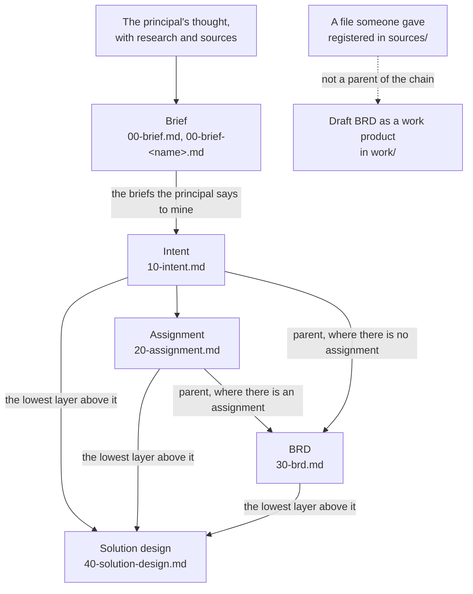

# The document chain

The document chain is the series of versioned documents a thought
travels in Forge of Thought, from the idea first put together
onward. This page explains how the chain is shaped, why it is a star
rather than a fixed line, and how it grows. It is for anyone who
uses the forge, extends it with a new layer or weighs whether its
design holds.

## What it is

The chain is made of artefacts.
An artefact is a document of the chain: versioned, and composed by
the principal (the person whose thinking is being forged) together
with Claude.

A chain starts at a brief.
Its trunk is the intent.
Below the intent a project takes the layers it needs.
No layer below the intent is a condition of another.
Many projects end at the intent.
A layer a project does not have is not missing: `/forge` and the
checks say nothing of it, and the ledger (the state of a project,
built from its documents) declares no end of the chain.

The artefacts of today's chain are these:

- the brief (`00-brief.md`, and later briefs `00-brief-<name>.md`):
  the principal's idea put together;
- the intent (`10-intent.md`): what the principal holds;
- the assignment (`20-assignment.md`): the intent carried to its
  recipients;
- the BRD (`30-brd.md`): the business requirements;
- the solution design (`40-solution-design.md`): how the things
  wanted are realised.

The chain ends where the project needs it to.
Nothing is implemented in the forge: it specifies.

## How it works

### One definition per artefact

Every artefact has a definition.
A definition is the artefact's state file,
`.claude/skills/forge/states/<state>.md`, and it stands beside the
artefact's template as a pair.
The definition says what the artefact is, how it is found (by
questions, research and sources) and which rules it keeps.
The template says what comes out.
What a definition is in full is explained on
[Elicitation](elicitation.md).

Which artefacts the forge has is the listing of that directory, one
definition each.
They are listed nowhere else.
The table of artefacts in the README is rendered from the
definitions.

### The chain is a star

Each definition declares its own inputs.
So the chain is a star, not a fixed line.
A new layer branches from any artefact by adding one definition that
names what it reads.

Work on an artefact is started by naming it: `/forge <state>`, such
as `/forge intent` or `/forge assignment`.
The command `/forge` is a dispatcher: it finds the definition of the
state named and follows it.
The dispatcher never changes when a layer is added.
Bare, `/forge` reports the state map of a project, including which
artefacts can be worked on from here and what is missing for the
others.

### The inputs of today's artefacts

Each arrow below is an input as the artefact's definition declares
it.

- **The brief** is made from the principal's thought, however it
  arrives.
  Research notes, sources and Claude's own proposals are gathered
  around it.
  The existing intent and the ledger are read only to know what
  already stands, never to shape the text.
- **The intent** is made from the briefs the principal says to mine,
  approved or not, with the decisions and the ledger.
  Sources enter only as the principal directs.
- **The assignment** is made from the intent, read with the
  project's threads (the open matters of the intent), and from the
  decisions and the ledger.
- **The BRD** has one parent, named by the principal.
  The parent is the assignment where the project has one.
  Where it has none, the parent is the intent, and no assignment is
  invented for it.
  A file someone gave (a transcript, an offer, someone else's
  document) is a third way in, but not a parent of the chain.
  It yields a draft BRD that is always a work product (an output
  with work of its own, kept in `work/`), never `30-brd.md`.
  The reason is that what someone said is never silently promoted to
  the principal's position.
- **The solution design** is made from the lowest layer the project
  has above it (the intent alone, the assignment or the BRD) and
  from whatever stands above that.

More on the first artefacts is on [The brief](the-brief.md),
[The intent](the-intent.md) and [The BRD](the-brd.md).
All definitions of today, one row each, are on
[Artefacts](../reference/artefacts.md).

### Files numbered in tens

Files in the chain are numbered in tens: `00-brief.md`,
`10-intent.md`, `20-assignment.md`, and so on.
The gaps leave room for a layer to be added between two others.
The number orders the files.
It prescribes no sequence: what an artefact reads is said by its
definition, not by its number.

### Substance changes go into the intent first

A change of substance goes into the intent first.
From there it propagates down the whole chain the project has: the
assignment, the BRD and the solution design are each brought to it.
Only wording is fixed in a lower layer directly.

A change may come from below.
When solving shows that what is wanted cannot be had, or must be
wanted differently, the intent changes first and the layers follow.
If the principal dictates substance straight into a lower layer, the
matching change of the intent is proposed in the same step.

### The chain never spans two principals

The recipients of an assignment may be teams, colleagues, or the
principal's future self.
What a recipient does with an assignment is his own run of the
forge, in his own instance (one installation of the forge).
There the assignment becomes his brief.
An assignment is self-contained for exactly that.
The layers below the assignment grow in the same project by the same
principal's hand, when he chooses to take his own thought further.

## Why

- **A star, not a line.**
  Knowing the name of the target artefact is knowing the command.
  So there is nothing to memorise as layers are added.
  A layer can branch from whichever artefact it needs, by one
  definition.
- **Growth without rework.**
  The chain grows by adding a layer's definition, without reworking
  anything that exists.
  The dispatcher stays as it is.
- **Numbers in tens.**
  Later layers can be added without renaming anything that exists.
- **No layer a condition of another.**
  Many projects end at the intent, where what is wanted needs no
  solution written down.
  A project takes only the layers it needs.
- **The listing of the definitions as the one list of artefacts.**
  The reason is not recorded.
- **Intent first.**
  The intent is the trunk that every lower layer is brought to.
  Why substance must enter there rather than in the layer where it
  was found, beyond that, is not recorded.
- **One principal per chain.**
  A recipient's work on an assignment is his own run of the forge,
  starting from his own brief.
  Why the boundary is drawn at the principal is not recorded beyond
  that.

## A worked example

A principal starts a project `<slug>`.

1. He works the brief with `/forge brief`.
   `00-brief.md` holds the idea put together.
2. He mines it with `/forge intent`.
   `10-intent.md` now holds what he holds.
3. The way to realise it is not obvious, so he goes straight to
   `/forge solution-design`.
   The project has no assignment and no BRD.
   The solution design reads the intent alone, because the intent is
   the lowest layer above it.
   Nothing is reported as missing.
4. Later he wants to hand part of the work to a team, and works
   `/forge assignment`.
   `20-assignment.md` takes its place in the gap between the intent
   and the solution design, and no file is renamed.
5. Solving shows that one wish cannot be had as stated.
   The intent changes first.
   The assignment and the solution design are then each brought to
   it.

An extender who adds a new kind of artefact writes one definition,
`.claude/skills/forge/states/<layer>.md`, that names the artefacts
it reads, with its template beside it.
From then on `/forge <layer>` works, and the dispatcher is unchanged.

## See also

- [The brief](the-brief.md): the first artefact.
- [The intent](the-intent.md): the trunk.
- [The BRD](the-brd.md): the business requirements below the
  assignment.
- [Elicitation](elicitation.md): what a definition is.
- [Artefacts](../reference/artefacts.md): the definitions of today,
  one row each.
- [Glossary](../reference/glossary.md): every term of the forge in
  one line.

Generated on 2026-10-25 for version 6.0 from the files the
front-matter names; never edited by hand.
