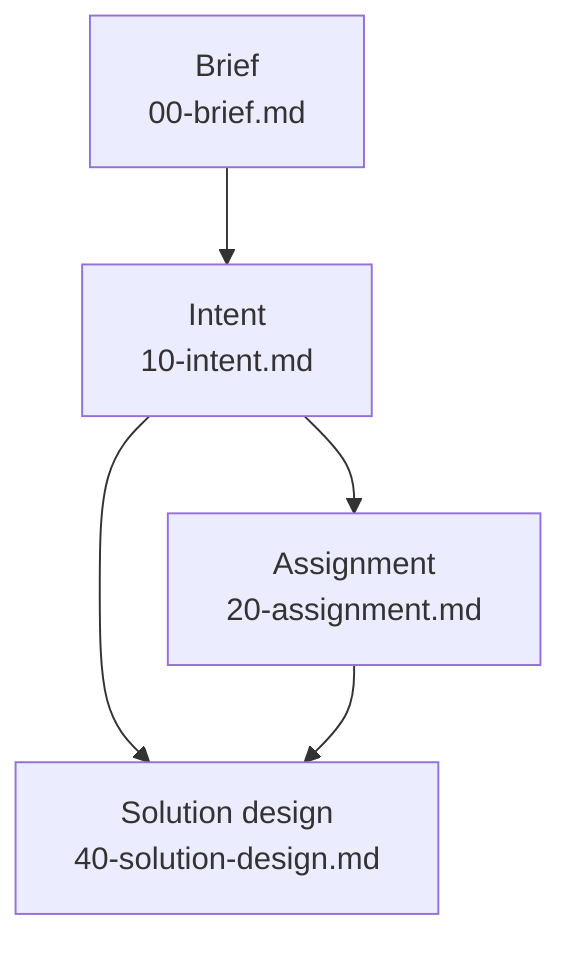

# The document chain

The document chain is the series of versioned documents a thought
travels in a project of the forge, from the idea put together onward.
This page explains how the chain is shaped, why it is a star of
definitions rather than a fixed line, and how it grows. It is for
anyone who uses the forge, extends it or weighs it up.

## What it is

The chain is made of artefacts, that is the versioned documents of a
project that the principal (the person whose thinking is forged)
composes with Claude. A chain starts at a brief
([The brief](the-brief.md)). Its trunk is the intent
([The intent](the-intent.md)). Below the intent a project takes the
layers it needs, and none of them is a condition of another. Many
projects end at the intent.

Every artefact of the chain has a definition. A definition is a file
`.claude/skills/forge/states/<state>.md` that says what the artefact
is, how it is found (by questions, research and sources) and which
rules hold for it ([Elicitation](elicitation.md)). It stands beside
the artefact's template as a pair: the definition says how the
artefact is found, the template says what comes out. Which artefacts
the forge has is the listing of that directory, one definition each.
They are listed nowhere else, and the table of artefacts in the
README is rendered from the definitions. The definitions of today
stand one row each in [Artefacts](../reference/artefacts.md).

The chain ends where the project needs it to. A layer a project does
not have is not missing: `/forge` and the checks say nothing of it.

## How it works

### Work is invoked by the name of the artefact

Work on an artefact is invoked by naming it: `/forge <state>`, such as
`/forge intent` or `/forge assignment`. The `/forge` command is a
dispatcher. It finds the definition of the named artefact, reads it
and follows it. Bare `/forge` reports the state map of the project,
and in it which artefacts can be worked on from here because their
inputs exist.

### Each definition declares its own inputs

The order of the chain is not written in one place. Each definition
declares its own inputs, so the chain is a star and not a fixed line.
The definitions of today declare these inputs among the artefacts:

- **Brief:** the principal's thought, however it arrives, with
  research notes, sources and Claude's own proposals gathered around
  it. The existing intent is read only to know what already stands,
  never to shape the text.
- **Intent:** the briefs the principal says to mine.
- **Assignment:** the intent.
- **Solution design:** the lowest layer the project has above it
  (the intent alone or the assignment), and whatever stands above
  that.

Beside the artefacts, the intent, the assignment and the solution
design also read `decisions.md` (the record of the principal's
decisions) and the ledger (the project's one record of state). The
intent is read with the project's open threads.

The diagram shows the artefacts of today's chain with their inputs
as the definitions declare them. An arrow points from an input to the
artefact that reads it.

The solution design reads the intent directly where the project has
no assignment. It reads the assignment, and the intent above it,
where the project has one.

### Files are numbered in tens

The files of the chain are numbered in tens: `00-brief.md`,
`10-intent.md`, `20-assignment.md`, `40-solution-design.md`. Later
briefs are `00-brief-<name>.md`. The number orders the files and
prescribes no sequence. Each versioned document keeps its history in
a companion `<file>.history.md` beside it.

### The chain grows by one definition

A new layer branches from any artefact by adding one definition that
declares its inputs. Nothing that exists is reworked. The dispatcher
never changes.

### Substance changes go into the intent first

A change of substance goes into the intent first and then propagates
down the whole chain the project has. Each lower layer is brought to
the intent. Only wording is fixed in a lower layer directly. The
change may come from below. When solving shows that what is wanted
cannot be had, or must be wanted differently, the intent changes
first and the layers follow. If the principal dictates substance
straight into a lower layer, Claude proposes the matching change of
the intent in the same step.

### The chain never spans two principals

The layers below the assignment grow in the same project, by the
same principal's hand, when he chooses to take his own thought
further. What a recipient does with an assignment in his own
instance (his own installation of the forge) is his own run of the
forge. There the assignment becomes his brief, by his own hand.

## Why

- **The star.** Knowing the name of the target artefact is knowing
  the command, so there is nothing to memorise as layers are added.
  A layer can branch from any artefact because each definition
  declares its own inputs.
- **The dispatcher that never changes.** The chain grows by adding a
  layer's definition, without reworking anything that exists.
- **Numbering in tens.** The gaps leave room for a layer to be added
  without renaming anything that exists.
- **No layer a condition of another.** Many projects end at the
  intent, where what is wanted needs no solution written down. A
  solution design is worth writing where the way is not obvious,
  where a choice has a price, or where two hands would solve the same
  matter differently if it were not written down. Whether it is
  written, the principal says.
- **The listing of the definitions directory.** The reason the
  artefacts are listed nowhere else is not recorded.
- **Intent first.** The reason substance goes into the intent before
  any lower layer is not recorded.
- **One principal per chain.** An assignment is self-contained so
  that a recipient can make it his own brief. The reason the chain
  itself never spans two principals is not recorded.

## A worked example

A project `<slug>` holds a brief and an intent. The principal wants
the way of realising it written down, but there is nobody to hand an
assignment to.

1. The project has `00-brief.md` and `10-intent.md`.
2. `/forge solution-design <slug>` works the solution design. Its
   definition reads the lowest layer the project has above it, which
   here is the intent alone.
3. The project now has `00-brief.md`, `10-intent.md` and
   `40-solution-design.md`. The project has no assignment, and that
   layer is not reported as missing.
4. Later the principal sees that the solution cannot give what the
   intent wants. The change goes into `10-intent.md` first, and the
   solution design is then brought to it.

Suppose someone extending the forge adds a new kind of artefact. It
is a hypothetical `<layer>`. They add one definition,
`.claude/skills/forge/states/<layer>.md`, with its template. The
definition declares which artefacts it reads, for example the
intent. Its file takes a free number in the tens, such as
`NN-<layer>.md`. From then on `/forge <layer>` works it. `/forge`
itself, the brief, the intent and every other definition stay as
they were.

## See also

- [The brief](the-brief.md): the first artefact.
- [The intent](the-intent.md): the trunk.
- [Elicitation](elicitation.md): what a definition is.
- [Artefacts](../reference/artefacts.md): the definitions of today,
  one row each.
- [Glossary](../reference/glossary.md): every term of the forge in
  one line.

Generated on 2026-10-19 for version 5.26 from the files the
front-matter names; never edited by hand.
