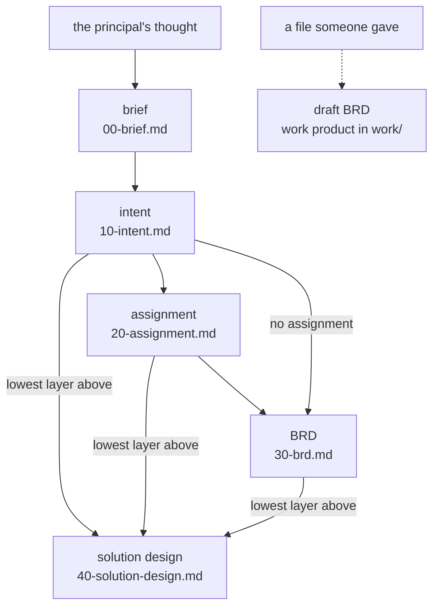

# The document chain

The document chain is the series of versioned documents an idea
travels in Forge of Thought, from the idea put together onward. This
page explains how the chain is shaped, why it is a star of
definitions rather than a fixed line, and how it grows. It is for
anyone who uses the forge, extends it or weighs it up.

## What it is

Every project of thought has a chain of artefacts. An artefact is a
document of the chain, composed by the principal (the person whose
thinking is being forged) with Claude. The chain ends where the
project needs it to.

- **The start.** A chain starts at a brief: the principal's own text
  of one whole of thinking. See [The brief](the-brief.md).
- **The trunk.** The intent is the trunk of every chain: what the
  principal currently holds, chiselled from the briefs. See
  [The intent](the-intent.md).
- **The layers below.** Below the intent, a project takes the layers
  it needs. None of them is a condition of another. Many projects
  end at the intent, where what is wanted needs no solution written
  down.

A layer a project does not have is not missing. The state map of the
project and the checks say nothing of it, and no end of the chain is
declared anywhere.

Each artefact has a definition: a file in
`.claude/skills/forge/states/`, paired with the artefact's template.
The definition says what the artefact is, how it is found and what
its inputs are; the template says what comes out. What a definition
holds in full is described in [Elicitation](elicitation.md). Which
artefacts the forge has is simply the listing of that directory, one
definition each. They are listed nowhere else. The table of artefacts
in the README is rendered from the definitions, and
[Artefacts](../reference/artefacts.md) gives today's definitions one
row each.

## How it works

### One command per target, one definition per artefact

You work on the chain by naming the artefact you want to work on:
`/forge intent`, `/forge assignment`, `/forge brd`. The command
`/forge` is a dispatcher. It finds the definition of the named
artefact and follows it. Everything specific to the artefact (its
inputs, its working rules) lives in that definition, so the
dispatcher itself never changes.

### The star

Each definition declares its own inputs. So the chain is a star, not
a fixed line: a new layer can branch from any existing artefact by
adding one definition. Nothing that exists has to be reworked for it.

Today's definitions declare these inputs:

- **Brief:** the principal's thought, however it arrives, with the
  research notes, sources and Claude's proposals gathered around it.
  The existing intent is read only to know what already stands.
- **Intent:** the briefs the principal says to mine, approved or
  not.
- **Assignment:** the intent.
- **BRD:** one parent, named by the principal. The parent is the
  assignment where the project has one, otherwise the intent. See
  [The BRD](the-brd.md).
- **Solution design:** the lowest layer the project has above it
  (the intent alone, the assignment or the BRD) and whatever stands
  above that.

A file someone else gave (a transcript, an offer, a document) is a
third way into a BRD, but it is not a parent in the chain. It yields
a draft BRD that is always a work product in `work/`, never the
chain's BRD. The reason is that what someone said is never silently
promoted to the principal's own position. Where the principal wants
that BRD in the chain, an intent is first made from the same source
and the BRD is then re-parented on it.

The diagram shows these arrows as the definitions declare them.
A dotted arrow is a way in that is not a parent of the chain.



The solution design takes exactly one of its three arrows: the one
from the lowest layer the project has above it.

### Numbering in tens

The files of the chain are numbered in tens: `00-brief.md`,
`10-intent.md`, `20-assignment.md`, `30-brd.md`,
`40-solution-design.md`. Later briefs are `00-brief-<name>.md`. The
gaps leave room for a layer to be added later without renaming
anything that exists. The number orders the files. It prescribes no
sequence of work: the inputs of each artefact are what its
definition says, not what the number suggests.

### Changes of substance go into the intent first

A change of substance goes into the intent first. From there it
propagates down the whole chain the project has: the assignment, the
BRD and the solution design are each brought in line with it. Only
wording is fixed directly in a lower layer.

A change may also come from below. When solving shows that what is
wanted cannot be had, or must be wanted differently, the intent
still changes first and the layers follow. If the principal dictates
substance straight into a lower layer, Claude proposes the matching
change of the intent in the same step.

### One principal per chain

The chain never spans two principals. The layers below the
assignment grow in the same project, by the same principal's hand,
when he chooses to take his own thought further. What a recipient
does with an assignment handed to him is his own run of the forge,
in his own installation: the assignment becomes his brief. An
assignment is written to be self-contained for exactly that.

## Why

- **A star, not a line.** Knowing the name of the target artefact is
  knowing the command. Nothing has to be memorised as layers are
  added, and a new layer branches from any artefact by adding one
  definition, with the dispatcher left as it is.
- **The listing of one directory.** Which artefacts exist is said in
  one place, the directory of definitions, and nowhere else. The
  reason for listing them nowhere else is not recorded beyond the
  README table being rendered from them.
- **Layers only as needed.** A project takes the layers it needs
  because many ideas need no solution written down. A solution
  design is worth writing where the way is not obvious, where a
  choice has a price, or where two hands would solve the same matter
  differently if it were not written down. Whether a project has one
  is the principal's decision.
- **Numbering in tens.** The gaps let a layer be added without
  renaming anything that exists. The BRD and the solution design
  were both added this way.
- **Intent first.** The intent is the trunk from which every layer is
  derived. The reason for routing every change of substance through
  it, beyond that, is not recorded.
- **One principal.** Others act on an assignment in their own run of
  the forge, so the chain stays the thinking of the one principal
  whose project it is.
- **Growth on demand.** The engine is meant to keep extending
  downward, as far as thoughts need to be taken. The mechanics of a
  new layer are designed when that layer is actually taken up, not
  in advance.

## A worked example

A project `example-project` starts with one brief:

```
projects/example-project/
  00-brief.md
```

The principal mines it into the intent with `/forge intent`. The
idea needs no assignment and no BRD, but the way to realise it is not
obvious, so he asks for a solution design. Its definition takes the
lowest layer above it, which here is the intent alone:

```
projects/example-project/
  00-brief.md
  10-intent.md
  40-solution-design.md
```

Later the principal decides to hand part of the work to a team and
writes an assignment with `/forge assignment`. It takes the free
number `20`, and nothing existing is renamed:

```
projects/example-project/
  00-brief.md
  10-intent.md
  20-assignment.md
  40-solution-design.md
```

The solution design now has a lower layer above it, the assignment,
which becomes its input. When the principal changes his mind on a
matter of substance, he changes `10-intent.md` first, and the
assignment and the solution design are brought in line with it.

## See also

- [The brief](the-brief.md): the first artefact.
- [The intent](the-intent.md): the trunk.
- [The BRD](the-brd.md): the business requirements below the
  assignment.
- [Elicitation](elicitation.md): what a definition is.
- [Artefacts](../reference/artefacts.md): the definitions of today,
  one row each.
- [Glossary](../reference/glossary.md): every term of the forge in
  one line.

Generated on 2026-10-25 for version 6.1 from the files the
front-matter names; never edited by hand.
