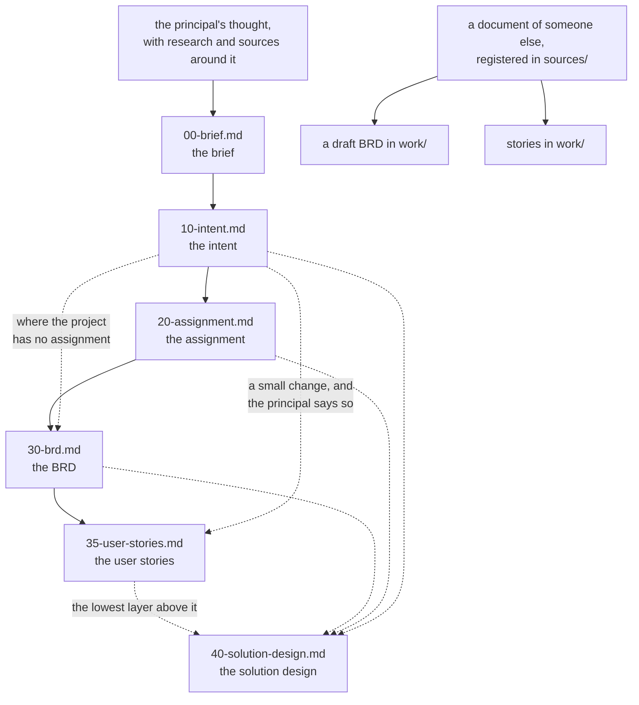

# The document chain

The document chain is the row of versioned documents an idea travels
in Forge of Thought, from the brief that puts it together to whatever
layer the project needs below the intent. This page explains what the
chain is, how its layers hang together, how it grows and why it is
built as a star of definitions rather than a fixed line. It is for
the user who works a project along the chain, for the extender who
adds a layer to it, and for the evaluator who wants to know what
holds the chain together.

## What it is

Any idea, whatever its subject, travels a chain of versioned
documents from the moment it is put together, under isolated
adversarial review. The documents of the chain are its
[artefacts](../reference/glossary.md). "Artefact" is the forge's
word for these documents alone; every other file of a project is a
document of another kind.

The principal (the one whose thinking is forged, who supplies the
ideas, the answers and the decisions and has the final authority on
all content) composes every artefact together with Claude. Claude
owns the structure, the order and the hygiene of the documents. It
proposes and never decides.

A chain starts at a brief and its trunk is the intent. The brief is
the principal's thought put together, however it arrives
([The brief](the-brief.md)). The intent chisels the briefs into what
the principal holds: positions, facts, open threads and rejected
directions with the reason each was dropped
([The intent](the-intent.md)). Below the intent a project takes the
layers it needs, and many projects end at the intent. The layers the
forge has today below the intent are these:

- the assignment: it carries the in-scope substance of the intent to
  its recipients, complete and precise, so that they can act on it
  without the principal in the room;
- the BRD, the business requirements document: it breaks its parent
  into rules, behaviour and qualities ([The BRD](the-brd.md));
- the user stories: they break their parent into behaviour seen from
  the outside ([The user stories](the-user-stories.md));
- the solution design: it says how the things wanted are realised,
  as the solution stands today.

No layer below the intent is a condition of another. A layer a
project does not have is not missing: the state map of `/forge`, the
checks and the ledger (the project's state report, made at read time
from its documents and never kept in git) say nothing of it, and the
ledger declares no end of the chain.

Beside the artefacts stand the records. Every artefact keeps its
history in an append-only companion `<file>.history.md`; the
principal's decisions are appended to `decisions.md`; `ledger.md` is
the single source of truth for state. A [render](../reference/glossary.md)
is generated from the chain and is not part of it: the artefacts stay
the source of truth. The boundary between chain and render is
authorship: a chain artefact is composed by the principal, a render
is generated from artefacts.

## How it works

### Every artefact has a definition

Every artefact of the chain has a definition: its state file
`.claude/skills/forge/states/<state>.md`, paired with the artefact's
template. The definition says what the artefact is and how it is
found, by questions, research and sources, and it owns the
artefact's rules; the template says what comes out. What a
definition is and how it is worked is said on
[Elicitation](elicitation.md).

Which artefacts the forge has is the listing of that directory, one
definition each. They are listed nowhere else. The table of
artefacts in the README is rendered from the definitions, and
[Artefacts](../reference/artefacts.md) gives the definitions of
today, one row each.

### The chain is a star

Work on the chain is invoked by target state, never by verb:
`/forge <state>`, such as `/forge intent` or `/forge assignment`.
The command resolves the definition of the state named, reads it and
follows it. If no such definition exists, it lists the states that
do and stops.

Each definition declares its own inputs. So the chain is a star, not
a fixed line: every layer hangs from the artefact its definition
names, and a new layer branches from any artefact by adding one
definition. The dispatcher, the `/forge` command itself, never
changes.

The diagram shows the artefacts of today's chain with their inputs
as the definitions declare them. A solid arrow is the input the
definition names first; a dotted arrow is an input the definition
allows instead, under the condition on the arrow. Every dotted arrow
into the solution design is the same rule: the lowest layer the
project has above it. The outside documents at the right are not
parents of the chain; what they yield is said below the diagram.



The arrows, one definition at a time:

- The brief takes the principal's thought, however it arrives, and
  around it what was gathered during the elicitation: research
  notes, sources and Claude's own proposals. The existing intent and
  the ledger are read only to know what already stands, never to
  shape the text.
- The intent takes the briefs the principal says to mine, approved
  or not, with the decisions and the ledger; sources only as the
  principal directs. The intent as it stands is read with the
  project's threads.
- The assignment takes the intent, read with the project's threads,
  the decisions and the ledger.
- The BRD takes one parent, named by the principal when he asks for
  it. The parent is the assignment, read with the intent and the
  threads for the reasons the assignment does not carry; the parent
  of an item is then a requirement of the assignment. Where the
  project has no assignment, the parent is the intent with the
  threads; the parent of an item is then a position, and no
  assignment is invented for it.
- The user stories take one parent, named by the principal. The
  parent is the BRD, read with the layers above it for the reasons it
  does not carry. Where the change is small, the ask precise and
  without further impact, and the principal says so, the parent is
  the intent with the threads. Whether the ask suffices is the
  principal's word, never Claude's; Claude may say why it thinks it
  does not.
- The solution design takes the lowest layer the project has above
  it, the intent alone, the assignment, the BRD or the user stories,
  and whatever stands above that, with the decisions and the ledger.
  Where the thing already exists, what realises it is read as it
  stands.

A file the principal puts in from outside is a third way in, not a
parent of the chain: a transcript, an offer, a document of someone
else, a requirements document of someone else. Registered through
`/ingest` and cited by path, it yields a draft BRD or a set of
stories that is always a work product in `work/`, never the chain's
`30-brd.md` or `35-user-stories.md`; each item cites its place in
the source. Where the principal wants such a BRD in the chain, an
intent is handed over from the same source first and the BRD is
re-parented on it.

### The files are numbered in tens

The files of the chain are numbered: `00-brief.md`, `10-intent.md`,
`20-assignment.md`, `30-brd.md`, `35-user-stories.md`,
`40-solution-design.md`. The gaps of ten leave room for a layer to
be added without renaming anything that exists; the user stories
took a place inside the gap between the BRD and the solution design.
The number orders the files and prescribes no sequence: which
artefact feeds which is said by the definitions, not by the numbers.

### How the chain grows

The chain grows by adding a layer's definition, without reworking
anything that exists. The mechanics of a layer (its commands, its
agents, the calibration of its reviewers) are designed when that
layer is taken up, not in advance. Which layers are added, and in
what order, is open.

The layers below the assignment grow in the same project, by the
same principal's hand, when he chooses to take his own thought
further: a BRD as his next layer, not as someone else's deliverable.
The chain never spans two principals. What a recipient does with an
assignment in his own instance (his own installation of the forge)
is his own run of the forge: the assignment becomes his brief, by
his hand. An assignment is self-contained for exactly that.

### Substance changes go into the intent first

Substance changes go into the intent first and then propagate down
the whole chain the project has: the assignment, the BRD, the
solution design are each brought to it. Only wording is fixed in a
lower layer directly. The change may come from below. When solving
shows that what is wanted cannot be had, or must be wanted
differently, the intent changes first and the layers follow. If the
principal dictates substance straight into a lower layer, Claude
proposes the corresponding intent update in the same step.

Feedback from recipients has no channel of its own. The principal
processes it and feeds the conclusions back through `/forge intent`.

## Why

The chain ends where the project needs it to, because nothing is
implemented here: the engine specifies. Many projects end at the
intent, where what is wanted needs no solution written down. A
solution design is worth writing where the way is not obvious, where
a choice has a price, or where two hands would solve the same matter
differently if it were not written down; whether it is written, the
principal says. From the artefacts of the chain the thing must be
buildable without a look at the finished product: the product is
what is built, never a source of its own design. How deep the chain
must go for that is the project's own matter: the solution design
gives the architecture, a technical specification the detail where
the one who builds needs it.

The chain is a star so that a future layer branches from any
artefact by adding one definition, with the dispatcher unchanged.
Work is invoked by target state so that knowing the name of the
target artefact is knowing the command, with nothing to memorise as
layers are added.

The files are numbered in tens so that later layers can be added
without renaming anything that exists.

A document of someone else yields a work product and never a chain
artefact, because what someone said is never silently promoted to
the principal's position.

Why a change of substance goes into the intent first, rather than
into the layer where it was found, is not recorded in the inputs of
this page. Why the chain never spans two principals is not recorded
either; what is recorded is the mechanism, the assignment becoming
the recipient's brief in his own run.

## A worked example

A project with the placeholder slug `example` starts with the
principal's thought put together as a brief, `00-brief.md`. Through
`/forge intent` Claude mines the brief with him into `10-intent.md`:
positions, facts, threads and rejections. The project now looks like
this:

```
projects/example/
  00-brief.md
  00-brief.history.md
  10-intent.md
  10-intent.history.md
  threads/
  decisions.md
  ledger.md
```

The project ends here for now. What is wanted needs no solution
written down, and nothing reports an assignment as missing: the
state map of `/forge` and the checks say nothing of a layer the
project does not have.

Later the principal wants the way written down, because a choice has
a price. He asks for `/forge solution-design`. The definition of the
solution design names as its input the lowest layer the project has
above it; here that is the intent alone, so `40-solution-design.md`
is derived from `10-intent.md` read with its threads, and no
assignment and no BRD is invented in between. The listing now holds
`40-solution-design.md` with its history companion beside it, and
the gap between `10` and `40` stays open.

While the design is worked, solving shows that one thing wanted
cannot be had as it was wanted. The change does not land in the
solution design: the intent changes first, in a round the principal
confirms, and the solution design follows it.

Had the principal instead handed the thing to a team, he would have
asked for `/forge assignment`, and `20-assignment.md` would have
been derived from the intent. What the team did with it would be
its own run of the forge in its own instance, the assignment its
brief; the chain of `example` would end at the assignment.

## See also

- [The brief](the-brief.md): the first artefact.
- [The intent](the-intent.md): the trunk.
- [The BRD](the-brd.md): the business requirements below the
  assignment.
- [The user stories](the-user-stories.md): the stories below the BRD.
- [Elicitation](elicitation.md): what a definition is.
- [Artefacts](../reference/artefacts.md): the definitions of today,
  one row each.
- [Glossary](../reference/glossary.md): every term of the forge in
  one line.

Generated on 2026-11-08 for version 6.21 from the files the
front-matter names; never edited by hand.
