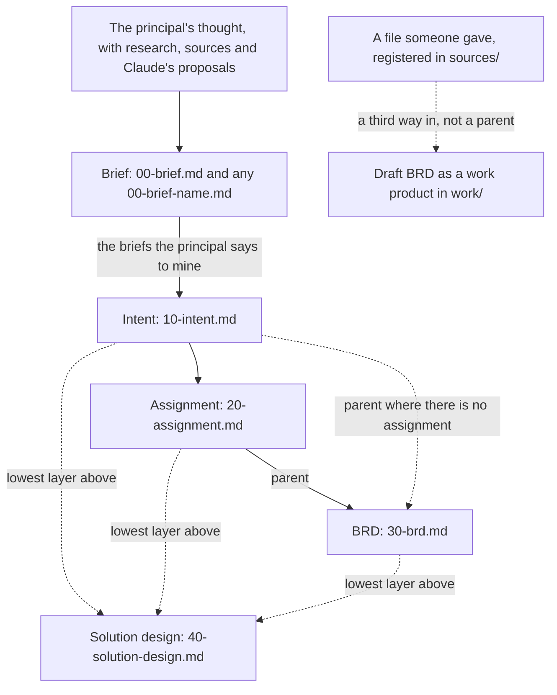

# The document chain

The document chain is the set of versioned documents that one idea
travels through in a project, from a brief down to whatever layer the
project needs. This page explains how the chain is shaped, why it is
a star of definitions rather than a fixed line, and how it grows. It
is for anyone who uses the forge, extends it or weighs it up.

## What it is

The chain belongs to one principal (the person whose thinking is
being forged, with final authority over its content). Each document
of the chain is called an artefact. Every artefact is versioned and
keeps its history beside it.

The chain has a fixed start and a fixed trunk:

- **The brief** is where the chain starts: the principal's own text
  of what he wants and why. See [The brief](the-brief.md).
- **The intent** is the trunk: the positions the principal holds,
  chiselled out of the briefs. See [The intent](the-intent.md).

Below the intent a project takes the layers it needs. No layer below
the intent is a condition of another. Many projects end at the
intent. A layer a project does not have is not missing: the state
map of `/forge` and the checks say nothing of it.

The chain ends where the project needs it to. Nothing is implemented
in the forge: the chain specifies what is wanted and, where the
project takes that layer, how it is realised.

## How it works

### Every artefact has a definition

Every artefact of the chain has a definition (see
[Elicitation](elicitation.md)). The definition is the file
`.claude/skills/forge/states/<state>.md`, paired with the artefact's
template. The definition says what the artefact is, how it is found
and which inputs it is made from. The template says what comes out.

Which artefacts the forge has is the listing of the definitions
directory, one definition per artefact. They are listed nowhere
else. The table of artefacts in the README is rendered from the
definitions. [Artefacts](../reference/artefacts.md) lists the
definitions of today, one row each.

### The chain is a star

Each definition declares its own inputs. So the chain is a star, not
a fixed line. A new layer can branch from any artefact by adding one
definition, without reworking anything that exists.

Work on the chain is invoked by the name of the target artefact:
`/forge <state>`, such as `/forge intent` or `/forge assignment`.
The `/forge` command is a dispatcher. It finds the definition for
the state named and follows it. The dispatcher never changes when a
layer is added. Called bare, `/forge` reports the state map of the
project, including which artefacts can be worked on from here and
which cannot yet, and what is missing for them.

### The chain of today

The diagram shows the artefacts that exist today, with the inputs
each definition declares. A solid arrow is the usual parent. A
dashed arrow is an alternative parent or a way in from outside the
chain.

The inputs, as each definition declares them:

- **Brief**: the principal's thought, however it arrives. Around it:
  research notes, sources and Claude's own proposals. The existing
  intent and the ledger (the project's single source of truth for
  state, made at read time) are read only to know what already
  stands.
- **Intent**: the briefs the principal says to mine, approved or
  not, with the decisions and the ledger. Sources are read only as
  the principal directs.
- **Assignment**: the intent, with the decisions and the ledger.
- **BRD**: one parent, named by the principal. The parent is the
  assignment where there is one, otherwise the intent. A file
  someone else gave (a transcript, an offer, a document) is a third
  way in. It yields a draft BRD that is always a work product, never
  the chain's BRD. See [The BRD](the-brd.md).
- **Solution design**: the lowest layer the project has above it
  (the intent alone, the assignment or the BRD) and whatever stands
  above that.

### Files numbered in tens

The files of the chain are numbered in tens: `00-brief.md`,
`10-intent.md`, `20-assignment.md`, `30-brd.md`,
`40-solution-design.md`. A gap of ten leaves room for a layer to be
added without renumbering. The number in a file name orders the
files. It prescribes no sequence: which artefact is made from which
is what the definitions say.

### Substance goes into the intent first

A change of substance goes into the intent first. From there it
propagates down the whole chain the project has. Only wording is
fixed in a lower layer directly.

A change may also come from below. When solving shows that what is
wanted cannot be had, or must be wanted differently, the intent
changes first and the layers follow. If the principal dictates
substance straight into a lower layer, the matching change to the
intent is proposed in the same step.

### One chain, one principal

The chain never spans two principals. Layers below the assignment
grow in the same project, by the same principal's hand, when he
chooses to take his own thought further. What a recipient does with
an assignment handed to him is his own run of the forge. In that run
the assignment becomes his brief. An assignment is self-contained so
that it can serve as such a brief.

## Why

- **A star rather than a line.** Knowing the name of the target
  artefact is knowing the command. Nothing has to be memorised as
  layers are added. A future layer branches from any artefact by
  adding one definition, so the dispatcher never has to change.
- **Layers taken as needed.** Many projects end at the intent,
  because what is wanted there needs no solution written down. A
  solution design is worth writing where the way is not obvious,
  where a choice has a price, or where two hands would solve the
  same matter differently if it were not written down. Whether it is
  written is the principal's call.
- **Numbering in tens.** Later layers can be added without renaming
  anything that exists.
- **The listing of the definitions as the only list of artefacts.**
  The reason is not recorded.
- **Substance in the intent first.** The reason is not recorded.
- **One principal per chain.** The reason is not recorded. What is
  recorded is the consequence: a recipient continues in a run of his
  own, from the assignment as his brief.

## A worked example

A principal opens the project `example-project` and writes
`00-brief.md`. He mines it with `/forge intent`, and `10-intent.md`
holds his positions.

For a while the project ends there. The state map reports the brief
and the intent and says nothing of an assignment, a BRD or a
solution design, because a layer the project does not have is not
missing.

Later the principal wants the way of realisation written down, but
hands nothing to recipients. He runs `/forge solution-design`. Its
definition takes the lowest layer above it, which here is the intent
alone. The project now holds `00-brief.md`, `10-intent.md` and
`40-solution-design.md`. The gap at 20 and 30 is not a defect.

While solving, the principal finds that one thing he wanted cannot
be had as stated. The intent is changed first. The solution design
is then brought to the new intent.

## See also

- [The brief](the-brief.md): the first artefact.
- [The intent](the-intent.md): the trunk.
- [The BRD](the-brd.md): the business requirements below the
  assignment.
- [Elicitation](elicitation.md): what a definition is.
- [Artefacts](../reference/artefacts.md): the definitions of today,
  one row each.
- [Glossary](../reference/glossary.md): every term of the forge in
  one line.

Generated on 2026-11-01 for version 6.4 from the files the front-matter names; never edited by hand.
