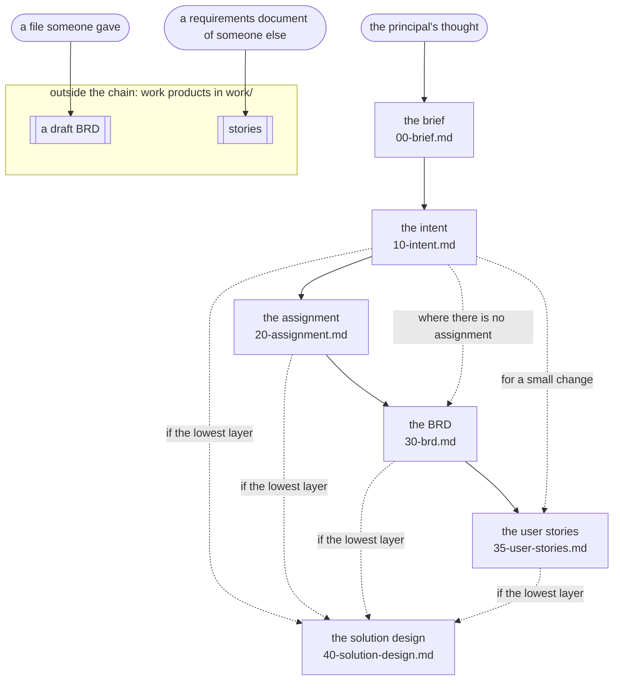

# The document chain

The document chain is the series of versioned documents an idea
travels in Forge of Thought, from the brief that puts the idea together
down to as many layers as the project needs. This page explains what
the chain is made of, why it has the shape of a star and how it grows
by one definition at a time. It is written for whoever uses the forge,
extends it or weighs it.

## What it is

Any idea travels a chain of versioned documents, from the idea put
together onward. A document of the chain is an
[artefact](../reference/glossary.md). An artefact is composed by the
principal (the person whose thinking is being forged). A document
generated from the artefacts is not part of the chain.

The chain starts at a [brief](the-brief.md), which puts the idea
together. The [intent](the-intent.md) is the artefact every layer below
is made from, directly or through the layers between: it is the trunk
of the chain. Below the intent a project takes the layers it needs.
None is a condition of another. A layer a project does not have is not
missing. Many projects end at the intent. The chain ends where the
project needs it to.

Nothing is implemented in the forge: it specifies.

Every artefact has a [definition](elicitation.md): a file
`.claude/skills/forge/states/<state>.md`, paired with the artefact's
template. The definition says what the artefact is and how it is found,
by questions, research and sources. It owns the rules of the artefact.
The template says what comes out.

Which artefacts the forge has is the listing of that directory, one
definition each. They are listed nowhere else: the table of artefacts
in the README is rendered from the definitions. The page
[Artefacts](../reference/artefacts.md) shows the definitions of today,
one row each.

## How it works

### Each definition names its own inputs

Work on the chain is invoked by its target, never by a verb. The
command `/forge <state>` works the artefact whose definition has that
name, such as `/forge intent` or `/forge assignment`. The command finds
the definition, reads it and follows it. Where no definition of that
name exists, it lists the ones that do and stops.

The definition declares the target file, its inputs and its working
rules. What is the same for every artefact is said once for all of
them, such as that the first version of a file is created from its
template as version 0.1. A definition names only what is its own.

Each definition declares its own inputs, so no artefact has a fixed
place in a line. The chain is a star: a layer may branch from any
artefact.

Typed alone, `/forge` reports which artefacts of the project exist,
each at its version and status. It says which artefacts can be worked
on from here, that is those whose inputs exist. For the others it says
what is missing. A layer the project does not have is not reported as
missing. The report recommends the natural next step. The
recommendation is never a gate.

### The chain of today

The diagram shows the artefacts the forge has today, each with the
inputs its definition declares.



A solid arrow is the parent a definition names first. A dashed arrow is
another parent the definition allows, in the case its label names. An
artefact has one parent at a time: of the arrows that enter the BRD,
the user stories or the solution design, one holds in a given project.

The arrows, read one artefact at a time:

- The brief (`00-brief.md`): made from the principal's thought, however
  it arrives. Research notes, sources and Claude's own proposals are
  gathered around it. An intent that already exists is read only to
  know what already stands, never to shape the text.
- The intent (`10-intent.md`): made from the briefs the principal names
  (`00-brief.md` and any `00-brief-<name>.md`), approved or not.
- The [assignment](../reference/glossary.md) (`20-assignment.md`): made
  from the intent. Its recipients may be teams, colleagues or the
  principal's future self.
- The [BRD](the-brd.md) (`30-brd.md`, the business requirements): made
  from one parent, which the principal names. The parent is the
  assignment, read with the intent for the reasons the assignment does
  not carry. Where the project has no assignment, the parent is the
  intent, and no assignment is invented for it.
- The [user stories](the-user-stories.md) (`35-user-stories.md`): made
  from one parent, which the principal names. The parent is the BRD,
  read with the layers above it. The parent is the intent where the
  change is small, the ask is precise and without further impact, and
  the principal says so. Whether the ask suffices is the principal's
  word. Claude may say why it thinks the ask does not suffice.
- The [solution design](../reference/glossary.md)
  (`40-solution-design.md`): says how the things wanted are realised.
  It is made from the lowest layer the project has above it and
  whatever stands above that. The lowest layer is the intent alone, the
  assignment, the BRD or the user stories.

Beside its parent, every definition from the intent down reads the
decisions of the project (`decisions.md`) and its ledger (the state of
the project, made each time it is read). Where a definition names
sources or research, they are read as the principal directs.

Two inputs yield a document outside the chain. A file the principal
puts in, such as a transcript, an offer or a document of someone else,
is not a parent of the chain. Registered through `/ingest` and cited by
path, it yields a draft BRD that is always a
[work product](../reference/glossary.md) in `work/`, never `30-brd.md`.
Where the principal wants that BRD in the chain, an intent is made from
the same source first, and the BRD is then given that intent as its
parent. A requirements document of someone else yields stories in the
same way: a work product in `work/`, never `35-user-stories.md`.

### How it grows

The chain grows by adding the definition of a layer, without reworking
anything that exists. The new definition declares the artefact it
branches from, which may be any artefact of the chain. The `/forge`
command does not change: the new target is worked under its own name.

The files are numbered in tens. The gaps leave room for a layer to be
added without renumbering and without renaming anything that exists:
`35-user-stories.md` stands in the gap between `30-brd.md` and
`40-solution-design.md`. The number in a file name orders the files and
prescribes no sequence of work.

Which layers are added next, and in what order, is open. The mechanics
of a layer, such as its commands and its agents, are designed when the
layer is taken up, not in advance.

A new kind of artefact is added by one command, `/new-artefact <name>`,
described on the page
[Add an artefact](../extend/add-an-artefact.md).

### Where a change goes

A change of substance goes into the intent first. From there it
propagates down the whole chain the project has: each lower layer is
brought to it. Only wording is fixed in a lower layer directly.

The change may come from below. When solving shows that what is wanted
cannot be had, or must be wanted differently, the intent changes first
and the layers follow. If the principal dictates substance straight
into a lower layer, the corresponding update of the intent is proposed
in the same step.

Feedback from the recipients of an assignment has no channel of its
own. The principal processes it and feeds the conclusions back through
`/forge intent`.

### One chain, one principal

The chain never spans two principals. The layers below the assignment
grow in the same project, by the same principal's hand, when the
principal chooses to take the thought further.

What a recipient does with an assignment is the recipient's own run of
the forge, in the recipient's own instance (one installation of the
forge). There the assignment becomes a brief, by the recipient's hand.
An assignment is self-contained for exactly that.

## Why

**Why each definition declares its own inputs.** A future layer can
branch from any artefact by adding one definition. Nothing that exists
is reworked, and the command that works the chain never changes.

**Why work is invoked by its target.** Knowing the name of the target
artefact is knowing the command. Nothing is to be memorised as layers
are added.

**Why the files are numbered in tens.** A later layer can be added
without renaming anything that exists.

**Why no layer is a condition of another.** A thought is forged as far
as the principal needs it taken. Many projects end at the intent, where
what is wanted needs no solution written down. The solution design
shows the kind of judgement. It is worth writing in three cases:

- where the way is not obvious;
- where a choice has a price;
- where two people would solve the same matter differently if it were
  not written down.

Whether it is written, the principal says.

**Why a file someone gave yields a work product.** What someone said is
never silently promoted to the principal's own position. When the
content of a source does enter the intent, that is the principal's
explicit act, cited with its provenance.

**Why the chain has one principal.** A layer below the assignment is
the principal's own thought taken further: a BRD is the principal's
next layer, not someone else's deliverable.

**Why substance goes into the intent first.** The reason is not
recorded.

## A worked example

A principal has an idea for changing how a team takes in requests. The
slug of the project is `my-project`.

The idea is put together in a brief (`00-brief.md`). The intent
(`10-intent.md`) is made from it. Had the principal needed nothing
more, the chain would end here and nothing would be missing.

The principal wants business requirements and has no use for an
assignment. The BRD is asked for with `/forge brd my-project`, and the
principal names the intent as its parent. `30-brd.md` is made from
`10-intent.md`. No assignment is invented. `/forge` typed alone does
not report an assignment as missing.

The way to realise the change is not obvious, so the principal asks for
a solution design with `/forge solution-design my-project`. Its
definition takes the lowest layer the project has above it (here the
BRD) and reads the intent above that. The project now holds four
artefacts:

```
00-brief.md
10-intent.md
30-brd.md
40-solution-design.md
```

The numbers 20 and 35 stay free. The files stand in order, and no
sequence was prescribed.

While the design is worked, it shows that one thing the intent wants
cannot be had as written. The intent is changed first, through
`/forge intent my-project`. The BRD and the solution design are then
brought to it.

A requirements document of someone else arrives. Registered through
`/ingest`, it yields stories that are a work product in `work/`. The
project still has no `35-user-stories.md`, and its chain holds only
what the principal composed.

If a definition of a further layer is added to the forge later,
`my-project` takes that layer or leaves it. None of its files is
renamed either way.

## See also

- [The brief](the-brief.md): the first artefact.
- [The intent](the-intent.md): the trunk.
- [The BRD](the-brd.md): the business requirements below the
  assignment.
- [The user stories](the-user-stories.md): the stories below the BRD.
- [Elicitation](elicitation.md): what a definition is.
- [Add an artefact](../extend/add-an-artefact.md): adding a kind of
  artefact with `/new-artefact`.
- [Artefacts](../reference/artefacts.md): the definitions of today,
  one row each.
- [Glossary](../reference/glossary.md): every term of the forge in one
  line.

Generated on 2026-11-17 for version 7.12 from the files the
front-matter names; never edited by hand.
