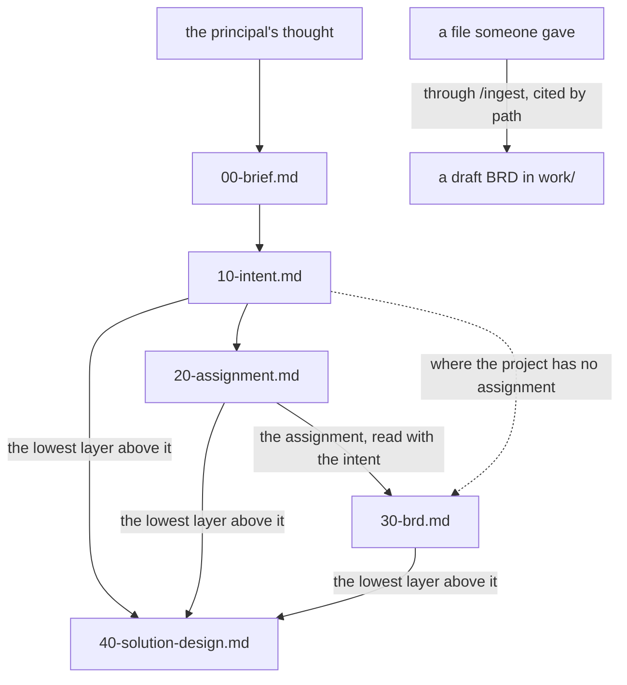

# The document chain

The document chain is the series of versioned documents through
which an idea travels in Forge of Thought, from the idea put together
to as far as the project needs it taken. This page explains what the
chain is, why it is a star of definitions rather than a fixed line,
and how it grows. It is for anyone who works a project in the forge,
anyone who wants to add a layer to it, and anyone who evaluates how
the forge is built.

## What it is

The chain is a sequence of artefacts, the documents of the chain,
each a versioned file in the project's root. The one whose thinking
is forged is called the principal: he supplies the ideas, the answers
and the decisions, and he is the final authority on everything the
chain says. Claude, the machine beside him, owns the structure, the
order and the discipline of the process; it proposes and never
decides.

A chain starts at a brief and its trunk is the intent. The
[brief](the-brief.md) is the principal's text of one whole of
thinking, thrown in rough on purpose. The [intent](the-intent.md)
chisels the briefs into what the principal holds: positions, facts,
open threads and rejected directions. Below the intent a project takes
the layers it needs, and many end at the intent. The layers the forge
has today, below the intent, are these:

- the assignment: the in-scope substance of the intent, carried to
  the recipients so that they can act on it without the principal in
  the room;
- the [BRD](the-brd.md): the business requirements below the
  assignment, or below the intent where the project has no
  assignment;
- the solution design: how the things wanted are realised, read by
  whoever realises the solution.

None of these layers is a condition of another. A layer a project
does not have is not missing: the state map (`/forge`) and the checks
say nothing of it, and the ledger, the project's state report made at
read time, declares no end of the chain.

Every artefact has a definition: one file in
`.claude/skills/forge/states/`, worked through `/forge <state>` and
paired with the artefact's template. What a definition is and how it
drives the conversation is the matter of [Elicitation](elicitation.md).
The definition says what the artefact is, how it is found (by
questions, research and sources) and owns its rules; the template says
what comes out. Which artefacts the forge has is the listing of that
directory, one definition each. They are listed nowhere else; the
table of artefacts in the README is rendered from the definitions, and
the page [Artefacts](../reference/artefacts.md) gives them one row
each.

The files of the chain are numbered in tens:

```
00-brief.md            the brief (later briefs: 00-brief-<name>.md)
10-intent.md           the intent, the trunk
20-assignment.md       the assignment
30-brd.md              the BRD
40-solution-design.md  the solution design
<file>.history.md      the history of each versioned document,
                       an append-only companion beside it
```

The number in a file name orders the files and prescribes no
sequence. Nothing is implemented in the chain; the engine specifies.
The chain travels under isolated adversarial review, and the
recipients of an assignment may be teams, colleagues or the
principal's future self.

## How it works

Work on the chain is invoked by target state, never by verb:
`/forge intent`, `/forge assignment`, `/forge brd`. Knowing the name
of the target artefact is knowing the command. The `/forge` command
is only a dispatcher: it resolves the definition of the state it was
given, reads it and follows it. The definition declares the target
artefact, its inputs and its working rules. The dispatcher never
changes.

Because each definition declares its own inputs, the chain is a star,
not a fixed line. The definitions of today declare these inputs:

- The brief takes the principal's thought, however it arrives. Around
  it, gathered during the elicitation, stand research notes, sources
  and Claude's own proposals. The existing intent and the ledger are
  read only to know what already stands, never to shape the text.
- The intent takes the briefs the principal says to mine, approved or
  not, with the decisions, the ledger, and sources only as the
  principal directs. The intent as it stands is read with the
  project's threads.
- The assignment takes the intent, the decisions and the ledger; the
  intent is read with the threads.
- The BRD takes one parent, named by the principal when he asks for
  the BRD: the assignment, read with the intent and the threads, or
  the intent with the threads where the project has no assignment. No
  assignment is invented for it.
- The solution design takes the lowest layer the project has above
  it, the intent alone, the assignment or the BRD, and whatever stands
  above that; with the decisions and the ledger, and the threads
  beside the intent.

A file someone gave, such as a transcript, an offer or a document of
someone else, is a third way into a BRD. It is not a parent of the
chain. Registered through `/ingest` and cited by path, it yields a
draft BRD that is always a work product in `work/`, never
`30-brd.md`. Where the principal wants that BRD in the chain, an
intent is handed over from the same source first and the BRD is
re-parented on it.

The diagram shows the artefacts of today's chain with their inputs
as the definitions declare them. An arrow points from an input to
the artefact made from it.



The chain grows by adding a layer's definition, without reworking
anything that exists. A future layer branches from any artefact by
adding one definition that names that artefact among its inputs. The
gaps of ten in the numbering leave room for it without renumbering.
Which layers are added, and in what order, is open; the mechanics of
a layer are designed when that layer is actually taken up, not in
advance. The layers below the assignment grow in the same project, by
the same principal's hand, when he chooses to take his own thought
further.

Substance changes go into the intent first and propagate from there
down the whole chain the project has: the assignment, the BRD and the
solution design are each brought to it. Only wording is fixed in a
lower layer directly. The change may come from below. When solving
shows that what is wanted cannot be had, or must be wanted
differently, the intent changes first and the layers follow. If the
principal dictates substance straight into a lower layer, Claude
proposes the corresponding intent update in the same step.

The chain never spans two principals. What a recipient does with an
assignment in his own instance (his own installation of the forge) is
his own forge run: the assignment becomes his brief, by his hand. An
assignment is self-contained for exactly that.

## Why

The files are numbered in tens so that later layers can be added
without renaming anything that exists.

The chain is a star so that a future layer can branch from any
artefact by adding one definition, and so that nothing has to be
memorised as layers are added: the name of the target artefact is the
command, and the dispatcher stays as it is.

No layer below the intent is a condition of another, because a
project takes the layers it needs, and many end at the intent, where
what is wanted needs no solution written down. The solution design is
worth writing where the way is not obvious, where a choice has a
price, or where two hands would solve the same matter differently if
it were not written down; whether it is written, the principal says.
From the artefacts of the chain the thing must be buildable without a
look at the finished product, and how deep the chain must go for that
is the project's own matter.

A BRD drafted from a file someone gave is a work product and not an
artefact of the chain, because what someone said is never silently
promoted to the principal's position.

Why substance changes go into the intent first, beyond the fact that
the lower layers are derived from it, is not recorded. Why the chain
never spans two principals is not recorded either; the inputs state
the rule and the way a recipient continues, his own forge run from
the assignment as his brief.

## A worked example

A project with the slug `my-project` starts with one brief. The
principal and Claude mine it into the intent, and the project's root
holds these artefacts:

```
projects/my-project/
  00-brief.md
  10-intent.md
```

The project may end here. Nothing reports an assignment as missing,
and `/forge` offers the states that can be worked from what exists.

Later the principal decides to hand the work to a team. He runs
`/forge assignment my-project`; the dispatcher resolves the
assignment's definition, which names the intent, the decisions and
the ledger as its inputs, and `20-assignment.md` is composed from the
intent. When the team needs business requirements, `/forge brd
my-project` composes `30-brd.md` with the assignment as its parent.

Another project, `my-tool`, needs no recipients. Its principal runs
`/forge solution-design my-tool` straight after the intent. The
solution design's definition names the lowest layer above it, here
the intent alone, and `40-solution-design.md` is composed from it:

```
projects/my-tool/
  00-brief.md
  10-intent.md
  40-solution-design.md
```

The gap between `10` and `40` is not a hole. It is the room the
numbering leaves for a layer the project did not need.

## See also

- [The brief](the-brief.md): the first artefact.
- [The intent](the-intent.md): the trunk.
- [The BRD](the-brd.md): the business requirements below the
  assignment.
- [Elicitation](elicitation.md): what a definition is.
- [Artefacts](../reference/artefacts.md): the definitions of today,
  one row each.
- [Glossary](../reference/glossary.md): every term of the forge in
  one line.

Generated on 2026-11-01 for version 6.8 from the files the
front-matter names; never edited by hand.
