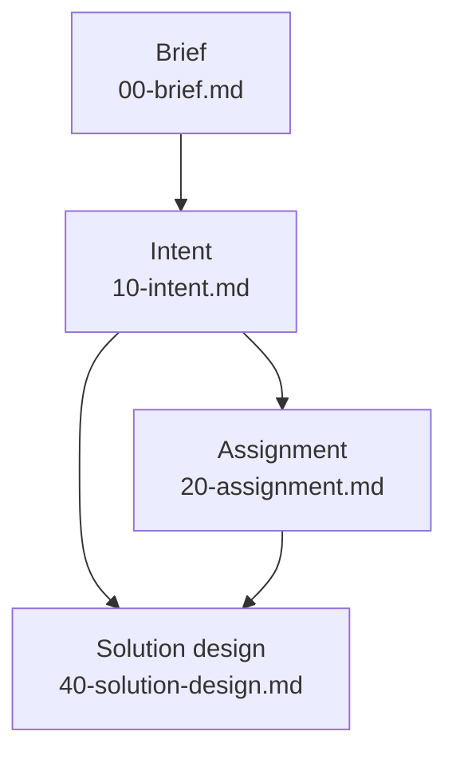

# The document chain

The document chain is the series of versioned documents a thought
travels in Forge of Thought, from the idea first put together onward.
This page explains how the chain is shaped, why it is a star of
definitions rather than a fixed line, and how it grows. It is for
anyone who uses the forge, extends it or evaluates it.

## What it is

Each document of the chain is an artefact. Every artefact belongs to
the principal (the person whose thinking is being forged, who has the
final word on all content). Claude works each artefact with the
principal.

A chain starts at a brief: the principal's rough text of one whole of
thinking (see [The brief](the-brief.md)). Its trunk is the intent:
what the principal currently holds, chiselled out of the briefs (see
[The intent](the-intent.md)).

Below the intent, a project takes the layers it needs. No layer below
the intent is a condition of another. Many projects end at the
intent. A layer a project does not have is not missing: the state map
of `/forge` and the checks say nothing of it, and the ledger (the
project's state report, made from its documents when it is read; see
the [Glossary](../reference/glossary.md)) declares no end of the
chain.

The artefacts of the chain today are these:

- `00-brief.md` (and later briefs `00-brief-<name>.md`): the first
  artefact.
- `10-intent.md`: the trunk.
- `20-assignment.md`: the in-scope substance of the intent, carried to
  the recipients.
- `40-solution-design.md`: how the things wanted are realised.

[Artefacts](../reference/artefacts.md) lists them one row each.

## How it works

### One definition per artefact

Every artefact of the chain has a definition. A definition is a
file `.claude/skills/forge/states/<state>.md`, paired with the
artefact's template. The definition says what the artefact is and
how it is found (by questions, research and sources), and it owns the
artefact's rules. The template says what comes out. How a definition
guides the conversation is explained in [Elicitation](elicitation.md).

Which artefacts the forge has is the listing of that directory, one
definition each. They are listed nowhere else. The table of artefacts
in the README is rendered from the definitions.

### Work by target, not by verb

Work on an artefact is called by its name: `/forge <state>`, such as
`/forge intent` or `/forge assignment`. The command finds the
definition of that name, reads it and follows it. If no definition of
that name exists, it lists the ones that do and stops. Bare `/forge`
reports the state map of the project: which artefacts exist, which
can be worked on from here because their inputs exist, and which
cannot yet.

### A star, not a line

Each definition declares its own inputs. The command that dispatches
the work (`.claude/skills/forge/SKILL.md`) therefore holds no order of
layers and never changes. A new layer branches from any artefact by
adding one definition. In the forge's own image, the chain is a star,
not a fixed line.

The arrows below are the inputs the definitions of today declare. Each
arrow points from an input to the artefact that reads it.



What each definition declares:

- **Brief:** the principal's thought, however it arrives, with
  research notes, sources and Claude's own proposals gathered around
  it. The existing intent and the ledger are read only to know what
  already stands, never to shape the text.
- **Intent:** the briefs the principal says to mine, `decisions.md`
  and the ledger; sources only as the principal directs. The intent
  as it stands is read with the project's threads (`threads/`).
- **Assignment:** `10-intent.md`, read with its threads,
  `decisions.md` and the ledger.
- **Solution design:** the lowest layer the project has above it
  (the intent alone or the assignment) and whatever stands above
  that; `decisions.md` and the ledger. Where the thing already
  exists, what realises it is read as it stands. Research and sources
  as the principal directs.

The solution design takes the intent directly where a project has no
assignment. That is the star at work: the solution design branches
from whichever layer stands above it.

### Files numbered in tens

The files of the chain are numbered in tens: `00-brief.md`,
`10-intent.md`, `20-assignment.md`, `40-solution-design.md`. The gaps
leave room for a layer to be added without renumbering. The number
orders the files and prescribes no sequence. Beside each versioned
document lies its history, `<file>.history.md`, an append-only
companion. Beside the chain lie `decisions.md` (append-only decision
records) and `ledger.md`.

### Substance changes go into the intent first

A change of substance goes into the intent first. From there it
propagates down the whole chain the project has: each lower layer is
brought to it. Only wording is fixed in a lower layer directly.

A change may come from below. When solving shows that what is wanted
cannot be had, or must be wanted differently, the intent changes
first and the layers follow. If the principal dictates substance
straight into a lower layer, Claude proposes the matching change of
the intent in the same step.

### One principal per chain

The chain never spans two principals. The layers below the intent
grow in the same project, by the same principal's hand, when he
chooses to take his own thought further.

An assignment may be handed to recipients. What a recipient does with
it in his own instance of the forge is his own run: the assignment
becomes his brief, by his own hand. An assignment is self-contained
for exactly that.

## Why

- **A star, so that nothing has to be memorised.** Knowing the name of
  the target artefact is knowing the command. Nothing new has to be
  learnt as layers are added.
- **One definition per layer, so that growth reworks nothing.** The
  chain grows by adding a layer's definition, without reworking
  anything that exists. The dispatcher never changes because each
  definition carries its own inputs.
- **Numbers in tens, so that nothing is renamed.** Later layers are
  added without renaming anything that exists.
- **No layer a condition of another, because many projects need
  none.** Many projects end at the intent, where what is wanted needs
  no solution written down. A solution design is worth writing where
  the way is not obvious, where a choice has a price, or where two
  hands would solve the same matter differently if it were not written
  down. Whether it is written, the principal says.
- **The listing of definitions as the one list.** The artefacts are
  listed nowhere else, and the README's table is rendered from them.
  The reason is not recorded.
- **Intent first.** The rule is stated, but the reason it is the
  intent rather than any other layer that takes a change first is not
  recorded.
- **One principal per chain.** A recipient's work on an assignment is
  his own run of the forge, starting from his own brief. Beyond that,
  the reason is not recorded.

## A worked example

A project `example-slug` begins with `00-brief.md`. The principal mines
it into `10-intent.md`. Bare `/forge example-slug` now reports the
brief and the intent, and names the assignment and the solution design
as workable, because their inputs exist.

The principal decides the idea needs no recipients but does need its
way written down. He runs `/forge solution-design example-slug`. The
solution design reads the intent directly, since it is the lowest
layer above it, and is written as `40-solution-design.md`. The project
now holds:

```
00-brief.md
10-intent.md
40-solution-design.md
```

No `20-assignment.md` exists, and nothing reports it as missing.

Later, solving shows that one wanted thing cannot be had. The
principal changes the intent first. The solution design is then
brought to the new intent.

An extender who wants a new kind of layer writes one definition,
`.claude/skills/forge/states/<layer>.md`, with its template, and
gives its file a free number in tens, `NN-<layer>.md`. The definition
declares which artefacts it reads. `/forge <layer>` works at once, and
nothing that exists is renamed or rewritten.

## See also

- [The brief](the-brief.md): the first artefact.
- [The intent](the-intent.md): the trunk.
- [Elicitation](elicitation.md): what a definition is.
- [Artefacts](../reference/artefacts.md): the definitions of today, one row each.
- [Glossary](../reference/glossary.md): every term of the forge in one line.

Generated on 2026-10-23 for version 5.34 from the files the front-matter names; never edited by hand.
