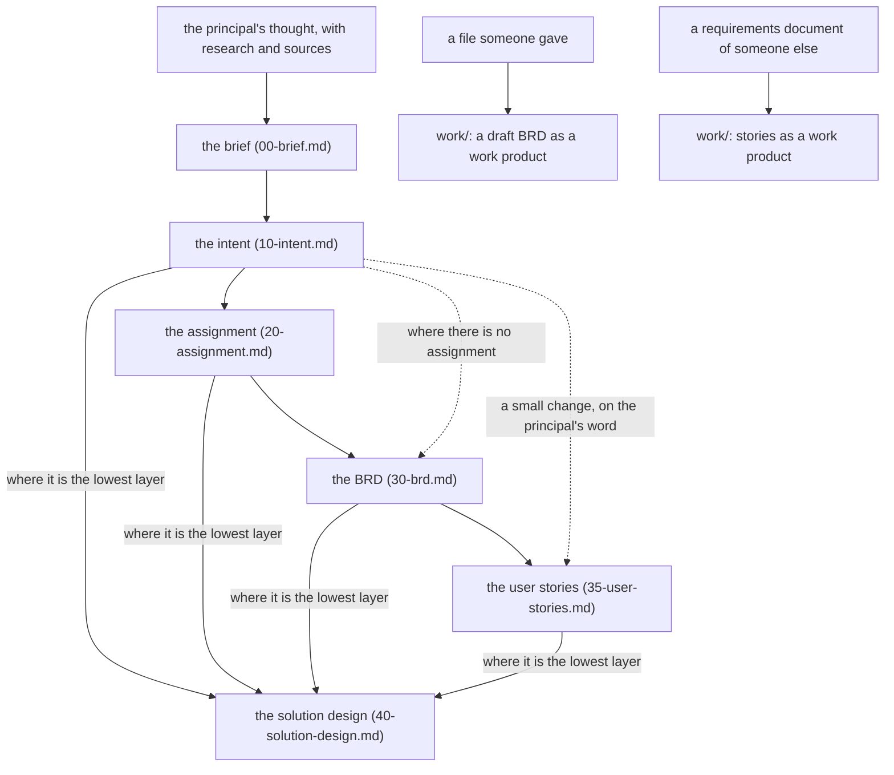

# The document chain

The document chain is the row of versioned documents through which
an idea travels in the forge, from the first text the principal
(the person whose thinking is forged) puts together down to however
far the project needs it taken. This page explains what the chain
is, why it is built as a star of definitions rather than a fixed
line, and how it grows. It is for anyone who works a project, anyone
who wants to extend the forge by a layer, and anyone judging whether
the shape holds together.

## What it is

A project's chain starts at a [brief](the-brief.md) and its trunk is
the [intent](the-intent.md). Below the intent a project takes the
layers it needs. Today those layers are the assignment, the
[BRD](the-brd.md), the [user stories](the-user-stories.md) and the
solution design. No layer below the intent is a condition of
another. Many projects end at the intent.

Every artefact of the chain has a definition, that is the file that
says what the artefact is, how it is found by questions, research
and sources, and what rules it owns; what a definition is and how it
is worked is explained in [Elicitation](elicitation.md). Each
definition is paired with the artefact's template, which says what
comes out. An artefact is worked through `/forge <state>`, where the
state is the name of the artefact.

Which artefacts the forge has is the listing of the definitions
directory, `.claude/skills/forge/states/`, one definition each. They
are listed nowhere else. The table of artefacts in the README is
rendered from the definitions, and the reference page
[Artefacts](../reference/artefacts.md) gives one row per definition
of today.

The files of the chain are numbered in tens: `00-brief.md`,
`10-intent.md`, `20-assignment.md`, `30-brd.md`, `40-solution-design.md`.
The number orders the files and prescribes no sequence. A layer
added later takes a free number in a gap, as the user stories took
`35-user-stories.md` between the BRD and the solution design.

A layer a project does not have is not missing. The state map of
`/forge`, the checks and the ledger (the project's state, made at
read time from its documents) say nothing of it, and the ledger
declares no end of the chain.

## How it works

`/forge` is a dispatcher. Bare, it reports the state map of the
project: which artefacts exist, at what version and status, and
which target states can be worked on from here because their inputs
exist. With a state name, it resolves the definition of that
artefact and follows it. The dispatcher itself never changes when a
layer is added.

That is what makes the chain a star rather than a line. Each
definition declares its own inputs. The chain is not a fixed order
of layers that every project walks; it is a set of artefacts, each
knowing what it is derived from. A new layer branches from any
artefact by adding one definition that names that artefact among
its inputs. Nothing that exists is reworked.

The inputs the definitions of today declare are these.

- The brief is made from the principal's thought, however it
  arrives, with the research notes, the sources and Claude's own
  proposals gathered around it. The existing intent and the ledger
  are read only to know what already stands.
- The intent is made from the briefs the principal says to mine, the
  first brief and any later one, approved or not. The decisions, the
  ledger and the project's threads (the open matters of the intent)
  are read with it; sources only as the principal directs.
- The assignment is made from the intent, read with the threads, the
  decisions and the ledger.
- The BRD has one parent, named by the principal when he asks for
  it: the assignment, read with the intent and the threads for the
  reasons the assignment does not carry; or the intent with the
  threads, where the project has no assignment. No assignment is
  invented for it.
- The user stories have one parent likewise: the BRD, read with the
  layers above it; or the intent with the threads, where the change
  is small, the ask precise and without further impact, and the
  principal says so.
- The solution design is made from the lowest layer the project has
  above it, the intent alone, the assignment, the BRD or the user
  stories, and whatever stands above that.

A file someone else gave, such as a transcript, an offer or a
requirements document, is a third way into a BRD or into stories.
It is not a parent of the chain. Registered through `/ingest` and
cited by path, it yields a draft that is always a work product in
`work/` (an output of the project with a specification of its own:
[Glossary](../reference/glossary.md)), never the chain's `30-brd.md`
or `35-user-stories.md`. Where the principal wants such a BRD in the
chain, an intent is handed over from the same source first and the
BRD is re-parented on it.

The diagram shows the artefacts of today and their inputs as the
definitions declare them. Solid arrows are the usual parent; dotted
arrows are the parent where the usual one is absent or the change is
small; the two boxes at the foot are work products, not artefacts.

Substance changes go into the intent first and propagate down the
whole chain the project has: the assignment, the BRD, the solution
design are each brought to it. Only wording is fixed in a lower layer
directly. The change may come from below. When solving shows that
what is wanted cannot be had, or must be wanted differently, the
intent changes first and the layers follow. If the principal dictates
substance straight into a lower layer, Claude proposes the matching
change of the intent in the same step.

A new kind of artefact is added to the forge by one command,
`/new-artefact <name>`, so that the chain grows without anyone having
to know by heart what a kind of artefact is made of; how that is done
is [Add an artefact](../extend/add-an-artefact.md).

The chain never spans two principals. What a recipient does with an
assignment handed to him is his own run of the forge: the assignment
becomes his brief, in his own instance, by his own hand. The
assignment is self-contained for exactly that.

## Why

The files are numbered in tens so that later layers can be added
without renaming anything that exists. The gaps of ten are the room
for a layer between two others.

The chain is a star because each definition declares its own inputs.
Work on the chain is invoked by target state, never by verb: knowing
the name of the target artefact is knowing the command, with nothing
to memorise as layers are added. A future layer branches from any
artefact by adding one definition, and the dispatcher stays as it
is.

No layer below the intent is a condition of another because a
project takes the layers it needs. Many end at the intent, where
what is wanted needs no solution written down. The forge is meant
to be extended downward as far as the principal needs a thought
taken, and the mechanics of a layer are designed when that layer is
taken up, not in advance.

Substance changes go into the intent first because the lower layers
are derived from it: the assignment carries the intent's in-scope
substance, and each layer below names the layer above among its
inputs. Why wording alone may be fixed in a lower layer directly is
not recorded in the inputs of this page.

A document someone else gave yields a work product and not an
artefact of the chain because what someone said is never silently
promoted to the principal's position.

The chain never spans two principals because the layers below the
assignment grow in the same project, by the same principal's hand,
when he chooses to take his own thought further; a recipient's work
on an assignment is his own forge run, with the assignment as his
brief.

Why the artefacts are listed nowhere but in the definitions
directory is not recorded in the inputs of this page.

## A worked example

A principal starts a project with the placeholder slug `my-project`.
He writes a brief, `00-brief.md`, and mines it into the intent,
`10-intent.md`, through `/forge intent`. The intent is complete for
now when no thread blocks the next layer.

He decides the project needs no assignment: nobody is handed the
work but himself. He asks for a BRD and names the intent as its
parent; `/forge brd` reads `10-intent.md` with the threads, and each
business rule cites the position it carries. The project now has
`00-brief.md`, `10-intent.md` and `30-brd.md`, and the gap at `20`
stays empty. The state map does not report an assignment as
missing.

Later he wants the way written down and asks for a solution design.
`/forge solution-design` takes the lowest layer the project has above
it, here the BRD, and whatever stands above that, and writes
`40-solution-design.md`. Had the project ended at the intent, the
solution design would have taken the intent alone as its input.

A colleague now receives an assignment from another project of the
same principal. He does not continue that project's chain. He opens a
project of his own, and the assignment becomes his `00-brief.md`.

## See also

- [The brief](the-brief.md): the first artefact.
- [The intent](the-intent.md): the trunk.
- [The BRD](the-brd.md): the business requirements below the assignment.
- [The user stories](the-user-stories.md): the stories below the BRD.
- [Elicitation](elicitation.md): what a definition is.
- [Add an artefact](../extend/add-an-artefact.md): adding a kind of artefact with `/new-artefact`.
- [Artefacts](../reference/artefacts.md): the definitions of today, one row each.
- [Glossary](../reference/glossary.md): every term of the forge in one line.

Generated on 2026-11-08 for version 7.0 from the files the front-matter names; never edited by hand.
