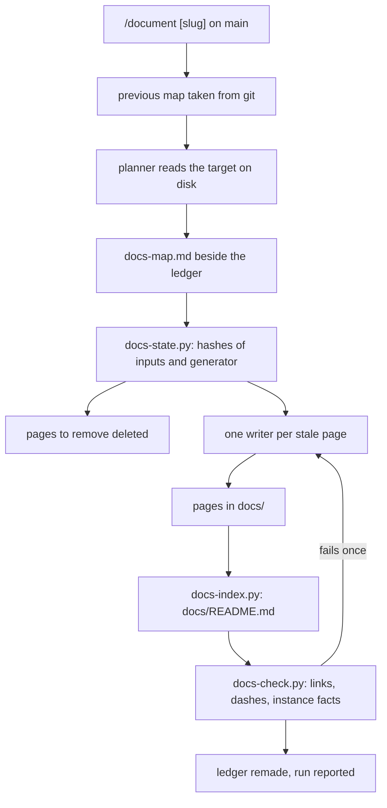

# The documentation

The documentation of a project is a set of pages of one topic each,
kept in the project's `docs/` directory with an index that names a
path through them for each reader. This page explains what the
documentation is, who it is written for, how it is made and why it
is generated rather than written by hand. It is for anyone who uses
the forge, extends it or wants to judge it.

## What it is

The documentation is a set of Markdown pages in `docs/`, at the
engine root for the engine and in `projects/<slug>/docs/` for a
project. The pages are readable where the project is published and
in a clone. An index, `docs/README.md`, lists every page with one
line each and names each reader's path through them. The terms of
the forge used on these pages are each given in one line in the
[Glossary](../reference/glossary.md).

It has three readers, in this order of weight:

- The user: who clones the forge and forges his own thinking in it.
- The extender: who adds an artefact, a lens, a persona, a genre, a
  check, a command or a script.
- The evaluator: who never runs it and wants to understand what it is
  and how it works. He gets the concept pages and nothing made for
  him alone.

The pages fall into five sections by the reader's journey, each a
directory under `docs/`:

- `start/`: what the thing is, what must be on the machine, the
  first setup and the first result.
- `use/`: one page per job the thing has a command or a procedure
  for.
- `about/`: one page per concept and per kind of artefact or part,
  the reasons included.
- `extend/`: what it is made of, how a change is made, proved and
  recorded, and one page per kind of addition.
- `reference/`: the commands, the rosters, the conventions, the
  layout, the scripts, the templates and a glossary.

A section or a page with no material is left out, never left empty.
A project that is not installed has no install page, and that is no
gap.

Each page is of one kind, and the kind says what content belongs on
it:

- A how-to: what the person does, step by step, and what he sees;
  never the reasons.
- An explanation: what a thing is, how it works and why it is so;
  never a procedure and never a listing.
- A reference: facts in the structure of what it mirrors, a table
  where the owner has a table; it never explains.

One rule of the forge has one home page, the page whose kind and
topic it is. Every other page that touches the rule says one
sentence and links to that home. Every page is reached from at least
one other page, so that the index is not the only way in.

A page is not a render. A render is an audience-specific output made
from a recipe by `/render` (see [Renders and
recipes](renders-and-recipes.md)). No recipe stands behind a page,
and `/render` plays no part in the documentation.

The folder `docs/videos/` of the engine lies under `docs/` but is not
part of the documentation. It is the one public folder that a
render's recipe may send a file into (see [The screenplay and its
player](the-screenplay-and-its-player.md)). `/document` leaves it
alone: no page is planned for it, and the scripts read `docs/`
without it.

## How it works

The documentation is generated and never composed by hand. A page
either mirrors the files that own its topic, restating what they say
in the reader's words, or is derived, put together from evidence
named in several files. Each page says in its front-matter which of
the two it is. What its inputs do not support is left out, not
guessed.

One command makes it: `/document`, bare for the engine, or
`/document <slug>` for a project (how to run it is on [Generate the
documentation](../use/generate-the-documentation.md)). The run asks
nothing. It runs only on `main`, and it refuses a repository that is
behind or diverged from its remote. At a merge the pages are taken
as `ours`.

A run is the work of two agents and three scripts. Both agents are
subagents (isolated helpers that never see the working
conversation), and they share one contract: their conduct, the
kinds of a page, the voice and the sentence of a page, and what must
never reach a page.

- The planner reads the target on disk and writes the documentation
  map.
- One writer per page makes that page alone, from its entry in the
  documentation map and the files the entry names, read from disk.
- `scripts/docs-state.py` computes which pages are stale.
- `scripts/docs-index.py` derives the index from the documentation
  map.
- `scripts/docs-check.py` scans the pages for broken links, long
  dashes in prose and facts of an instance before they are kept.

The documentation map is `docs-map.md` (its fields are given one by
one on [Documentation map](../reference/documentation-map.md)). It
lies beside the ledger (the file that holds the state of a project)
of the project that owns the documentation, never in `docs/`. It is
never shown to the reader. Its header carries only its target and
its owner. It holds a Paths section with three to five pages per
reader in reading order, then one entry per page: the title, one
line for the index, the kind, the reader, what the page says, its
exact inputs, the pages it links to with one sentence each, what it
must not say, whether it is mirrored or derived with the evidence
for a derived page, and its state. The previous documentation map is
taken from git at the start of a run.

A run regenerates only the pages whose inputs changed. The decision
is mechanical, never a judgement. An input is a file or a named part
of one (a section by its heading, an item by its ID), and a part is
hashed as that part. The rule the pages are made by (the writer's
definition and the contract) is hashed with the inputs. A change to
that rule therefore regenerates every page.

A mirrored page is written on a faster model. A derived page is
written, like the plan, on the session model: the model the
principal (the person whose thinking is forged) runs his working
session on. The choice is made by the entry of the page, never per
run.

A page that fails the check is made once more with the failure named.
A page that fails twice is left out of the documentation and reported,
never mended by hand. Whatever is wrong on a page is mended in the
file that owns the matter, and the page is then regenerated (see
[Change a documentation page](../extend/change-a-documentation-page.md)).

A release never regenerates the documentation. It reports the age of
the index against the version of the owning project's intent and
offers `/document`.

One documentation run:



## Why

The README was the whole documentation of the engine, and it was poor
as one: it was three things at once. A page of one topic can say a
thing well, and people inside the company and outside it should
understand the forge and use it in full.

The documentation is generated so that a page cannot drift from what
it mirrors. A reason a page would want and the inputs do not give is
not written: the page says the reason is not recorded, and the run
lists every such place for the principal. Where he wants the reason,
it enters the intent in its own round and reaches the page at the
next run.

A page regenerates only when its inputs change, so that a run is
cheap and the page names stay stable. Inputs are named by part
rather than by a file's whole body because the body changes at every
round. A page citing one position would otherwise be regenerated for
every other. The cost is that a moved heading or a renumbered ID
loses the part and regenerates the page, which is the safe side. The
generator is hashed with the inputs rather than forced by a switch,
so that the state stays computed, never judged.

A mirrored page leaves the model no room, so a faster model is
enough for it. A trial showed the stronger model more complete on
derived pages and the faster one sufficient on mirrored ones.

The pages have fixed outlines per kind and a one-line field for the
index rather than the writer's own judgement. An audit of the
documentation showed that the judgement does not converge: headings
differed from page to page and index entries ran long.

The index is named `README.md` rather than `index.md` because GitHub
shows a directory's README as its front page. The documentation map
lies beside the ledger rather than in `docs/` because a visitor of
the documentation would not understand it.

A release only offers the run, so that the pages pass under the
principal's eyes as every regenerated render does.

Why the run keeps to `main`, why the pages are taken as `ours` at a
merge, why the previous map comes from git and why `docs/videos/` is
left alone: the reason is not recorded.

Three other ways were rejected:

- A recipe per page, with the pages as renders. That would mean a
  recipe per page to iterate by hand, while a recipe is a tool the
  principal shapes and a page is to come from the project's documents
  with no hand in between. The documentation map replaces the
  recipes, one generated entry per page.
- A site or a wiki now. GitHub shows Markdown pages and a directory's
  README as they stand, so pages in the repository are readable
  without a build, a host or a second place to keep current. A site
  stays possible later over the same pages.
- A hand-kept file of the philosophy in the project root. The why
  lives in the brief and the intent already, and a hand-kept copy
  would drift from them. The `about/` pages are derived from those
  two.

## A worked example

One entry of a documentation map, in the shape the map's template
defines, for an invented page:

```
### docs/use/do-a-job.md
- title: Do a job
- line: How do you do the job with its command?
- kind: how-to
- reader: user
- says: What the command does for the person, typed as `/do-a-job <slug>`, and what he sees.
- inputs:
  .claude/skills/do-a-job/SKILL.md
  CLAUDE.md#Commands
- links:
  `docs/reference/glossary.md`: every term of the forge in one line.
- must-not: no value of an instance.
- made: mirrored
- state: new
```

The planner writes the entry. The state script hashes the skill file
whole and the section "Commands" of `CLAUDE.md` as that section
alone. One writer reads the entry and those two inputs, and nothing
else, and writes `docs/use/do-a-job.md`. Being mirrored, the page is
written on the faster model. At the next run the page is made again
only if one of those inputs, the writer's definition or the contract
has changed.

## See also

- [Generate the documentation](../use/generate-the-documentation.md):
  running `/document`.
- [Change a documentation page](../extend/change-a-documentation-page.md):
  changing a page through its owners.
- [Documentation map](../reference/documentation-map.md): the map's
  entry and the page's front-matter, field by field.
- [Renders and recipes](renders-and-recipes.md): the renders, which
  the pages are not.
- [The screenplay and its player](the-screenplay-and-its-player.md):
  the videos folder under `docs/` that the documentation leaves alone.
- [Glossary](../reference/glossary.md): every term of the forge in one
  line.

Generated on 2026-10-25 for version 6.0 from the files the front-matter names; never edited by hand.
