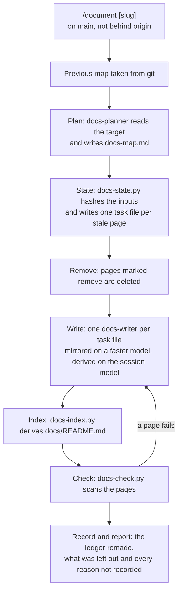

# The documentation

The documentation of a project is a set of pages in `docs/`, one
topic each, with an index that names each reader's path through
them. This page explains what the documentation is, who it is
written for, how one run makes it and why it is generated rather
than written by hand. It is for the user, the extender and the
evaluator alike.

## What it is

The documentation is kept with the project.
It can be read where the project is published and in a clone.
Its index is `docs/README.md`.
The index lists every page and names each reader's path through
them.

Three readers are served, in this order of weight:

1. The user: he clones the thing and works with it.
2. The extender: he adds to it, such as an artefact, a lens, a
   persona, a genre, a check, a command or a script.
3. The evaluator: he never runs it and wants to understand what it
   is and how it works. He gets the concept pages and nothing made
   for him alone.

Each reader's path is three to five pages in the order he reads
them.

The pages stand in five sections, ordered by the reader's journey.
The sections are the same for every project:

- `start/`: what the thing is, what must be on the machine, the
  first setup and the first result.
- `use/`: one page per job the thing has a command or a procedure
  for.
- `about/`: one page per concept and per kind of artefact or part,
  the reasons included.
- `extend/`: what the thing is made of, how a change is made, proved
  and recorded, and one page per kind of addition.
- `reference/`: the commands, the rosters, the conventions, the
  layout, the scripts, the templates and a glossary.

A section or a page with no material is left out, never left empty.
A project that is not installed has no install page, and that is no
gap.

Each page is of one kind, and the kind says what content belongs on
it:

- A how-to: what the person does, step by step where there are
  steps, and what he sees. It never carries the reasons.
- An explanation: what a thing is, how it works and why it is so.
  It never carries a procedure or a listing.
- A reference: facts in the structure of what it mirrors, a table
  where its input is a table. It never explains.

Each page opens with what it is for and for whom, and stands on its
own.

One rule of the forge has one home page: the page whose kind and
topic it is.
Every other page that touches the rule says one sentence about it
and links to the home page.
The same matter written on two pages is a defect of the plan, not of
the page.
Every page is reached from at least one other page, so the index is
not the only way in.

Every page is generated and none is composed or kept by hand.
A page is one of two kinds of making:

- Mirrored: it restates what the files that own its topic say, in
  the reader's words.
- Derived: it puts together what no single file says, from named
  evidence in several files.

A page is never invented.
What its inputs do not support is left out.
Where a page would want a reason that no input gives, it says that
the reason is not recorded.
An example that shows the shape a template or a convention defines,
plainly generic and taken from no project, is welcome on a page.
A diagram drawn from what the owners say is the same.
The content of a real project never reaches a page.
No instance fact (the facts of one installation, such as who the
principal is) reaches a page either.
The principal is the person whose thinking is forged.

A page is not a render.
No recipe stands behind it, and `/render` does not touch it.
How a render differs is explained in
[Renders and recipes](renders-and-recipes.md).

The folder `docs/videos/` of the engine lies under `docs/` but is
not part of the documentation.
It is the one public folder of the projects' video players, and a
documentation run leaves it alone.
What it holds is explained in
[The screenplay and its player](the-screenplay-and-its-player.md).

## How it works

One command makes the documentation: `/document`, bare for the
engine or with a project's slug.
How you run it is shown in
[Generate the documentation](../use/generate-the-documentation.md).
The run asks nothing.
It runs on `main` only.
It refuses a repository that is behind or diverged from its origin.

The pages are made from a map: `docs-map.md` (the documentation
map).
The map lies beside the owning project's ledger (the file that holds
the state of a project), never in `docs/`.
The owning project is the project whose documents the documentation
is made from; for the engine it is `projects/forge`.
The map is never shown to the reader of the documentation.
Its header carries only its target and its owner.
Its body is a section of reader paths, then one section per section
of the outline, with one entry per page.
An entry holds everything a writer needs to make that page alone:

- the title and one line for the index;
- the kind and the reader;
- what the page says;
- its inputs, as files or as named parts of files;
- the pages it links to, each with one sentence;
- what the page must not say;
- whether the page is mirrored or derived, with the evidence for a
  derived page;
- its state.

Every field is described in
[Documentation map](../reference/documentation-map.md).

Two agents make the documentation.
Each runs as a subagent (an isolated helper run of Claude that sees
only its task, never the working conversation):

- The planner (`docs-planner`): it reads the target on disk and
  writes the map. It writes no page.
- The writer (`docs-writer`): one per page, it makes that page from
  its entry and from the files the entry names, read from disk. It
  sees no other page.

Both share one contract (`docs-contract`).
The contract holds their isolation, the kinds of a page, what must
never reach a page, the voice and the sentence of a page.
The planner runs on the session model.
A derived page is written on the session model too.
A mirrored page is written on a faster model.
The choice is made by the entry's `made` field, never per run.

Three scripts do the mechanical work:

- `scripts/docs-state.py`: it computes which pages are stale and
  writes one task file per page to be made.
- `scripts/docs-index.py`: it derives the index `docs/README.md`
  from the map, the reader paths as links and one line per page.
- `scripts/docs-check.py`: it checks the pages before they are kept,
  for broken links, long dashes in prose and instance facts.

A run regenerates only the pages whose inputs changed.
The decision is mechanical, never a judgement.
Each input is hashed: a file whole, or a named part of a file.
A part is a section by its heading or an item by its ID, and it is
hashed as that part.
The rule the pages are made by (the writer's definition and the
contract) is hashed with the inputs.
The previous map is taken from git, so the state of a page is
computed against the last saved map.

A page that fails the check is regenerated once with the failure
named.
A page that fails twice is left out of the documentation and
reported, never mended by hand.
What is wrong on a page is mended in the file that owns the matter,
and the page is regenerated.
How that is done is shown in
[Change a documentation page](../extend/change-a-documentation-page.md).

A release never regenerates the documentation.
It reports the age of the index against the version of the intent
and offers `/document`.
The regenerated pages pass under the principal's eyes as every
regenerated render does.

One documentation run, step by step:



The run ends with a report.
It lists the pages new, regenerated, kept and removed.
It lists the facts no file supports and what the writers left out.
It lists every place where a page wanted a reason and none is
recorded.
Every fact no file supports waits for the principal to give it a
home in a file of the project.

## Why

The documentation exists because the README was the whole
documentation of the engine and poor as one.
It did three things at once.
A page of one topic can say a thing well.
People inside and outside the company should understand the forge
and use it in full.

The documentation is generated so that a page cannot drift from what
it mirrors.

A page has no recipe of its own.
A recipe per page would mean a recipe for every page to iterate by
hand.
A recipe is a tool the principal shapes, while a page is to come
from the project's documents with no hand in between.
The map replaces the recipes, with one generated entry per page.

The documentation is not a site or a wiki.
GitHub shows Markdown pages and the README of a directory as they
stand.
Pages in the repository are therefore readable without a build, a
host or a second place to keep current.
A site stays possible later over the same pages.

There is no hand-kept file of the philosophy in the project root.
The why lives in the brief and the intent already, and a hand-kept
copy would drift from them.
The `about/` pages are derived from those two, and the pitch stays a
render.

The index is named `README.md` rather than `index.md`.
The reason is that GitHub shows a directory's README as its front
page.

The map lies beside the ledger rather than in `docs/`.
The reason is that a visitor of the documentation would not
understand it.

Only the changed pages are regenerated so that a run is cheap and
the page names stay stable.

Inputs are named parts of files rather than whole files.
The body of a file changes at every round.
A page citing one position would otherwise be regenerated for every
other.
The cost is that a moved heading or a renumbered item loses the part
and regenerates the page, which is the safe side.

The rule the pages are made by is hashed with the inputs rather than
forced by a switch.
This keeps the state computed, never judged.
The cost is that a change of the writer's definition or of the
contract regenerates every page.

Each kind of page has a fixed outline, and each entry a one-line
field for the index.
The reason is that an audit of the documentation showed the writer's
own judgement of headings and index lines does not converge.

A mirrored page is written on a faster model because it leaves the
model no room.
A derived page and the plan need the session model.
A trial showed the stronger model more complete on derived pages and
the faster one sufficient on mirrored pages.

A run is made on `main` only because the pages are taken as `ours`
when branches are merged.

Why the three readers stand in this order of weight, the reason is
not recorded.
Why the sections follow the reader's journey, the reason is not
recorded.

## A worked example

One entry of a documentation map, invented for a generic project.
It has the shape the map's template defines:

```markdown
### docs/use/export-a-report.md
- title: Export a report
- line: How do you export a report?
- kind: how-to
- reader: user
- says: The command `/export <slug>` writes the report of a project
  into its `out/` directory; what you see at each step.
- inputs:
  .claude/skills/export/SKILL.md
- links:
  `docs/reference/glossary.md`: every term in one line.
- must-not: no value of an instance.
- made: mirrored
- state: new
```

The planner writes this entry.
The state script hashes the one input and, since the page is new,
writes a task file for it.
A writer on the faster model reads the task file and the skill, and
writes `docs/use/export-a-report.md` in the how-to outline.
The index script adds the entry's `line` to `docs/README.md`.
At the next run the page is kept as it is unless the skill has
changed.

## See also

- [Generate the documentation](../use/generate-the-documentation.md): running `/document`.
- [Change a documentation page](../extend/change-a-documentation-page.md): changing a page through its owners.
- [Documentation map](../reference/documentation-map.md): the map's entry and the page's front-matter, field by field.
- [Renders and recipes](renders-and-recipes.md): the renders, which the pages are not.
- [The screenplay and its player](the-screenplay-and-its-player.md): the videos folder under `docs/` that the documentation leaves alone.
- [Glossary](../reference/glossary.md): every term of the forge in one line.

Generated on 2026-10-19 for version 5.26 from the files the front-matter names; never edited by hand.
