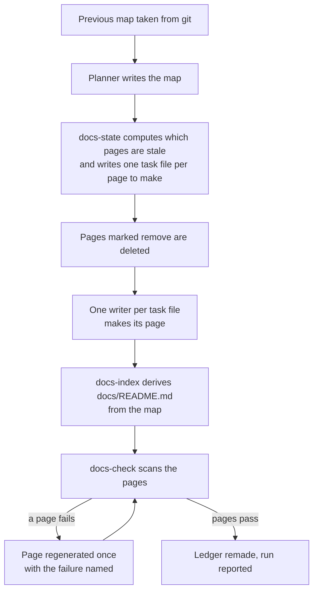

# The documentation

The documentation of a project is a set of pages of one topic each
in `docs/`, with an index that names each reader's path through
them. This page explains what the documentation holds, who it is
written for, how it is made and why it is generated rather than
written by hand. It is for anyone who reads the pages: the user, the
extender and the evaluator.

## What it is

The documentation lives with the project. It is readable where the
project is published and in a clone. The engine keeps its pages in
`docs/` at the engine root. A project keeps them in
`projects/<slug>/docs/`.

The index is `docs/README.md`. It lists every page with one line,
and that line is the one question the page answers. It also prints
one reading path per reader.

### Three readers

The pages are written for three readers, in this order of weight:

1. The user, who clones the forge and forges his own thinking in it.
2. The extender, who adds an artefact, a lens, a persona, a genre, a
   check, a command or a script.
3. The evaluator, who never runs it and wants to understand what it
   is and how it works.

The evaluator gets the concept pages and nothing made for him alone.

### Five sections

The pages fall into five sections by the reader's journey. Each
section is a directory under `docs/`, and the sections are the same
for every project:

- `start/`: what the thing is, what must be on the machine, the
  first setup, the first result.
- `use/`: one page per job the thing has a command or a procedure
  for.
- `about/`: one page per concept and per kind of artefact or part,
  the reasons included.
- `extend/`: what it is made of, how a change is made, proved and
  recorded, one page per kind of addition.
- `reference/`: the commands, the rosters, the conventions, the
  layout, the scripts, the templates, a glossary.

A section or a page with no material is left out, never left empty.
A project that is not installed has no install page, and that is no
gap.

### One kind per page

Each page is of one kind, and the kind says what content belongs on
it:

- A how-to carries steps, commands and what the person sees, never
  the reasons.
- An explanation carries what a thing is, how it works and why,
  never a procedure and never a listing.
- A reference mirrors its owner in the owner's structure, and never
  explains.

Each page opens with what it is for and for whom, and stands on its
own.

### One home per rule

One rule of the forge has one home page, the page whose kind and
topic it is. Every other page that touches the rule says one sentence
about it and links to the home page. The same matter written on two
pages is a defect of the plan, not of the writer.

Every page is reached from at least one other page. The index is not
the only way in.

### What the documentation is not

A page is not a render. No recipe stands behind it, and `/render`
does not make it. The renders are explained in
[Renders and recipes](renders-and-recipes.md).

The engine's public folder of videos, `docs/videos/`, lies under
`docs/` but is not part of the documentation. The planner never maps
it, and the scripts of the documentation read `docs/` without it.
What that folder holds is explained in
[The screenplay and its player](the-screenplay-and-its-player.md).
The reason it is kept apart is not recorded.

## How it works

The documentation is generated and never composed or maintained by
hand. A page either mirrors the files that own its topic or is
derived from named evidence, and its front-matter says which. A
mirrored page restates what its inputs say. A derived page puts
together what no single file says, from evidence in several files.
A page is never invented.

### The map

The pages are made from the documentation map, `docs-map.md`. The
map holds one entry per page, with everything a page is made from.
It lies beside the owning project's ledger (the file that holds the
project's state), never in `docs/`. It is never shown to the reader.

The header of the map carries only two things:

- `target`: `engine`, or the project's slug.
- `owner`: the project that owns the documentation.

Every field of an entry is described in
[Documentation map](../reference/documentation-map.md).

### Two agents under one contract

Two agents make the documentation. Each runs as a subagent, that is
an isolated helper run of Claude that sees nothing of the working
conversation and reads its inputs from disk:

- The planner reads the target on disk and writes the map. It writes
  no page.
- The writer makes one page from its entry in the map alone, from
  the files the entry names and nothing else. One writer runs per
  page, and it sees no other page.

The two agents share one contract, a skill file that owns their
conduct and isolation, the kinds of a page, the voice and the
sentence of a page, and what must never reach a page
(`.claude/skills/docs-contract/SKILL.md`). The writer keeps one fixed
page shape, with one outline per kind of page.

A mirrored page is written on a faster model, and a derived page on
the session model (the model the conversation with Claude runs on).
The choice is made mechanically by the entry's `made` field, never
per run. A mirrored page leaves the model no room, so the faster
model is sufficient for it.

Nothing invented means no fact. An example that shows the shape a
template or a convention defines, plainly generic and taken from no
project, mirrors that owner and is welcome. A diagram drawn from what
the owners say is the same. The content of a real project never
reaches a page.

A reason the inputs do not give is not written on a page. The page
says the reason is not recorded, the writer reports it, and the run
lists every such place for the principal (the person whose thinking
is forged). Where the principal wants a reason, it enters the intent
in a round of its own and reaches the page at the next run.

### One run

One command makes the documentation: `/document`, bare for the
engine or with a project's slug. It runs in one go and asks nothing.
How to run it is shown in
[Generate the documentation](../use/generate-the-documentation.md).

The run is made on `main` only. It refuses a repository behind or
diverged from its origin. At a merge, the pages are taken as the
local side.

The previous map is taken from git before the planner starts.



The run regenerates only the pages whose inputs changed. The choice
is made mechanically from the inputs, never by judgement. An input
is a file or a named part of one:

- a section, named by its heading;
- an item, named by its ID.

Each input is hashed as that part, so a change elsewhere in the file
leaves the page as it is. The rule the pages are made by is hashed
with the inputs: the writer's definition and the contract. A change
to either regenerates every page.

The script `scripts/docs-check.py` scans the pages before they are
kept, for broken links, long dashes in prose and instance facts. A
page that fails twice is reported and left out of the documentation.
It is never mended by hand.

At the end the run remakes the owning project's ledger. Its Renders
table carries the index, with the map as its input.

What is wrong on a page is mended in the file that owns the matter,
and the page is regenerated. How that is done is shown in
[Change a documentation page](../extend/change-a-documentation-page.md).

### The documentation and a release

A release never regenerates the documentation. It reports the age of
the index against the version of the intent, and offers `/document`.

### The index and the manual

The manual `/man` reads the index to answer a need said in free
words. Every page carries the one question it answers, so the manual
chooses the pages whose question meets the need and reads them. How
to ask it is shown in
[Look up a command, or ask how to do something](../use/look-up-a-command.md).

## Why

The README was the whole documentation of the engine, and poor as
one, because it did three things at once. A page of one topic can say
a thing well. Readers inside the principal's organisation and outside
it should understand the forge and use it in full.

The pages are generated so that a page cannot drift from what it
mirrors.

A run regenerates only what changed so that a run is cheap and the
page names stay stable. An input is hashed as its named part because
the body of a file changes at every round: a page citing one item
would otherwise be regenerated for every other. The cost is that a
moved heading or a renumbered ID loses the part and regenerates the
page, which is the safe side.

The rule the pages are made by is hashed with the inputs, rather than
a switch that forces a run, so that the state stays computed and
never judged.

The writer keeps a fixed outline per kind and a one-line field for
the index because an audit of the pages showed that a writer's own
judgement of headings and index lines did not converge.

The map lies beside the ledger and not in `docs/` because a visitor
of the documentation would not understand it. The index is named
`README.md` rather than `index.md` because GitHub shows a directory's
README as its front page.

A release does not regenerate the pages because the pages pass under
the principal's eyes, as every regenerated render does.

The reason the previous map is taken from git is not recorded. The
reason the run is made on `main` only is not recorded beyond the
handling of the pages at a merge.

Three alternatives were rejected:

- A recipe per page, the documentation as renders. A recipe is a
  tool the principal shapes by hand, one per page to iterate, while a
  page is to come from the project's documents with no hand in
  between. The map replaces the recipes, with one generated entry per
  page.
- A site or a wiki for the documentation now. GitHub shows Markdown
  pages and the README of a directory as they stand, so pages in the
  repository are readable without a build, a host or a second place
  to keep current. A site stays possible later over the same pages.
- A hand-kept file of the philosophy in the project root. The why
  lives in the brief and the intent already, and a hand-kept copy
  would drift from them. The `about/` pages are derived from those
  two.

## A worked example

A generic entry of the map, in the shape the map's template defines,
taken from no project:

```
### docs/use/<job>.md
- title: <Do the job>
- line: <How do I do the job?>
- kind: how-to
- reader: user
- says: <what the page says, its one topic and nothing beside it>
- inputs:
  .claude/skills/<command>/SKILL.md
  projects/<slug>/10-intent.md#<item ID>
- links:
  `docs/reference/glossary.md`: <one sentence on what that page gives>
- must-not: <what the page must not say of its topic>
- made: mirrored
- state: new
```

The `line` becomes the page's line in the index, and the question the
manual matches a need against. The two inputs are hashed: the skill
file whole, the intent as that one item. A change to another item of
the intent leaves this page as it is. Because `made` is `mirrored`,
the page is written on the faster model, and there is no `evidence`
field.

## See also

- [Generate the documentation](../use/generate-the-documentation.md): running `/document`.
- [Change a documentation page](../extend/change-a-documentation-page.md): changing a page through its owners.
- [Documentation map](../reference/documentation-map.md): the map's entry and the page's front-matter, field by field.
- [Renders and recipes](renders-and-recipes.md): the renders, which the pages are not.
- [The screenplay and its player](the-screenplay-and-its-player.md): the videos folder under `docs/` that the documentation leaves alone.
- [Look up a command, or ask how to do something](../use/look-up-a-command.md): the manual that reads the index to answer a question.
- [Glossary](../reference/glossary.md): every term of the forge in one line.

Generated on 2026-11-01 for version 6.4 from the files the front-matter names; never edited by hand.
