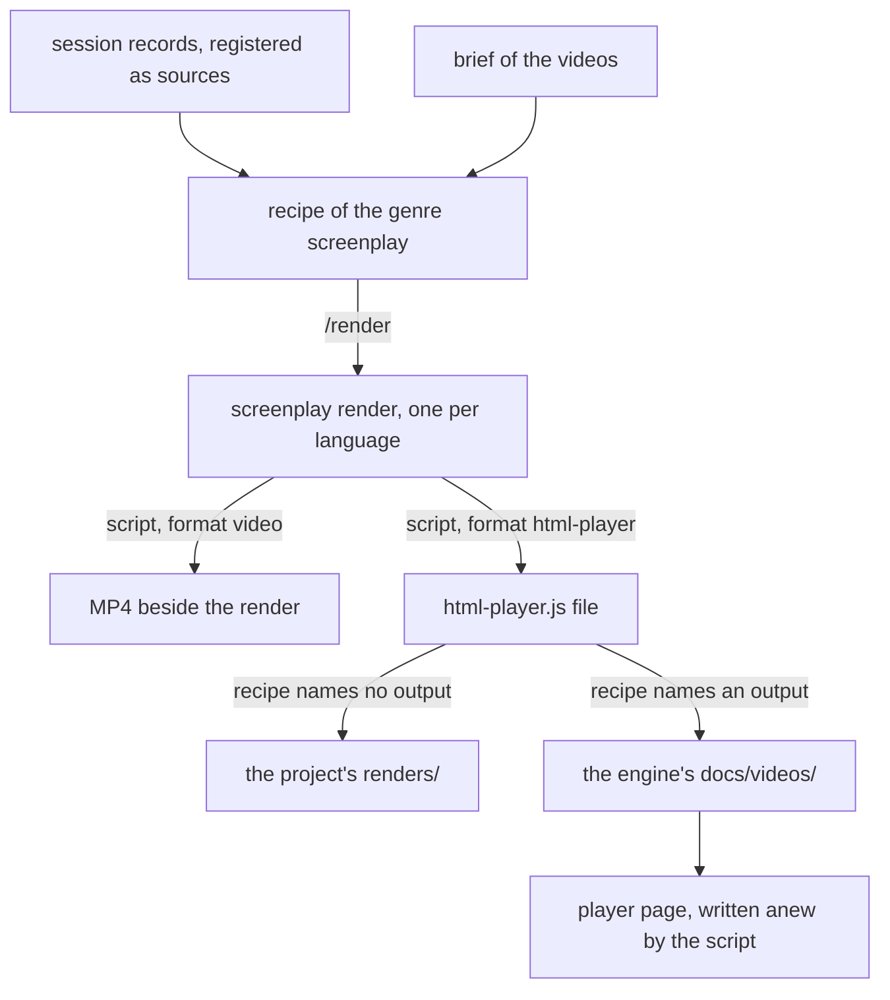

# The screenplay and its player

A screenplay is the written form of a teaching video of the forge: a
terminal conversation cut from the records of real work, scene by
scene, from which a script makes the file that is watched. This page
explains what a screenplay holds, why one script makes both of its
formats, what the player page does and why the engine hosts the files
a project shows in public. It is for whoever makes or watches such a
video, whoever extends the forge and whoever weighs how it is built.

## What it is

A screenplay is a render, that is the text `/render` generates from a
recipe ([Renders and recipes](renders-and-recipes.md)). Its recipe is
of the genre `screenplay`
([Recipe genres](../reference/recipe-genres.md)). The render holds
four kinds of part:

- a title card, which discloses the composition: that the work is
  real, how many sessions and hours it is cut from, that the times
  are real, and that the lines are verbatim and shortened
- a card of what the viewer will see
- scenes, each with the real time of day, a caption and a fenced
  block of what the terminal shows
- an end card, which says what the viewer leaves with

A session is one working conversation with Claude in the terminal.

The caption of a scene has two parts:

- Now: what happens
- Why: why the forge does it this way

The caption is the teaching. The terminal is the evidence.

The recipe of a screenplay reads two inputs:

- session records registered as sources: a transcript extract, read
  by its timestamps
- the brief that says what the videos are for

Source and brief are terms of the forge
([Glossary](../reference/glossary.md)). A document that the video
shows being born may stand beside the two, as a dependency by path.

The render is never the video. The file that is watched is made from
the render by a script ([Scripts](../reference/scripts.md)), in the
format the recipe names. The recipe's `## Format` section names one of
two formats, never both:

- `video`: an MP4, painted frame by frame from the render as a
  simulated terminal
- `html-player`: the timed events for the player page of the engine,
  playable from a file on disk as well as from GitHub Pages

The player page is one fixed page of the engine (the repository of
the forge itself, public on GitHub;
[Projects and the engine](projects-and-the-engine.md)). It lies in the
engine's folder `docs/videos/` and plays the `html-player` files of
that folder.

## How it works

The way from the records to the played file has three parts: the
recipe fixes the cut, `/render` writes the screenplay, and the script
makes the format file.



### The cut

The recipe fixes the cut, and `/render` writes the screenplay by it:

- The scenes are pinned by the time of their first line and by the
  lines that must appear. Every render is then the same cut.
- The lines of the principal (the person whose thinking is forged)
  stand as typed. Only gross errors are corrected.
- An answer of Claude is shown in full where the scene is about it.
  Elsewhere it is cut to the sentences that carry the move.
- Where there is too much, the answers of Claude are shortened, never
  the lines of the principal and never the captions.
- Names, companies, hosts and paths outside the forge do not appear.

### Languages

A recipe may render in several languages. It declares them in
`languages:`. The first is the primary, the rest are its
translations. For a screenplay the primary is the language of the
sessions. `/render` generates the primary render and, in the same
run, translates it into every other language, scene for scene and
line for line.

Each language has its own render, `renders/<recipe>.<lang>.md`, with
its own provenance (the record of what it was made from). A
translation cites the primary render it was made from. The format
file follows the name of its render. A recipe with one language keeps
`renders/<recipe>.md`. The notation of a render stays English in
every language. The content is in the language of the render.

### One script, two formats

`scripts/md2video.py` makes the format file of a screenplay, in the
format given as `--format video` or `--format html-player`. The
format file is the plain file of `/render`, that is the file made
from a render by a script and by no model.

The script reads from the render:

- the front-matter, for the language
- the cards
- the scenes with their captions and terminal blocks

From these it computes the timeline:

- the typing of a line
- the stand before Enter
- the reveal of an answer
- the hold for reading
- the breath at the end of a scene

The lengths come from the pace, given as
`--pace <principal>,<claude>,<file-report>` in words a second. There
is one rate for the lines of the principal, one for the answers of
Claude and one for the lines that only report a file. The defaults
are 4, 8 and 16.

The parsing and the pace are the same for both formats. What is
written from the timeline differs:

- `video`: the script paints every frame with Pillow as a simulated
  terminal, 1280×890, with a monospace font for the terminal and a
  sans font for the caption band, and pipes the frames into ffmpeg
  (H.264, 30 fps). Fallbacks stand in where the Windows fonts are
  missing.
- `html-player`: the script writes the timeline as timed events,
  wrapped in a script call, into `<name>.html-player.js`. The
  wrapping lets the page play the file from disk as well as from
  GitHub Pages.

The file lands beside the render, under the render's basename. An
`-o` argument names another path. Where that path lies under the
engine's `docs/videos/`, the script also writes the player page anew.

Both formats are made deterministically: the same render gives the
same file every time, and no model takes part. `/publish` does
nothing with a screenplay, and no published file exists of it.

The pace of reading, the look of the terminal (such as the date shown
in its tab bar) and the labels of the captions per language stand in
the recipe's `## Format` section. They reach the script as arguments.
The render carries none of them.

The script needs Pillow, and ffmpeg on PATH. It installs nothing.

### The player page

The player page is `docs/videos/index.html` of the engine. It is a
single file with no dependency beyond the browser, and it works from
a file on disk as well as from GitHub Pages. It offers:

- a sidebar that lists the videos in the order of their file names,
  by title, grouped by the section of the course each file names
- the player: the simulated terminal, the caption band and the cards
- play and pause
- the speed
- the scenes of a video as chapters
- the language, where a file has siblings in other languages
- three font sizes, remembered in the browser

For the course on the player page a recipe names the section its
video belongs to, with the name of the section per language, and what
the viewer will learn, which is listed in place of the title of the
title card.

The page is never written by hand and never by a model. The script
writes it anew from its template, `templates/html-player.html`,
whenever it writes a file into the folder. It puts the list of the
folder's `html-player` files into the page. What is edited is the
template, never the page. The page is tracked in git as the plain
file of a render is.

### The public folder

A recipe may send its format file out of its project into the engine,
by its `output:` path, into `docs/videos/`. A video that is not to go
public names no `output:` and stays in the project's `renders/`. For
a video that goes out:

- The engine carries the file only. The recipe, the render, the
  provenance and the history stay in the project, and whoever has the
  project regenerates the file.
- What goes out is chosen in the recipe, video by video.
- The principal reads the file before the engine is saved. That
  reading is the clearing of a public version, in one step.
- The name of the file carries a number, which gives its place in the
  order of the course.

The folder is flat, its files in the order of their names. It is
foreign to the documentation. `/document` (the command that generates
the documentation) and its checks generate and verify the
documentation around the folder and leave it alone. The index of the
documentation does not list it. An empty file, `docs/.nojekyll`,
makes GitHub Pages serve the folder as it lies. The principal
switches GitHub Pages on once, by hand, on `main` and `/docs`. The
documentation itself keeps being read in the repository view.

Video files (`.mp4`) are not written into the folder and never enter
the engine's tree. A video goes out as an asset of a release.

## Why

**The engine hosts what a project shows in public.** The engine is
public on GitHub and served by GitHub Pages from `docs/`. It is the
one public place of an instance (one installation of the forge). The
project that made the file stays where its sources require, such as
in a private repository. The engine therefore carries the file only,
and everything the file was made from stays in the project.

**The pace and the look stay out of the render.** The render carries
content only. Were the Format section copied into it, the plain file
would carry the instructions as text.

**The translations are cut from the primary render.** The quotes of a
transcript, the beats and the captions are chosen once. A second
generation would choose them again, differently. A translation made
scene for scene and line for line is the same cut.

**No designed step.** Both formats are made by the script alone.
There is no designed step a model could add, and `/publish` therefore
has no part.

**The list of files is embedded in the page.** GitHub Pages cannot
list a folder.

**The `html-player` file is wrapped in a script call.** The page then
plays it from a file on disk as well as from GitHub Pages.

**Video files stay out of the engine's tree.** The reason is not
recorded.

The choices of the build, with what each was weighed against and its
price:

| Choice | Weighed against | Reason | Price |
|---|---|---|---|
| One script with two formats | Two scripts | The parsing and the pace are one mechanism | None recorded |
| Pillow and ffmpeg | VHS; asciinema with agg; a browser driven by Playwright | VHS proved broken on Windows, agg ends at GIF and the browser took the most code. A painter in the language the scripts are already written in, with one encoder, was the least to install and runs on the three platforms | None recorded |
| A fixed page with the list of files embedded | A generated index file beside the page; a course recipe with an outline; folders as sections | The reason is not recorded. The order of the files is the alphabet of their names, for now | The script touches a page of the engine |
| A single file | A page with scripts and styles beside it | One file is one thing to serve and to copy | None recorded |

## A worked example

One scene of a screenplay, with a placeholder recipe `example-video`
that declares English and German. The layout shows the parts of a
scene. The exact notation of a render is given by the template of the
genre, `templates/recipe-screenplay.md`.

````
Scene 3, 10:42

Now: The principal asks for the render of the recipe `example-video`,
which declares two languages.
Why: The translation is made in the same run from the primary render,
scene for scene. Both languages then show the same cut.

```
> /render example-video
The screenplay is rendered in English and translated into German,
scene for scene and line for line.
  Write renders/example-video.en.md
  Write renders/example-video.de.md
```
````

The scene has the real time of day, the caption in its two parts and
the fenced block of what the terminal shows. The block holds the
three kinds of line the pace knows: a line of the principal, an
answer of Claude and two lines that only report a file.

Played, the scene runs like this:

1. The line of the principal is typed, at four words a second by
   default, and stands before Enter.
2. The answer of Claude is revealed, at eight words a second by
   default.
3. The two lines that only report a file pass at sixteen words a
   second by default.
4. The caption is shown in the caption band, its two parts under the
   labels of the render's language.
5. The scene is held for reading and closes with a breath before the
   next scene.

In the format `video` these steps are frames of the MP4. In the
format `html-player` they are timed events, and the scene is one
chapter of the video on the player page. The German render holds the
same scene at the same place, translated line for line.

## See also

- [Make a teaching video from a recipe](../use/make-a-video-from-a-recipe.md):
  the job from the recipe to the played file.
- [Renders and recipes](renders-and-recipes.md): the render and its
  recipe, which a screenplay is one of.
- [Projects and the engine](projects-and-the-engine.md): why the
  engine is public and a project is a repository of its own.
- [Scripts](../reference/scripts.md): the script that makes both
  formats.
- [Recipe genres](../reference/recipe-genres.md): the genre's
  checklist in full.
- [Glossary](../reference/glossary.md): every term of the forge in
  one line.

Generated on 2026-11-17 for version 7.12 from the files the
front-matter names; never edited by hand.
