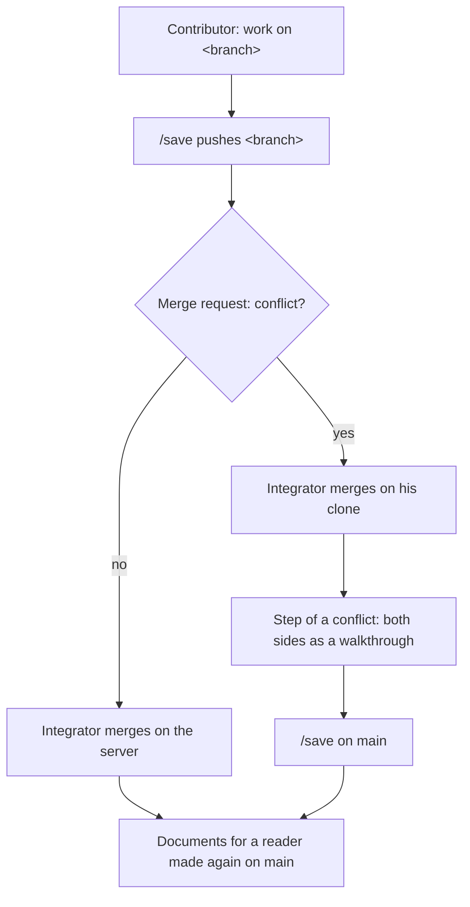

# Working together on one project

Working together on one project means two people, or two branches,
changing the same project and bringing their work into one line
through git. This page explains what the forge promises in that
case, how each kind of file of a project merges, and why it is so.
It is for the user who shares a project, the extender who adds a
kind of file, and the evaluator who wants to know where a merge can
hurt.

## What it is

Every file of a project has one of three ways of merging. The forge
tells git which way through the project's `.gitattributes`, a file
made from the engine's template `templates/gitattributes`. The forge
itself never merges, pulls or rebases on its own judgement: the
merge stays git's.

The three ways are these:

- **Text.** The artefacts (the documents of the chain), the recipes,
  the work specifications, the threads, the project file, and the
  record files: the histories, the decisions, the resource indexes
  and the documentation map. Git merges them as text. What git
  leaves in conflict is settled by a person.
- **Derived.** The ledger (the one file that says the state of a
  project) is never in git and is made at read time, so it is never
  merged. The documents for a reader are in git: the renders, the
  README, the release notes, CONTRIBUTING, the documentation, the
  state render and the published companions. They are made only on
  `main`, taken as `ours` at a merge and made again. The published
  files themselves are binary and never merged.
- **Immutable and unique.** Reviews, challenges, research, sources
  and closed threads. They never conflict. A report's name is unique
  across branches too. Immutability is a rule of the process;
  nothing is locked.

What the forge promises is this:

- One person on one project saves with `/save` and pulls with
  `/pull`, and nothing more is needed.
- With two people or two branches, the derived state is made anew at
  read time and never conflicts.
- A conflict in a history, in `decisions.md` or in a resource index
  is two tails appended after one last line. It is settled by
  keeping both.
- A conflict in an artefact is the same item or sentence changed on
  both sides. It is settled by a person with Claude's help, in the
  step of a conflict.
- IDs stay one sequence per project. A number taken by two branches
  is settled after the merge.
- A version given twice shows as a conflict of the header's
  `version:` line and is settled in the same step of a conflict.
- Two windows of one person on one project are not solved by the
  forge.

## How it works

### The attributes

The template `templates/gitattributes` carries three kinds of line:

- `* text=auto`: line endings are normalised, so that files do not
  fight between machines.
- `merge=ours` on `renders/**`, `README.md`, `RELEASE-NOTES.md`,
  `CONTRIBUTING.md`, `docs/**` and `published/*.md`: at a merge the
  side being merged into is kept, and the file is made again
  afterwards.
- `binary` on `published/*.pptx` and `published/*.docx`: never
  merged.

The record files carry no attribute, so they merge as plain text.
`/new-project` creates the file, and `/check project` reports a
project without it. The engine carries a list of its own, because
its derived files lie at its root and under `projects/forge/`.

The driver `ours` is not built into git. `/setup` registers it once
per machine, in the user's global git configuration, on the user's
word. `forge-status` says when the registration is missing. This
matters because an unregistered clone silently falls back to a
conflict.

The documents for a reader are made only on `main`. Two branches
that make the same one conflict, and the conflict is settled by
making it again. Why these files are made on `main` only is
explained in [Persistence in git](persistence-in-git.md).

### The step of a conflict

A conflict that `/save` meets is left standing, not aborted. It is
settled in the step of a conflict:

1. Claude lays both sides out as a walkthrough (one decision per
   message, in order, each closed with a verdict).
2. The principal (the person whose thinking is forged, with the
   final say on content) decides.
3. Claude writes the chosen wording into the file.
4. The git commands that finish the step run on the ask of the git
   hook (`scripts/hook-git.py`), which puts them to the principal
   and runs them on his yes.

Then `/save` runs again. How the step is done, command by command,
is on [Settle a conflict](../use/settle-a-conflict.md).

### IDs and versions taken twice

IDs are taken at the write, as always, with no block reserved and
no look over the branches. Two branches that took the same number
are reported after the merge. The younger item is renumbered with a
record, in a walkthrough, never by Claude alone; see
[Stable IDs](stable-ids.md).

A version given twice means two branches raised one document to the
same number. Git finds it itself: the header's `version:` line
conflicts whenever both sides raised it. Whoever merges settles it
in the step of a conflict. The merged document takes the next
number and one `changed` record naming the merge and what was
joined. The records of both sides keep their numbers.

### Several people: one integrator, contributors

The work of several people on one project has one model. One person
is the integrator: a maintainer of the repository, typically the
principal. The others are contributors.

- A contributor works on a branch and saves it; `/save` pushes the
  branch. Switching to a branch is shown on
  [Work on a branch](../use/work-on-a-branch.md).
- The integrator merges the branch.
- Where the merge request has no conflict, he merges it on the
  server.
- Where it has a conflict, he merges it on his own clone through the
  step of a conflict.

The server merges with no attribute of the forge's. So two people
who both append to any history or to the decisions have a
conflicting merge request there. A merge request on the server is
for reading and for the merge that needs no hand.

### Two windows of one person

A bare `/save` is meant for one window. It commits every repository
with changes, the other window's half-written work included. On two
projects the windows collide nowhere, because each project is a
repository of its own. On one project the forge solves nothing. The
person either does work the two windows can merge afterwards, or
arranges it through git: a branch, or a second clone where a branch
in one working tree is not enough. A branch switched in one working
tree is seen by both windows.

## Why

- **The ledger is made at read time.** At the merges the forge has
  seen, the ledger was the one file present on both sides every
  time. Made at read time, it stopped being a thing to merge. Why
  the ledger is made this way is explained in
  [The ledger, made from the records](the-ledger.md).
- **Two people on one project are the exception.** The exception is
  handled with git, not with a mechanism of the forge's own.
- **No driver of the forge's own for the record files.** A driver
  merging them as sets of records was let go. It fails where the
  merge happens on the server, and for a contributor without the
  registration. It would also be the most code for a case of a few
  times a year. The record files are text, and a conflict in them is
  two tails kept both.
- **No union merge.** `merge=union` duplicates and does not order,
  by git's own documentation.
- **No merge command of the forge.** The same help without a new
  mechanism is the step of a conflict, in `/save` and on the git
  hook's ask. The merge stays git's.
- **Detection instead of reserved numbers.** A clash of IDs or
  versions happens a few times a year on a project of one or two
  people. Detecting it with the existing remedy costs nothing.
- **One integrator.** A hosted `main` is protected by default, so
  push and merge are the maintainers'. The model fits a forge built
  around the principal and removes every need to write to `main`
  from a branch.

## A worked example

A project `<slug>` has an integrator and one contributor. The
contributor switches to a branch `<branch>`, changes an item of the
intent, raises the intent's version and appends a record to its
history. `/save` pushes the branch. Meanwhile the integrator, on
`main`, changed another item of the same intent, raised the version
to the same number and appended his own record.

On the server the merge request conflicts, because both sides
appended to the history and the server applies no attribute of the
forge's. The integrator merges `<branch>` on his own clone. What he
meets is this:

- The intent's history has two tails after one last line. Both are
  kept.
- The intent's `version:` line conflicts. The merged intent takes
  the next number, with one `changed` record naming the merge.
- The two changed items are different items, so git merged them as
  text and nothing is asked.
- Had both sides changed the same item, Claude would lay out both
  wordings and the principal would choose.
- The README and any render, had they changed, are kept as on
  `main` by `ours` and made again there.
- The ledger is not in git and is simply made again.

The finishing git commands run on the git hook's ask, then `/save`
on `main` saves the result.

## See also

- [Settle a conflict](../use/settle-a-conflict.md): the step of a
  conflict, done.
- [Persistence in git](persistence-in-git.md): the doors to git and
  why the files for a reader are made on `main` only.
- [Work on a branch](../use/work-on-a-branch.md): switching a
  repository to a branch.
- [The ledger, made from the records](the-ledger.md): why the ledger
  is made at read time.
- [Stable IDs](stable-ids.md): how an item number taken twice is
  settled.
- [Glossary](../reference/glossary.md): every term of the forge in
  one line.

Generated on 2026-10-25 for version 6.1 from the files the
front-matter names; never edited by hand.
