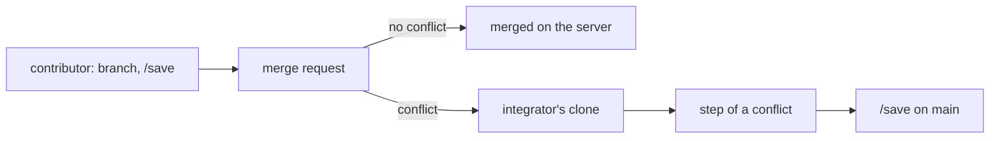

# Working together on one project

Working together on one project means two people, or two branches,
changing the same project and bringing their work into one. This page
explains how each kind of file of a project merges, what the forge
promises when work meets, and why it is built this way. It is for
anyone who uses the forge with others, extends it, or weighs whether
it fits a team.

## What it is

Every file of a project has one of three ways of merging. The forge
tells git which way through the project's `.gitattributes`, a file
made from the engine's template `templates/gitattributes`. The forge
itself still never merges, pulls or rebases on its own judgement.

The three ways:

- **Text.** The artefacts, the recipes, the work specifications, the
  threads and the project file. The record files belong here too: the
  histories, the decisions, the resource indexes and the documentation
  map. Git merges them as text. What git leaves in conflict is settled
  by a person.
- **Derived.** Files that are made from other files, never written by
  hand. The ledger (the one file that holds a project's state) is
  never in git and is made at read time. The documents for a reader
  are in git: the renders, the README, the release notes,
  CONTRIBUTING, the documentation, the state render and the published
  companions. They are made only on `main`, taken as `ours` at a merge
  and made again. The published files are binary and never merged.
- **Immutable and unique.** Reviews, challenges, research, sources and
  closed threads. They never conflict. The name of a report is unique
  across branches too.

## How it works

### The attributes

The template carries these lines:

| Path | Attribute | Way |
|---|---|---|
| `*` | `text=auto` | line endings normalised, so files do not fight between machines |
| `renders/**` | `merge=ours` | derived |
| `README.md` | `merge=ours` | derived |
| `RELEASE-NOTES.md` | `merge=ours` | derived |
| `CONTRIBUTING.md` | `merge=ours` | derived |
| `docs/**` | `merge=ours` | derived |
| `published/*.md` | `merge=ours` | derived |
| `published/*.pptx` | `binary` | derived, never merged |
| `published/*.docx` | `binary` | derived, never merged |

The record files carry no attribute and merge as text. `/new-project`
creates the file, and `/check project` reports a project without it.
The engine carries a list of its own. The reason is that the engine's
derived files lie at its root, and under `projects/forge/` for its own
project.

`ours` is not built into git. `/setup` registers it once per machine,
on the user's word, in the global git configuration. `forge-status`
says when the registration is missing. This matters because a clone
without the registration silently falls back to a conflict.

### What the forge promises

One person on one project saves with `/save` and pulls with `/pull`.

With two people, or two branches:

- **Derived state never conflicts.** The ledger is made anew at read
  time.
- **A conflict in a record file** is two tails appended after one last
  line. It is settled by keeping both.
- **A conflict in an artefact** is the same item or sentence changed
  on both sides. It is settled by a person with Claude's help, in the
  step of a conflict (below).
- **IDs stay one sequence** per project, taken at the write. A number
  taken twice on two branches is reported by the ledger script after
  the merge. It is settled as the page [Stable IDs](stable-ids.md)
  describes: the younger item is renumbered with a record, in a
  walkthrough (one item per message, each closed by the principal's
  verdict), never by Claude alone.
- **A version given twice** means two branches both raised a document
  to the same number. Git finds it itself, because the header's
  `version:` line conflicts whenever both sides raised it. Whoever
  merges settles it in the step of a conflict. The merged document
  takes the next number and one `changed` record naming the merge and
  what was joined. The records of both sides keep their numbers.

Two windows of one person on one project are not solved by the forge.
The person arranges it through git: a branch, or a second clone where
a branch in one working tree is not enough. A branch switched in one
working tree is seen by both windows. On two different projects the
windows collide nowhere, since each project is a repository of its
own. A bare `/save` is for one window only, because it commits every
repository with changes, the other window's half-written work
included.

### The step of a conflict

A conflict that `forge-save` meets is left standing, not aborted. It
is settled in the step of a conflict:

1. Claude lays both sides out as a walkthrough.
2. The principal (the person whose thinking is being forged) decides.
3. Claude writes the chosen wording into the file.
4. The git commands that finish the step run only after the principal
   says yes. A hook asks him, because the scripts are the one door
   through which Claude writes to git.

Then `/save` runs again. The page
[Settle a conflict](../use/settle-a-conflict.md) gives the step as you
do it.

`forge-save` rebases one's own linear commits. A branch carrying a
merge commit is merged by hand, since the forge has no door of its
own for it.

The derived files of a release, the documentation, the state render
and the published files are made only on `main`. Two branches that
make the same one conflict on the server. That conflict is settled by
making the file again. Why these files are made on `main` only is
explained in [Persistence in git](persistence-in-git.md).

### Several people: one integrator, several contributors

A hosted project's `main` is protected by default: pushing to it and
merging into it belong to its maintainers. So the work of several
people on one project has one model:

- **A contributor** works on a branch and saves it. `/save` pushes the
  branch. How a repository is switched to a branch is shown in
  [Work on a branch](../use/work-on-a-branch.md).
- **The integrator** is a maintainer, typically the principal. He
  merges the branch.

Where the merge request has no conflict, the integrator merges it on
the server. Where it has a conflict, he fetches it and settles it on
his own clone, through the step of a conflict. The reason is that the
server merges with no attribute of the forge's. Two people who both
append to a history or to the decisions therefore have a conflicting
merge request on the server. A merge request is for reading, and for
the merge that needs no hand.

## Why

**Why three ways.** At the merges that were observed, the ledger was
the one file present on both sides. Beside it stood the histories,
the decisions, the index of sources and the regenerated renders.
Making the ledger at read time, and keeping the threads as files of
their own, removed most of those collisions. Made at read time, the
ledger stopped being a thing to merge. Why the ledger is made at read
time is explained in [The ledger, made from the records](the-ledger.md).

**Why plain git for the exception.** Two people on one project are the
exception, and the exception is handled with git.

**Why the integrator model.** A protected `main` refuses a push from
everyone. The model is consistent with a forge built around the
principal. It removes every need to write to `main` from a branch.

**Why IDs and versions are settled after the merge.** A clash happens
a few times a year on a project of one or two people. Detection with
the existing remedy costs nothing. Reserving numbers in advance would
have cost the most code.

**Why the forge has no merge mechanism of its own.** Three mechanisms
were let go:

- **A merge driver of the forge's own for the record files.** A driver
  fails where the merge happens on the server, and for a contributor
  who has not registered it. It was also the most code for a case of a
  few times a year. The record files are text, and a conflict in them
  is two tails kept both.
- **Union merge for the record files.** By git's own documentation,
  union duplicates and does not order.
- **A merge command of the forge.** The step of a conflict gives the
  same help without a new mechanism. The merge stays git's.

## A worked example

A contributor and an integrator work on the project `<slug>`. The
contributor's branch is `<branch>`.

1. The contributor switches `<slug>` to `<branch>`, works, and runs
   `/save <slug>`. The branch is pushed.
2. Meanwhile the integrator has raised `10-intent.md` on `main` and
   appended a decision. The contributor has done the same on
   `<branch>`.
3. The merge request shows a conflict, so the integrator settles it
   on his own clone. He brings `main` up to date and merges `<branch>`
   with git.
4. Git reports three kinds of result:
   - `decisions.md` conflicts as two tails after one last line. Both
     are kept.
   - `10-intent.md` conflicts in its `version:` line, and in one item
     both sides changed. Claude lays the item out in a walkthrough
     and the principal chooses the wording. The document takes the
     next version number with one `changed` record naming the merge.
   - The README and the renders do not conflict. They are taken as
     `ours` and are made again on `main`.
5. The ledger is not merged at all. It is made again when it is next
   read. If both sides took the same item number, the ledger script
   reports it, and the younger item is renumbered with a record.
6. The integrator finishes the merge and runs `/save <slug>`.

## See also

- [Settle a conflict](../use/settle-a-conflict.md): the step of a
  conflict, done.
- [Persistence in git](persistence-in-git.md): the doors to git and why
  the files for a reader are made on `main` only.
- [Work on a branch](../use/work-on-a-branch.md): switching a
  repository to a branch.
- [The ledger, made from the records](the-ledger.md): why the ledger is
  made at read time.
- [Stable IDs](stable-ids.md): how an item number taken twice is
  settled.
- [Glossary](../reference/glossary.md): every term of the forge in one
  line.

Generated on 2026-10-25 for version 6.0 from the files the
front-matter names; never edited by hand.
