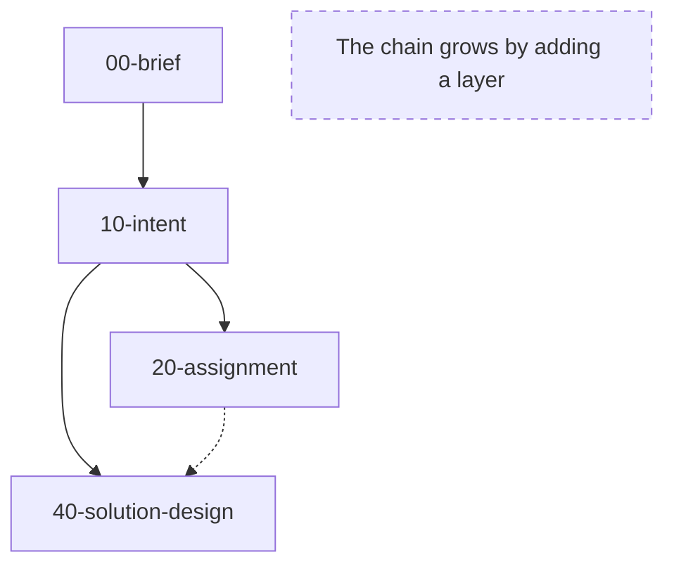
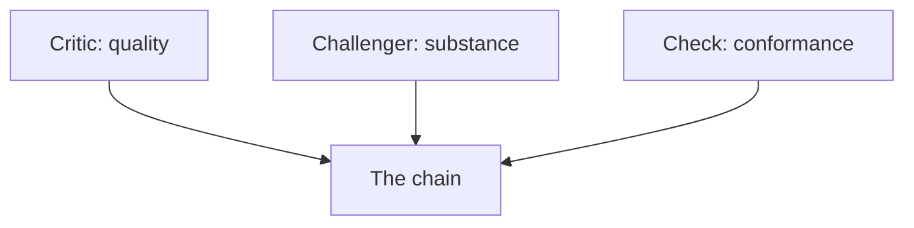

# Forge of Thought: an introduction for business analysts

Source material for a presentation of fourteen slides, followed by a
live demonstration and a task for the room. One section per slide:
the exact on-slide text, the diagram where the slide has one, and the
speaker notes with the inputs each slide rests on.

## S01 - Forge of Thought

**On slide:**

Forge of Thought

A workshop where thought is tempered and shaped

In twenty minutes you will know:

- what the forge is
- what it is not
- how one works in it
- what your task is

**Thought in, documents someone can act on out.**

**Speaker notes:**

I built a tool for my own thinking and I use it every day. This is
what it is, said plainly, by someone who uses it, not by someone
selling it. The name says thought, not assignment: thoughts of
whatever kind are the raw material, and forged documents are the
product. An assignment is one of them, and it is the one you will
recognise, because it is the kind of document you write and receive
for a living. The subtitle is the one line the forge gives itself: a
workshop where thought is tempered and shaped.

Four things in twenty minutes: what the forge is, what it is not, how
one works in it, and what I will ask you to do afterwards. Then I
show it live, and then the task is yours.

(CLAUDE.md, What this workspace is; projects/forge/10-intent.md,
Essence and POS.0620; docs/start/what-it-is.md, Why.)

## S02 - A chat gives you an answer

**On slide:**

A chat gives you an answer

- Thinking in a chat dies with the session.
- Instead, the idea travels a chain of versioned documents.
- Reviewers that never saw the conversation attack it.
- Who decided what, and why, is on record.

**What survives is a file, never a conversation.**

**Speaker notes:**

You have all done this: an hour of good thinking in a chat with an
AI, and the next morning the session is gone, the thread is gone, and
what you have is whatever you pasted somewhere. The forge is not a
chat. State lives in files, never only in the conversation. What is
in a file survives the session; what lives only in the conversation
does not.

So the forge does three things differently. First, the idea travels
a chain of versioned documents, from the idea as first put together
onward; each document is a file with a version, and the next one is
derived from it. Second, the documents are read by isolated
reviewers, agents that are deliberately blind to the working
conversation in which the documents were made, and they press on the
thinking from different angles. Third, who decided what and why is
on record: every versioned document has a history beside it, one
record per change, and the decisions of the person whose thinking is
forged are an append-only file of their own.

(docs/start/what-it-is.md, What it is and How it works;
docs/about/what-it-is-and-is-not.md, What it is not;
docs/about/documents-and-records.md, What it is.)

## S03 - What it is not

**On slide:**

What it is not

- Not a program: nothing is implemented, the engine specifies.
- Not a delivery tool: a run ends where its owner is satisfied.
- Not a chat: state lives in files.
- Not one domain: a platform assignment or a game campaign alike.

**The forge specifies; nothing is built or delivered here.**

**Speaker notes:**

Four things the forge is not, so that nobody waits for something it
will never do.

It is not a program. Nothing is implemented in it. Its product is a
chain of documents, and at the far end of the chain stands a
specification ready for realisation, not the realisation itself.

It is not a delivery tool. A run of the forge ends where its owner is
satisfied: the outcome is a document the principal stands behind,
and nothing further. Sponsorship, funding, adoption and delivery
outcomes are outside its scope and outside its sight.

It is not a chat. We had this on the previous slide: state lives in
files, and what lives only in the conversation does not survive it.

It is not tied to one domain. The mechanics of the chain are
domain-agnostic. The same machinery that forges a platform assignment
would forge a role-playing campaign: an intent of the story, then
materials rendered for the game master.

(docs/about/what-it-is-and-is-not.md, What it is not;
docs/start/what-it-is.md, How it works and Why.)

## S04 - Two roles

**On slide:**

Two roles

- The principal: ideas, answers, decisions; final authority on content.
- Claude: structure, order, process discipline, document hygiene.
- Claude proposes and never decides.
- Cognitive extension: an amplifier of your thinking, never a
  substitute.
- When unsure, ask: no gap is filled by assumption.

**Nothing enters the content because Claude proposed it.**

**Speaker notes:**

The forge knows two roles, and neither is tied to a person. The
principal is whoever's thinking is being forged. In the room today
that will be you. The principal supplies the ideas, the answers and
the decisions, and is the final authority on all content. Whoever
receives the result, a team, a colleague or your own future self, is
called the recipient.

Claude, the AI the forge runs on, is the principal's cognitive
extension. The phrase means one thing exactly: an amplifier of the
principal's thinking, never a substitute for it. Claude owns
structure, order, process discipline and document hygiene. Its
contribution to content is to criticise, to challenge, to inspire
and to lay out options. It proposes and never decides. The
composition is the principal's: nothing enters the content because
Claude proposed it, only because the principal took it up.

The first rule Claude works under, the first of ten prime directives
in its core instructions: when unsure, ask. Claude never fills a gap
by assumption. Beyond answering, it elicits, that is, it helps you
extract what you have not yet articulated. And whatever it brings as
knowledge, it says in plain words whether that is verified, and on
what, or unverified, or a hypothesis. You will feel this in the first
ten minutes of use: more questions than you expect, and no invented
facts.

(CLAUDE.md, Roles and Prime directives;
docs/about/the-principal-and-claude.md, What it is and When unsure,
ask; projects/forge/10-intent.md, POS.0010, POS.0020, POS.0070.)

## S05 - The document chain

**On slide:**

The document chain

- Brief, then intent; below it, assignment and solution design.
- Every artefact: a versioned file, its history beside it.
- Many projects end at the intent; the chain ends where needed.
- Items carry stable IDs, numbered in tens, never renumbered.
- Files numbered in tens: a layer is added without renaming.

**The chain grows by adding a layer, nothing reworked.**

**Diagram:**

**Speaker notes:**

This is the picture to keep. A project is a chain of documents, the
forge calls them artefacts, and each is a versioned file with an
append-only history companion beside it.

The chain starts at a brief, the idea put together. Its trunk is the
intent, the document of what the principal wants and why. Below the
intent a project takes only the layers it needs: today the forge has
definitions for two, the assignment and the solution design. The
solution design is derived from the lowest layer the project has
above it, the assignment where there is one, the intent alone where
there is not; that is the dotted arrow. No layer below the intent is
a condition of another, and a layer a project does not have is not
missing. Many projects end at the intent, because what is wanted
needs no solution written down and no one else has to act on it.

Every kind of artefact has a definition: a file in the engine that
says what the artefact is, how it is found, by questions, research
and sources, and what its rules are. Which artefacts the forge has is
the listing of that directory, one definition each. Working on an
artefact means invoking one command with the name of the target
artefact, and Claude reads that definition.

Two conventions make the chain able to grow. Files are numbered in
tens, so a layer can be added between two without renaming anything;
the number orders the files and prescribes no sequence of work. And
every item inside a document carries a stable ID, a three-letter
prefix and a four-digit number, numbered in tens, global and never
renumbered: an item with a stable ID can be cited, reviewed, traced
into the layer below and changed one at a time. Prose cannot be
pointed at.

(docs/about/the-document-chain.md, What it is and How it works;
docs/about/how-a-thought-travels.md, What it is and Below the intent;
.claude/skills/forge/states/, the four definitions, their Target and
Inputs; CLAUDE.md, Document chain and ID scheme.)

## S06 - The brief: rough on purpose

**On slide:**

The brief: rough on purpose

- The idea put together: what you want and why.
- Free-form: any structure, no IDs, no conventions of the chain.
- Thoughts to be processed, not decisions; nothing is yet a position.
- Three origins: arrives finished, begun outside and finished here,
  born here.
- Mined into the intent, never polished into one.

**Throw the thoughts in; the sifting is the intent's.**

**Speaker notes:**

The first artefact is the brief: the principal's text of one whole of
thinking, what he wants and why, with what he chose to take from the
finding around it. It is free form. Any structure you find useful is
allowed, prose, headings, tables, use cases; no content is required,
no IDs are given, none of the conventions of the chain apply. Only a
minimal header stands at the top.

A brief holds thoughts to be processed, not decisions. Nothing in it
is yet a position; its thoughts may be changed, reworked or dropped
when it is mined, and only the intent turns them into positions. So
the brief is rough on purpose. The chiselling is the intent's work,
and a brief polished until the intent has nothing left to do has gone
too far. It is composed in a round or two and then mined.

Three origins are equally legitimate, and the forge does not
distinguish them: the brief arrives finished from outside and is
stored as it came; it is begun outside and finished with Claude; or
it is born in the forge from the first word. For most of you the
first one is the natural door: you have a page of notes already, and
you paste it.

(docs/about/the-brief.md, What it is and What it holds;
.claude/skills/forge/states/brief.md, Target and Aim;
docs/about/how-a-thought-travels.md, It arrives as a brief.)

## S07 - The intent: what you want and why

**On slide:**

The intent: what you want and why

- Positions with their reason, facts, rejected directions with why
  dropped.
- Open threads live beside it, one file per project.
- Rewritten for coherence every round, never appended to.
- The way to a position lives in its history.
- The document to read after weeks, instead of old conversations.

**The intent says what holds today, and why.**

**Speaker notes:**

The brief is mined into the intent, the working document of a project
and the trunk of its chain. The intent is the consolidated current
state of what the principal holds. It is made of positions: a
position says what the principal holds and why it holds, in as many
words as it takes, and names what it comes from, a brief or a source.
Beside the positions stand the facts, what is the case on the
principal's word or a source's, and the rejected directions, what was
considered and dropped, with the reason, so that old ground is not
re-litigated.

What is still open lives beside the intent in a file of threads, one
for the project. A thread names what is open and where it came from,
and carries the working debate for as long as it is unsettled. It is
where an unfinished conversation is saved. A settled thread leaves
the file: what holds goes into the intent, and the record of its
closing in the history carries the thread's last wording word for
word.

The intent is not a log. It is rewritten for coherence every round,
and what changed is recorded in its history companion. The way to a
position does not belong in the position: why it was changed, what
was said on the way, trials, measurements, which research turned it.
All of that goes into the history in the same step that writes the
position, while the whole context is at hand.

Why this shape: chat context dies, and anything of value must live in
a file. The intent is the document to read when you return to a
project after weeks, instead of excavating old conversations. It
answers "what do I want now".

(docs/about/the-intent.md, What it is, What it holds and Why;
docs/about/how-a-thought-travels.md, It is chiselled into the intent;
.claude/skills/forge/states/intent.md, Aim and Threads and files.)

## S08 - The assignment: where your work meets the forge

**On slide:**

The assignment: where your work meets the forge

- Complete and precise: nothing left out in silence.
- It assigns; it does not solve.
- Items with shall and shall not, no priorities, one idea each.
- Prefixes: REQ, OOS, CON, ASM, DEL, TBC, SCR.
- A BRD layer below it is foreseen and not built.

**Delegated or open on purpose is complete; silent is not.**

**Speaker notes:**

This is the slide where your daily work meets the forge. The
assignment is the handover document for the recipients: it carries
the in-scope substance of the intent to them, complete and precise,
so that they can act on it without the principal in the room. It
tells them who they are, what must be true at the end, what is theirs
to decide and bring back, what they shall not do, and what the
principal has left open on purpose.

The one design constraint that shapes almost everything: nothing is
left out for brevity's sake, and a silent omission is a defect.
Leaving a matter out is legitimate only as an explicit delegation, a
deliverable or an open question with an owner. There is no size
target in either direction; length is whatever fidelity requires. The
assignment assigns and does not solve, and what keeps it an
assignment rather than a solution is the kind of its content, never
the amount.

The items will look familiar. They are written with shall and shall
not, in full sentences, one idea per item, each written once. The
softer verbs, would, could, should, might, may, and MoSCoW wording are
not used: shall is testable and binds, the softer verbs leave the
recipient to guess, and MoSCoW puts a priority where completeness
belongs. There is no priority column and no priority tag; everything
in an assignment is essential, and an exception carries a note
reading optional. Testability is recommended, not required, because
assignments are deliberately high-level and delegating the
concretisation to the recipients is a legitimate outcome.

The prefixes of an assignment: REQ for a requirement, OOS for out of
scope, CON for a constraint the recipients do not challenge, ASM for
an assumption, DEL for a deliverable, which may delegate work, TBC
for an open question with an owner, SCR for a success criterion,
optional or delegated. The prefix vocabulary is aligned with the BRD
standard you know where an equivalent exists.

One fact, so that nobody waits for it: a BRD layer below the
assignment is foreseen in the forge's own intent and is not built.
The file number 30 is kept free for it. Today the chain goes brief,
intent, assignment, solution design, and the forge keeps the BRD's
place.

(docs/about/the-assignment.md, What it is, What it holds and Complete
when; docs/reference/requirement-style.md, The rules;
.claude/skills/forge/states/assignment.md, Aim and Requirement style;
docs/about/the-document-chain.md, Why; CLAUDE.md, ID scheme;
projects/forge/10-intent.md, POS.0100, POS.0230, POS.0700.)

## S09 - How a session feels

**On slide:**

How a session feels

- Elicitation interview: one question at a time.
- Walkthrough: one item per message, a verdict each.
- Draft early; reflect back before anything is written.
- One write per round, on the word write.
- Step by step: nothing hard to reverse without your word.

**You answer and decide; Claude asks and keeps order.**

**Speaker notes:**

The forge has named ways a working conversation runs; it calls them
working methods. None is a command. A method applies whenever its
situation arises, and you can call for one in a word. These are the
five you will meet in the first hour.

The elicitation interview. Claude draws out by questions what you
have not yet articulated, rather than filling gaps by assumption. One
question per message; your answer is acknowledged before the next
question is asked. This is the heart of forging an intent.

The walkthrough. Any list that needs your decision, the findings of a
reviewer, open threads, the open questions before a handover, is
worked one item per message, in order of weight. Each item carries
what it says, what would change and for whom, and a recommendation
with its reason; it closes with one verdict line: accept, modify,
reject or park. You can answer with a single letter. You are never
given a table of twenty items to judge at once.

Draft early, and reflect back. An early draft is a tool for drawing
you out, not an output: concrete text sharpens your reaction. And
before anything is written, Claude restates what it understood, so
that the write confirms and does not surprise.

One write per round. A working conversation is one round. What you
agree in it is carried in the conversation and written once, at its
end, on your word. The word is "write", typed in full. Until then
everything agreed is nowhere yet, and Claude says so.

Step by step. Any action that needs your consent, a write, a commit,
a push, a rename, anything hard to reverse, arrives as one step with
the exact operation and its reason, and runs on your word. A plan
you have seen is not consent for its steps. A remark in answer to
"shall I change it?" is not a yes.

(docs/about/working-methods.md, What it is and How it works;
docs/about/elicitation.md, What it is; CLAUDE.md, Working methods.)

## S10 - Reviewers that never saw the conversation

**On slide:**

Reviewers that never saw the conversation

- Critic: the quality of the documents, never substance.
- Challenger: the substance of the thinking, never document quality.
- Check: conformance with the conventions, never substance or quality.
- Isolated: blind to the conversation, and that blindness is their
  value.
- Every finding settled by walkthrough: fixed, or rejected with a
  reason.

**Three reviewers, three jobs, and none of them blocks you.**

**Diagram:**

**Speaker notes:**

At every layer the documents and the thinking are pressed on by
isolated reviewers. There are three kinds, each with one job and one
output, and they are kept strictly apart.

The critic judges document quality and never substance: ambiguity,
contradiction, duplication, drift between one layer and the next. It
has lenses, and it produces findings. The challenger judges the
substance of the thinking and never document quality: unstated
assumptions, whether the stated objective is the real problem,
second-order effects, the serious counter-case. It has personas, and
it produces challenges. The check verifies mechanical conformance
with the conventions and never substance or quality; each check owns
one concern.

All three run as isolated subagents: a separate run of Claude that
reads the project's documents and the engine's rules and sees nothing
of the working conversation in which the documents were made. That
blindness is the source of their value: the audit benefits from a
clean context. Every reviewer is invoked by hand; none runs on
Claude's own judgement. Every report is immutable and dated.

What happens with a report is the walkthrough from the previous
slide. Every finding and every challenge is either fixed or
explicitly rejected, with the reason recorded as a decision.
Rejecting and parking are legitimate outcomes; silently ignoring is
not. And nothing blocks: the findings are advisory, and the principal
alone decides what is published.

One honest limit, in the forge's own words: isolation is not
independence. The author and the reviewers share one model family,
so their agreement is never treated as validation; it only means the
documents are consistent under one set of priors. The calibration
point lies outside: review by humans, which is one reason you are in
this room.

(docs/about/isolated-reviewers.md, What it is, Settling and Why;
CLAUDE.md, Isolated reviewers; projects/forge/10-intent.md, POS.0400,
POS.0440, POS.0790.)

## S11 - Everything is a file

**On slide:**

Everything is a file

- A history beside every versioned document; decisions on record,
  append-only.
- The ledger: the single source of truth for state.
- Sources and research, each directory with its own index.
- Renders generated from recipes, never edited by hand, the README
  among them.
- Git only through the forge's scripts, the one door.

**State lives in files, never only in the conversation.**

**Speaker notes:**

Everything a project is lives in its directory, as Markdown files.
Every document has one kind, and the kind says who writes it, whether
it is versioned and how it behaves.

The artefacts of the chain are versioned and rewritten freely. Beside
every versioned document stands its history: an append-only
companion, one record per change, to which records are added and from
which nothing is removed. The principal's decisions are an append-only
file of their own, numbered, never edited; a later decision
supersedes an earlier one by a new record that names it.

The ledger is the single source of truth for state: one file, with
one table per thing the project tracks, documents, renders, sources,
research, findings, challenges, and a list of what waits on the
principal. It is freely rewritten and kept current after every
operation.

External inputs, transcripts, offers, documents, standards, live in a
sources directory, immutable once registered; durable answers to one
question live in a research directory. Each directory carries a light
index so that one knows what is there without re-reading it.

Outputs for an audience, a pitch, an executive summary, the README of
the project, are renders: generated from the chain, never edited by
hand. What is iterated is the recipe, the file that says what the
render reads, for whom and in what shape. When the thinking moves,
the render is regenerated, not patched. The README of every project
is such a render.

And all of it is saved to git, through the forge's own scripts, which
are its only door to git. The engine is one repository; every project
is a repository of its own, with whatever remote and visibility its
owner gives it.

(docs/about/documents-and-records.md, What it is and How it works;
docs/about/renders-and-recipes.md, What it is and When a render is
regenerated; CLAUDE.md, Document kinds, Persistence (git) and Ledger.)

## S12 - How complex is it

**On slide:**

How complex is it

- A git repository of slash commands, isolated agents and templates.
- Runs in Claude Code; one command per situation.
- The map of a project on one command: /forge.
- One sitting: a project, a brief, an intent, a save.
- Installed: git, Python, Claude Code and a clone of the engine.

**Knowing the artefact's name is knowing the command.**

**Speaker notes:**

Less complex than the previous slides suggest. Technically, Forge of
Thought is a git repository of slash commands, isolated agents and
templates, bound to no domain. It is not a program; it is a set of
instructions that Claude reads, with the deterministic work kept at
the edge in scripts. The engine, that repository, is public; your
projects are repositories of your own, which the engine does not
know.

It runs in Claude Code, and the forge is worked through commands:
one command per situation. The commands are typed with a slash. The
map of a project is one command, "/forge" on its own: it says which
artefacts exist, at what version, which can be worked next, and ends
with a recommendation. Work on an artefact is the same command with
the name of the target: "/forge intent", "/forge assignment". Knowing
the name of the target artefact is knowing the command, and there is
nothing to memorise as layers are added.

A first result takes one sitting: a project scaffolded by one
command, a brief pasted and approved, a first intent found in an
interview and written at the round's end, and the whole saved to git
by one command. That is what the documentation calls a first result,
and it is what your task is.

What must be installed, in one line: git; Python, reachable as
"python"; Claude Code with a subscription; and the engine, cloned
from its public home. A few optional tools come later, each only for
the command that uses it.

(docs/start/what-it-is.md, Why; docs/about/how-a-thought-travels.md,
What it is; docs/about/the-document-chain.md, Working a layer;
docs/start/first-result.md, What you do; docs/start/install.md, What
you do.)

## S13 - What you will see now

**On slide:**

What you will see now

- The map of a project: /forge.
- The interview that forges an intent: /forge intent.
- A reviewer run and its walkthrough: /critique or /challenge.
- A render made from the chain: /render.

**What follows is the forge itself, not slides.**

**Speaker notes:**

Four things, live, in this order.

First, the map of a project. One bare command reports where a
project stands: which artefacts exist and at what version, what can
be worked from here, and the natural next step, as a recommendation.

Second, the interview that forges an intent. The command with the
name of the target reads the brief, and Claude works through it with
me by questions, one theme at a time. Watch the shape: one question
per message, my answer acknowledged, the next question. Nothing is
written while the round runs; at the end Claude reflects back what we
agreed and writes once, on my word.

Third, a reviewer run and its walkthrough. I start a critic lens or a
challenger persona against the intent. The agent reads the files,
blind to our conversation, and returns an immutable dated report.
Then the findings come to me one per message, each with a
recommendation and a verdict line, and I accept, modify, reject or
park.

Fourth, a render made from the chain. A recipe names its inputs, its
audience, its instructions and its template; one command regenerates
the output from the documents as they stand, and the render opens
with its provenance, the recipe and every input with their versions.

(docs/start/first-result.md, What happens;
docs/about/isolated-reviewers.md, How it works and A worked example;
docs/about/renders-and-recipes.md, Generating the render;
docs/about/the-document-chain.md, Working a layer.)

## S14 - Your task

**On slide:**

Your task

- A GitHub account.
- Follow the author's profile: https://github.com/pche-broken-artist
- Install the forge on your own machine, by the documentation.
- Make a project of your own, any idea, to the first intent.
- One improvement: an idea in Discussions first, a change through
  the chain.

**Come back with what did not work.**

**Speaker notes:**

Five things, in this order.

Get a GitHub account if you have none; the engine lives there, and
so do the places where you tell me what you found.

Follow my profile: https://github.com/pche-broken-artist. The
engine's public home and its documentation are reached from it, and
my contacts for anything that should not be public are on it.

Install the forge on your own machine, by the documentation, not by
memory of today. The page says what must be on the machine, in what
order, and what you see when each piece is in place. The forge is
cloned, not copied.

Make a project of your own. Any idea: a process you want changed, a
handover you keep writing the same way, anything you carry around.
Take it to the first intent: a project scaffolded, a brief pasted
and approved, an intent found in the interview and written at the
round's end, the whole saved. That is one sitting.

Bring one improvement, in the way the forge's own contributing file
asks for it. An idea needs nothing but itself: open a discussion and
say what you would want the forge to do, or to stop doing, and why.
A change of how the forge behaves goes through the chain before it is
built, so that we agree on what is wanted while it is still cheap.
And nobody sends a change he has not tried himself.

What I want most is to hear what you found and what you would do
differently. Feedback and ideas come first. So the closing line is
the whole task: come back with what did not work.

(CONTRIBUTING.md, Tell me what you found, You have an idea, You want
to send a change, Try it first and Privately; docs/start/install.md,
What you do; docs/start/first-result.md, What you do and What you
have afterwards.)
